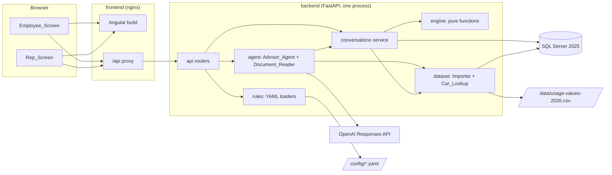
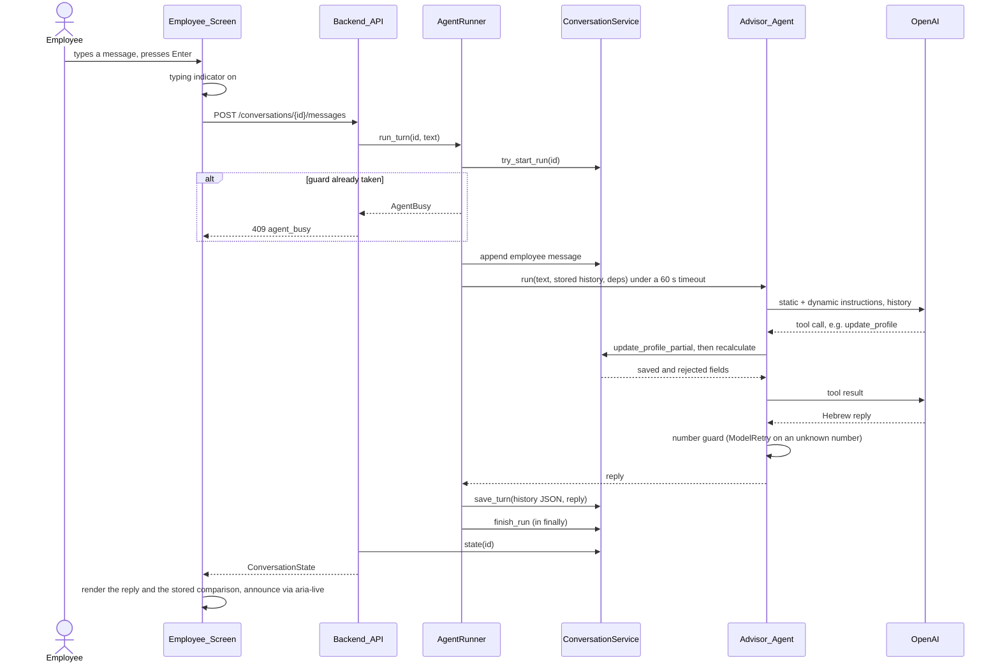
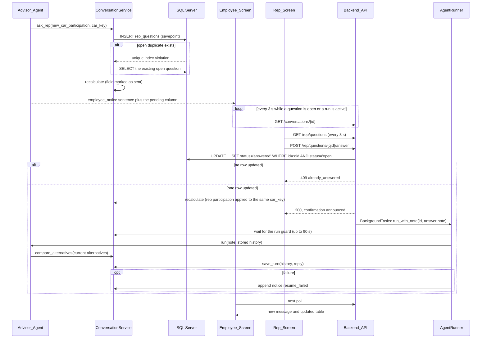
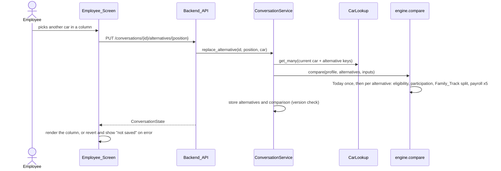

# Design Document: Strauss Car Advisor

## Overview

Strauss Car Advisor answers one question for a Strauss employee who has a company car: "how does my monthly net pay change if I switch car, take an EV or give the car up?"

The employee chats in Hebrew with Advisor_Agent. The agent's only job is to collect the missing Employee_Profile fields in the order of the challenge script and to call tools. All numbers come from code:
- Car_Lookup reads the official Usage_Value_Dataset.
- Eligibility_Checker, Payroll_Calculator and Comparison_Engine are pure functions over `rules.yaml`, the car catalog and the occupations table.
- Backend_API stores the result as the conversation's comparison, which Employee_Screen renders as a table.

When only the transport representative can supply a value, the agent opens a Rep_Question. The representative answers on Rep_Screen, and the backend resumes the same conversation on the server.

Advisor_App runs as three Docker Compose services on loopback ports:
- `db`: SQL Server 2025.
- `backend`: FastAPI with Pydantic AI.
- `frontend`: nginx serving the Angular build and proxying `/api`.

The pinned versions come from `.kiro/handoff/research.md` (checked 13 Oct 2026).
This document gives Hebrew text by its English meaning; the exact Hebrew wording lives in the copy files (`engine/copy_he.py` and the `*.copy.ts` files).

### Key decisions

1. **One backend process with plain modules.**
   - Modules: `settings`, `db`, `dataset`, `rules`, `engine`, `agent`, `conversations`, `api`, and `logs` (the structured log formatter and middleware of Req 14.10).
   - No queues, Redis, workers or WebSockets. A resume after a rep answer runs as a FastAPI background task in the same process.
   - This keeps every moving part explainable (Req 15.1).
2. **The pure engine owns every number** (Req 7, 8, 15.2).
   - `engine` imports nothing from the other modules and never reads files, environment variables or the Database.
   - It computes with exact `Decimal` and returns unrounded values.
   - Rounding to whole shekels happens in one function, `engine.money.display()`, half away from zero. The API returns those integers, so the frontend never rounds.
3. **The API, not the agent, owns the comparison table** (Req 8.15, 11.10).
   - After every state change, `conversations.service.recalculate()` runs Comparison_Engine and stores the result in `conversations.comparison`. The changes that trigger it are a profile edit (from the panel or the agent), an alternative change, a rep answer, and the compare tool.
   - `GET /api/conversations/{id}` returns messages, profile, alternatives, comparison, open questions and agent status in one payload.
   - The compare tool returns the same stored result to the agent, so the chat and the table cannot disagree.
4. **Four tables** (Req 14.7): `usage_values`, `conversations`, `messages`, `rep_questions`.
   - `conversations` holds the Employee_Profile, the Alternative list and the last comparison as Pydantic-validated JSON, plus the serialized Pydantic AI message history.
   - Because the profile is JSON, adding a profile field needs no migration (Req 17.7).
   - `rep_questions` is a real table, because it needs a filtered unique index and conditional updates.
5. **Agent on Pydantic AI v2 with `openai:gpt-6-luna`** (Req 9).
   - Pydantic AI v2 sends `openai:` models through the Responses API.
   - The agent has six tools, matching the glossary: `lookup_car`, `list_catalog_cars`, `check_eligibility`, `compare_alternatives`, `ask_rep`, `update_profile`.
   - Its instructions are English and require Hebrew replies.
   - A dynamic instruction, computed in code, names the next script step and its missing fields, so "ask only what is missing, in order" (Req 9.1) is decided by code, not by the model.
   - An output validator rejects any reply that contains a number no tool returned in this conversation, and asks the model to retry (Req 9.5).
6. **One agent run per conversation** (Req 10.10, 10.12).
   - The guard is a nullable column, `conversations.agent_run_started_at`, taken with a conditional `UPDATE ... WHERE agent_run_started_at IS NULL OR agent_run_started_at < now - 90 s`. It is released in a `finally` block with `UPDATE ... WHERE agent_run_started_at = <the time this run took it>`, so a run whose stale guard was taken over never frees the guard of the run that took over.
   - A DB flag survives restarts, unlike an in-process lock. A run that crashed frees itself after 90 s, which is longer than the 60 s agent timeout.
   - The flag also serves as `agent.running` in the state payload, and the employee screen polls while it is set.
7. **Rep answers are race-safe** (Req 10.4, 10.7, 10.8).
   - A filtered unique index on `(conversation_id, missing_field, car_key) WHERE status = 'open'` keeps exactly one open question per combination. In SQL Server a unique index treats NULLs as equal, so this also covers questions without a car.
   - The answer is stored with `UPDATE ... WHERE id = ? AND status = 'open'`. If no row is updated, the question was already answered (HTTP 409), and no second resume is scheduled.
8. **Resume = a normal agent run plus a note.**
   - The background task waits for the run guard (up to 90 s). It then runs the agent with the stored history and an English note that describes the answer.
   - The note is not saved as a readable message. Only the agent's Hebrew reply is appended. If anything fails, a stored notice says so (Req 10.15).
   - The same helper also runs the car identification turn after a confirmed document upload (Req 13.7).
9. **Polling every 3 s.**
   - Employee_Screen polls only while an open Rep_Question exists or `agent.running` is true (Req 10.12-10.13).
   - Rep_Screen polls every 3 s while open, within the 10 s limit of Req 12.11.
10. **The startup sequence runs in the FastAPI lifespan** (Req 1.14-1.20, 3.16-3.17, 4.6-4.7, 14.2-14.3).
    - Order: settings → `rules.yaml`, catalog and occupations → create the database if missing → `alembic upgrade head` → import the tax year if it has no records → check that every catalog key exists in the dataset → build the agent if an API key is set.
    - Any failure raises, uvicorn exits with a non-zero code, and no request is accepted.
11. **Config files are YAML in `config/`, loaded into Pydantic models** (Req 3, 4).
    - `rules.yaml` holds every rule and payroll parameter, with a `source` per parameter group and a `pending` list.
    - `car_catalog.yaml` and `occupations.yaml` each start with a `mock_data` marker (Req 4.13).
12. **The database driver is `mssql-python`** through SQLAlchemy 2.1's `mssql+mssqlpython` dialect.
    - The backend image needs three Debian libraries, and no Microsoft apt repo or EULA step.
    - pyodbc + msodbcsql18 is the documented fallback.
13. **Frontend: Angular 22, standalone, zoneless and signal-based** (Req 11, 12, 16).
    - Forms use Signal Forms (stable in v22).
    - Styling uses custom SCSS tokens with one accent color, and the self-hosted Heebo font comes from `@fontsource-variable/heebo`.
    - Each feature keeps its Hebrew copy in one `*.copy.ts` file.
    - Every number, date, Official_Key and Latin name inside Hebrew text is wrapped in `<bdi>`.
14. **The upload is a second, tool-less Pydantic AI agent with a structured output type** (Req 13).
    - The file stays in memory and is passed as `BinaryContent`.
    - Candidates go back to the browser only. Nothing is saved until the employee confirms.

### Scope guardrails

- Only the monthly net pay method is implemented. Locality-based tax benefits are out of scope (Req 7.14).
- There is no login, by requirement (Req 12.1, 17.10). Every endpoint, including the rep endpoints, is unauthenticated. The design limits exposure as follows:
  - ports bind to `127.0.0.1` (Req 14.16);
  - the rep API never returns a conversation ID or salary data (Req 12.5);
  - logs never contain amounts or secrets (Req 14.11).

  SSO, roles and an audit log are pilot needs (Req 17.11).
- Today with a current car outside the catalog is supported. The car is identified through Car_Lookup, and Today needs only its dataset record (Usage_Value and Powertrain), never its Eligibility_Group.
- Anything not required is left out: no admin screens, no caching layer, no streaming and no retention jobs.

## Architecture

### System diagram



### Module dependency rules

Arrows point from the importer to the module it imports. There are no cycles.

| Module | May import | Never imports |
|---|---|---|
| `engine` | standard library, `pydantic` | everything else in the app |
| `settings` | `pydantic-settings` | app modules |
| `logs` | `settings` | other app modules |
| `db` | `settings`, SQLAlchemy, Alembic | `engine`, `agent`, `api` |
| `rules` | `engine` (schema types), PyYAML | `db`, `dataset`, `agent`, `api` |
| `dataset` | `engine`, `db`, `settings` (only `dataset/cli.py`) | `conversations`, `agent`, `api` |
| `conversations` | `engine`, `rules`, `dataset`, `db` | `agent`, `api` |
| `agent` | `engine`, `rules`, `dataset`, `conversations`, `logs` | `api` |
| `api` | all of the above | none |

`engine/config.py` defines the Pydantic schema for `rules.yaml`, the catalog and the occupations table as plain data types. `rules/loader.py` reads the files, parses YAML and formats the validation errors. This split keeps the engine free of file I/O (Req 15.2) while the schema lives next to the code that uses it.

The resume logic lives in `agent/runner.py`, not in `conversations`. Because of that, `conversations` never imports `agent`, and the tools can call the conversations service without a cycle.

### Compose topology

```yaml
name: car-advisor
services:
  db:
    image: mcr.microsoft.com/mssql/server:2025-CU9-ubuntu-24.04
    environment:
      ACCEPT_EULA: "Y"
      MSSQL_PID: Developer
      MSSQL_SA_PASSWORD: ${DB_PASSWORD}
    ports: ["127.0.0.1:1433:1433"]
    volumes: ["mssql-data:/var/opt/mssql"]
    healthcheck:
      test: ["CMD-SHELL", "/opt/mssql-tools18/bin/sqlcmd -C -b -S localhost -U sa -P \"$$MSSQL_SA_PASSWORD\" -Q 'SELECT 1' -o /dev/null"]
      start_period: 30s
      interval: 5s
      timeout: 5s
      retries: 18
  backend:
    build: ./backend
    env_file: .env
    environment:
      DB_HOST: db
    volumes:
      - ./config:/app/config:ro
      - ./data:/app/data:ro
    depends_on:
      db:
        condition: service_healthy
    ports: ["127.0.0.1:8000:8000"]
    healthcheck:
      test: ["CMD", "python", "-c", "import urllib.request; urllib.request.urlopen('http://127.0.0.1:8000/api/health', timeout=3)"]
      start_period: 300s
      interval: 10s
      timeout: 5s
      retries: 6
  frontend:
    build: ./frontend
    depends_on:
      backend:
        condition: service_healthy
    ports: ["127.0.0.1:8080:8080"]
    healthcheck:
      test: ["CMD", "wget", "-q", "-O", "/dev/null", "http://127.0.0.1:8080/"]
      start_period: 10s
      interval: 10s
      timeout: 5s
      retries: 3
volumes:
  mssql-data: {}
```

Notes:
- **Healthcheck timing (Req 14.15).** Failures during the 30 s `start_period` do not count. After it, 18 failures at 5 s intervals mark `db` unhealthy at about 120 s. Compose then prints `dependency failed to start: container ... is unhealthy` and never starts `backend`. If `db` exits early, Compose reports the same failure.
- **Startup order (Req 14.15).** `frontend` waits for a healthy `backend`. The first start imports the dataset for 1.5 to 3.5 minutes while the backend accepts no connection, and without the condition the page would open and fail. The backend healthcheck is a Python one-liner, because the slim image has no curl. `urlopen` raises on a 503, so the check fails until the database is reachable and the dataset is loaded. Its `start_period` of 300 s covers the import. The frontend healthcheck requests `/` from nginx itself and does not depend on the backend. No service has a restart policy, so a service that fails at startup exits and `docker compose up` shows why.
- **Project name.** Compose derives the default project name from the folder name, which is Hebrew and normalizes to an empty string, so the file sets `name: car-advisor`.
- **Config and data are bind mounts, read-only.** Replacing `rules.yaml` or a Mock_Data file and running `docker compose restart backend` applies the change with no rebuild (Req 3.18, 4.12). The container runs as the non-root user `app` (uid 10001) in `/app/backend`, so the `../config` and `../data` paths of `.env.example` land on the two mounts. The user reads them through the "other" permission bits, so the files must stay world-readable.
- **The backend Dockerfile** starts from `python:3.12-slim` and adds `libltdl7 libkrb5-3 libgssapi-krb5-2` for mssql-python. It copies `uv` 0.12.23 from `ghcr.io/astral-sh/uv:0.12.23`, runs `uv sync --frozen --no-dev`, and starts `uvicorn car_advisor.api.app:app --host 0.0.0.0 --port 8000 --no-access-log`. Our own middleware writes the access log (Req 14.10), so the uvicorn access log is disabled.
- **The frontend Dockerfile** has two stages: a `node:22-alpine` build (`npm ci`, then `npx ng build`) and an `nginx:stable-alpine` runtime.
- **The nginx config:**
  - listens on 8080, published as `127.0.0.1:8080:8080`. On some hosts a connection from the host to port 80 of a bridge container hangs, and port 8080 is not affected. The URLs stay `http://127.0.0.1:8080/...`;
  - serves the build with `try_files $uri /index.html`. A path with a file extension is a file, so a missing script gets a 404 and not `index.html`;
  - proxies `location /api/` to `http://backend:8000` with `proxy_read_timeout 90s`, so a 60 s agent turn is not cut off. The upstream is in a variable and `resolver 127.0.0.11 valid=10s` (Docker's DNS) resolves it at run time. Because of that nginx starts while the backend is down and follows the backend's new address after a restart;
  - sets `client_max_body_size 11m`, so a 10 MB upload plus multipart overhead fits;
  - sends `Content-Security-Policy: default-src 'self'; img-src 'self' data:; style-src 'self' 'nonce-$request_id'; font-src 'self'; connect-src 'self'`, plus `X-Content-Type-Options: nosniff`, `Referrer-Policy: no-referrer` and `X-Frame-Options: DENY`;
  - caches the files whose names carry a content hash for a year (`immutable`) and sends `no-cache` for `index.html`.

  The CSP makes the "no external host" rule enforceable in the browser (Req 14.12, 16.6). Angular adds the styles of its components to the page at run time, as `<style>` elements, and a plain `style-src 'self'` blocks them: the page loaded unstyled, with 12 violations in headless Chrome. Turning off critical-CSS inlining (`optimization.styles.inlineCritical: false`) is not enough, and Angular 22.2.2 has no build option that writes component styles to files. So `style-src` has a nonce that is new for every request. nginx puts it in the header and, with `sub_filter`, as `ngCspNonce` on `<app-root>`, where Angular reads it and sets it on every `<style>`. `sub_filter` also removes `ETag` and `Last-Modified` from `index.html`, so a browser never keeps an old copy of it next to a new header. The smallest relaxation that was tested, `style-src-elem 'self' 'unsafe-inline'`, was not applied, because the nonce lets through only those `<style>` elements.
- **The app uses the `sa` login** for the demo. A least-privilege login is a pilot item.
- **Dev mode (Req 14.6):**
  - `docker compose up db`;
  - `uv run uvicorn car_advisor.api.app:app --reload --host 127.0.0.1` in `backend/`, with `DB_HOST=127.0.0.1` from `.env` (not `localhost`: the db container publishes IPv4 only, and the driver can try `::1` first);
  - `npx ng serve --host 127.0.0.1` with `proxy.conf.json` forwarding `/api` to `http://127.0.0.1:8000`.

### Tech stack (exact pins; lockfiles `uv.lock` and `package-lock.json` are committed)

| Area | Choice | Version |
|---|---|---|
| Runtime | Python / uv | 3.12 (image `python:3.12-slim`, local 3.12.3) / 0.12.23 |
| API | fastapi / uvicorn | 0.143.0 / 0.54.0 |
| Validation, settings | pydantic / pydantic-settings | 2.14.1 / 2.15.0 |
| Agent | pydantic-ai-slim[openai] | 2.55.0 |
| LLM | OpenAI `gpt-6-luna` via the Responses API | model id `gpt-6-luna` |
| ORM, migrations | sqlalchemy / alembic | 2.1.4 / 1.20.0 |
| SQL Server driver | mssql-python (`mssql+mssqlpython`) | 1.16.0 |
| Config, upload | pyyaml / python-multipart | 6.0.3 / 0.0.32 |
| Python tests, lint | pytest / hypothesis / ruff / httpx | 9.1.1 / 6.169.0 / 0.17.0 / 0.28.1 |
| Database | `mcr.microsoft.com/mssql/server` | `2025-CU9-ubuntu-24.04` |
| Frontend | @angular/core, common, forms, router, platform-browser, build, cli | 22.2.2 |
| Language | typescript | 6.0.3 (Angular 22 requires `>=6.0 <6.1`) |
| Frontend tests | vitest / jsdom | 5.0.4 / 30.1.2 |
| Frontend lint, format | angular-eslint / eslint / prettier | 22.6.0 / 10.12.0 / 3.9.10 |
| Font | @fontsource-variable/heebo | 5.3.0 |
| Node (build) | Node.js | 22.23.3 locally; Angular 22 needs `^22.22.0` |
| Containers | nginx / node base images | `nginx:stable-alpine`, `node:22-alpine` (not in research; pin by digest at implementation) |

`rxjs` and `tslib` use the versions that `ng new` generates for Angular 22.2.2.

## Repository Layout

```text
.
├── README.md                      English: what, prerequisites, quick start, URLs, dev mode, check command
├── compose.yaml                   db, backend, frontend (loopback ports only)
├── .env.example                   every App_Settings variable, no secrets
├── .gitignore                     .env, node_modules, .venv, dist, .angular, __pycache__, .kiro/handoff, the PDF
├── check.sh                       the single check command (Req 15.5)
├── config/
│   ├── rules.yaml                 Rules_Config (tracked; it is the sample file of Req 3.20)
│   ├── car_catalog.yaml           Car_Catalog Mock_Data
│   └── occupations.yaml           Occupations_Table Mock_Data
├── data/
│   └── usage-values-2026.csv      Tax Authority file, unchanged bytes (windows-1255, 77,988 records)
├── docs/
│   └── explanations.he.md         Explanations_File (Hebrew)
├── backend/
│   ├── Dockerfile
│   ├── pyproject.toml             exact pins, ruff config, [project.scripts] car-advisor-import
│   ├── uv.lock
│   ├── alembic.ini
│   ├── migrations/
│   │   ├── env.py
│   │   └── versions/0001_initial_schema.py
│   ├── src/car_advisor/
│   │   ├── settings.py            App_Settings (pydantic-settings)
│   │   ├── logs.py                JSON-lines formatter, request middleware, tool-call logging
│   │   ├── db.py                  engine/session factory, create-database-if-missing, run migrations
│   │   ├── engine/
│   │   │   ├── types.py           Group, Powertrain, CarKey, CarRecord, EmployeeProfile, Alternative
│   │   │   ├── config.py          RulesConfig, CarCatalog, OccupationsTable schemas and validators
│   │   │   ├── money.py           display rounding (half away from zero)
│   │   │   ├── eligibility.py     Eligibility_Checker
│   │   │   ├── payroll.py         Payroll_Calculator
│   │   │   ├── comparison.py      Comparison_Engine (Today, alternatives, breakdown)
│   │   │   ├── explanation.py     Explanation from templates
│   │   │   └── copy_he.py         Hebrew reasons, field labels, explanation templates
│   │   ├── rules/
│   │   │   └── loader.py          read and validate the three YAML files, readable errors
│   │   ├── dataset/
│   │   │   ├── models.py          usage_values table
│   │   │   ├── importer.py        Importer
│   │   │   ├── lookup.py          Car_Lookup
│   │   │   └── cli.py             manual load command
│   │   ├── conversations/
│   │   │   ├── models.py          conversations, messages, rep_questions tables
│   │   │   ├── profile.py         field validation, script steps, missing fields
│   │   │   ├── service.py         state, profile and alternative updates, recalculation, run guard
│   │   │   └── rep_questions.py   create-or-get-open, answer
│   │   ├── agent/
│   │   │   ├── advisor.py         Advisor_Agent definition and instructions
│   │   │   ├── tools.py           the six Agent_Tool functions
│   │   │   ├── number_guard.py    output validator for Req 9.5
│   │   │   ├── runner.py          run_turn, run_with_note (resume), timeouts, notices
│   │   │   └── document_reader.py Document_Reader
│   │   └── api/
│   │       ├── app.py             create_app and the startup lifespan
│   │       ├── services.py        Services and the get_services dependency
│   │       ├── schemas.py         request and response models
│   │       ├── conversations.py   employee routes
│   │       ├── rep.py             Rep_Screen routes
│   │       ├── documents.py       upload and confirm
│   │       └── health.py
│   └── tests/
│       ├── conftest.py            SQLite and loaded-dataset fixtures, rules fixtures
│       ├── fixtures/payroll/      one YAML file per fictitious employee; Strauss golden files go here too
│       ├── engine/                payroll, eligibility, comparison, explanation, money, rule examples, properties
│       ├── dataset/               importer, lookup, powertrain of named models
│       ├── rules/                 loader and schema errors
│       ├── conversations/         profile steps, rep-question races, recalculation
│       ├── agent/                 TestModel / FunctionModel scenarios, number guard, document reader
│       └── api/                   routes, health, rep API field exposure
└── frontend/
    ├── Dockerfile
    ├── nginx.conf
    ├── package.json  package-lock.json  angular.json  tsconfig.json  tsconfig.app.json  tsconfig.spec.json
    ├── eslint.config.js  .prettierrc  proxy.conf.json
    └── src/
        ├── index.html             <html lang="he" dir="rtl">
        ├── main.ts
        ├── styles/                _tokens.scss, _base.scss, _forms.scss, _table.scss, styles.scss
        └── app/
            ├── app.ts  app.routes.ts  app.config.ts
            ├── shared/
            │   ├── api.ts         typed HttpClient wrapper for /api
            │   ├── api-models.ts  TypeScript mirrors of api/schemas.py
            │   ├── format.ts      formatShekels, formatSigned, formatDate, groupLetter
            │   ├── bidi-text.ts   component that renders text with numbers and Latin names in <bdi>
            │   ├── poller.ts      interval polling tied to a signal condition
            │   └── shared.copy.ts state messages (loading, empty, failed)
            ├── employee/
            │   ├── employee-page.ts|html|scss
            │   ├── chat/          chat.ts, message-list, composer, typing indicator
            │   ├── my-details/    my-details.ts, details-field.ts
            │   ├── comparison/    comparison-table.ts, car-picker.ts
            │   ├── document-upload/ upload-button.ts, confirm-form.ts
            │   └── employee.copy.ts
            └── rep/
                ├── rep-page.ts|html|scss
                ├── rep-question.ts
                ├── answer-form.ts
                └── rep.copy.ts
```

Naming follows the Angular 20+ style guide (`employee-page.ts`, no `.component` suffix) and PEP 8.

Each Glossary concept keeps one English name in every layer (Req 15.7):

| Concept | Name in every layer |
|---|---|
| Usage_Value | `usage_value` / `usageValue` |
| Participation | `participation` |
| EV_Refund | `ev_refund` / `evRefund` |
| Car_Maintenance | `car_maintenance` / `carMaintenance` |
| Unused_Budget | `unused_budget` / `unusedBudget` |
| Rep_Question | `rep_question` / `repQuestion` |
| Official_Key | `CarKey` |

`check.sh` runs these steps with `set -euo pipefail`:
1. `uv run ruff check`
2. `uv run ruff format --check`
3. `uv run pytest`
4. `npm run lint`
5. `npm run format:check`
6. `npx ng test --watch=false`

Any failing or missing tool gives a non-zero exit (Req 15.5).

## Components and Interfaces
The backend modules come first, then the Angular frontend.
### Backend

The signatures below are the contracts that the tasks implement. All Python functions are fully annotated (Req 15.3). The database layer is synchronous SQLAlchemy: FastAPI runs sync handlers in its threadpool, and Pydantic AI runs sync tools in a thread, so one style is used everywhere.

#### `settings.py` (App_Settings)

```python
NonEmpty = Annotated[str, Field(min_length=1)]

class Settings(BaseSettings):
    model_config = SettingsConfigDict(env_file="../.env", env_ignore_empty=True, extra="ignore")

    dataset_path: Path                      # DATASET_PATH=../data/usage-values-2026.csv
    tax_year: int                           # TAX_YEAR=2026
    db_host: NonEmpty                       # DB_HOST=127.0.0.1 (compose overrides to db)
    db_port: int = 1433
    db_name: Annotated[str, Field(pattern=r"^[A-Za-z_][A-Za-z0-9_]*$")]
    db_user: NonEmpty
    db_password: SecretStr
    llm_provider: NonEmpty = "openai"       # Req 9.14
    llm_model: NonEmpty                     # gpt-6-luna
    openai_api_key: SecretStr | None = None # optional (Req 14.5)
    rules_path: Path = Path("../config/rules.yaml")
    catalog_path: Path = Path("../config/car_catalog.yaml")
    occupations_path: Path = Path("../config/occupations.yaml")
```

- The working directory is `backend/` in dev mode and `/app/backend` in the container, where `config/` and `data/` are mounted one level up. The same relative paths therefore work in both modes, from the same `.env`.
- `env_ignore_empty=True` turns an empty variable into "missing". An empty API key becomes `None`, and an empty required variable fails.
- A `ValidationError` at startup is logged with each variable name and the error type only, never the input value (Req 14.3, 14.11).

#### `db.py`

```python
def database_url(settings: Settings, database: str | None = None) -> URL: ...
def make_engine(settings: Settings) -> Engine: ...
def ensure_database(settings: Settings) -> None: ...
def run_migrations(engine: Engine) -> None: ...
def make_session_factory(engine: Engine) -> sessionmaker[Session]: ...
```

- **`database_url`** builds `URL.create("mssql+mssqlpython", ...)`.
  - It adds `Encrypt=yes` and `TrustServerCertificate=yes`, because the container uses a self-signed certificate. The exact query keys for mssql-python are confirmed at implementation.
  - The URL object is never logged. SQLAlchemy's `repr` masks the password anyway.
- **`ensure_database`** connects to `master` with `AUTOCOMMIT` and runs `IF DB_ID(:name) IS NULL EXEC('CREATE DATABASE [' + :name + ']')`. The name is safe to use because the settings pattern only allows identifier characters. Identifiers cannot be bound as parameters, so the pattern is the safeguard.
- **`run_migrations`** calls `alembic.command.upgrade(config, "head")` with the live connection passed through `config.attributes`. Running it on an up-to-date schema is a no-op (Req 14.8).

#### `dataset/` (Importer and Car_Lookup)

**Table `usage_values`.**
- Primary key: `(tax_year, registration_year, vehicle_type_code, manufacturer_code, model_code)`. The three codes are `VARCHAR(10)` text with their leading zeros kept (Req 1.3, 1.4).
- Secondary index: `(tax_year, registration_year)`, for search.
- Text columns: `manufacturer_name`, `model_description`, `trade_name` (all `NVARCHAR`), plus `fuel_type`.
- Raw integer columns: `automatic`, `electric_raw`, `green_score`, `pollution_level`, `engine_cc`, `weight`, `list_price`, `adjusted_price`, `usage_value`.
- `powertrain` is `VARCHAR(12)`. `effective_date` is `DATE`.
- All amounts in the file are whole shekels, so integers store them exactly (Req 1.10). A value that does not parse as an integer counts as malformed.

```python
class DatasetImportError(Exception):
    def __init__(self, path: Path, reason: str, line: int | None = None) -> None: ...

@dataclass(frozen=True)
class ImportResult:
    tax_year: int
    record_count: int

def parse_dataset(path: Path, tax_year: int) -> list[dict[str, object]]: ...
def import_tax_year(sessions: sessionmaker[Session], path: Path, tax_year: int) -> ImportResult: ...
def has_records(sessions: sessionmaker[Session], tax_year: int) -> bool: ...
def derive_powertrain(electric_raw: int) -> Powertrain: ...   # 3 electric, 1 hybrid, 2 plug_in, 0 conventional
```

**`parse_dataset`** reads the whole file before touching the Database (78k rows fit in memory easily). It opens the file with `encoding="windows-1255", newline=""` and parses it with `csv.reader`.

The file-level failures below are raised as `DatasetImportError` with the path and the reason (Req 1.18):
- the file is missing;
- the file cannot be read;
- a `UnicodeDecodeError` occurs;
- there are zero data rows.

Each data row (line 2 onward) is checked in this order, and the first failure stops the parse with the line number and the reason (Req 1.5, 1.13, 1.19):
1. 19 columns;
2. trim every field;
3. no empty Official_Key part;
4. the numeric fields parse as integers;
5. `effective_date` parses with `datetime.strptime(value, "%d/%m/%Y")`, which also rejects `31/02/2026`;
6. `electric` is in `{0, 1, 2, 3}`;
7. the row's tax year equals the year being loaded;
8. the key has not been seen before. A `dict[CarKey, int]` remembers the first line of each key, so the error names both lines.

Powertrain comes only from `electric_raw` (Req 1.6-1.8).

**`import_tax_year`** runs everything inside one `with sessions.begin():` block:
1. `DELETE FROM usage_values WHERE tax_year = :y`;
2. a bulk `insert(UsageValueRow)` with the parsed rows (SQLAlchemy batches them under SQL Server's 2,100-parameter limit).

Any exception rolls the whole block back, so the previous records of that year and every other year stay as they were (Req 1.11-1.12).

**Startup and the manual command.**
- At startup the importer runs only when `has_records(tax_year)` is false (Req 1.14-1.15).
- `car-advisor-import --tax-year 2026 [--path ...]` always reloads that year (Req 1.16).
- Both report `tax_year` and `record_count` (Req 1.17).

```python
@dataclass(frozen=True)
class Found:
    record: CarRecord

@dataclass(frozen=True)
class NotFound:
    key: CarKey

@dataclass(frozen=True)
class Rejected:
    missing: tuple[str, ...]      # names of absent inputs

@dataclass(frozen=True)
class LookupFailed:
    reason: str                   # Database unreachable (Req 2.14)

@dataclass(frozen=True)
class Candidates:
    items: tuple[CarCandidate, ...]
    selection_required: bool      # len(items) > 1 (Req 2.7)
    none_found: bool              # len(items) == 0 (Req 2.8)

class CarLookup:
    def __init__(self, sessions: sessionmaker[Session], tax_year: int) -> None: ...
    def get(self, parts: KeyParts) -> Found | NotFound | Rejected | LookupFailed: ...
    def get_many(self, keys: Iterable[CarKey]) -> dict[CarKey, CarRecord]: ...
    def search(self, registration_year: int | None, text: str | None) -> Candidates | Rejected | LookupFailed: ...
    def missing_keys(self, keys: Iterable[CarKey]) -> list[CarKey]: ...
```

**`get`.**
- It trims every part of `KeyParts` (all five `str | int | None`) and rejects the request with every missing part named (Req 2.4).
- Otherwise it does a primary-key seek, well within 100 ms (Req 2.11).
- `NotFound` carries no record. There is no near-match fallback (Req 2.3).

**`search`.**
- It requires both inputs (Req 2.13), and searches only the tax year in App_Settings.
- Query: `WHERE tax_year = :ty AND registration_year = :ry AND (UPPER(manufacturer_name) LIKE :p ESCAPE '\' OR UPPER(trade_name) LIKE :p ESCAPE '\')`, where `p = '%' + escape(text.strip().upper()) + '%'`. `escape` prefixes `%`, `_`, `[` and `\` with a backslash, so user text cannot act as a wildcard.
- Using `UPPER` makes the match case-insensitive for Latin letters whatever the collation (Req 2.5). A single SELECT with `OR` returns each row once.
- Results are ordered by manufacturer, trade name and model code. The year index keeps the scan to a few thousand rows, under 500 ms (Req 2.12).
- `CarCandidate` holds the fields of Req 2.6.

**`LookupFailed`.** `SQLAlchemyError` is caught and turned into `LookupFailed`, which is distinct from `NotFound` and from an empty `Candidates`.

#### `rules/loader.py`

```python
@dataclass(frozen=True)
class AppConfig:
    rules: RulesConfig
    catalog: CarCatalog
    occupations: OccupationsTable

class ConfigError(Exception):
    def __init__(self, path: Path, problems: list[str]) -> None: ...

def load_config(rules_path: Path, catalog_path: Path, occupations_path: Path) -> AppConfig: ...
```

Each file is checked in three steps:
1. **Existence.** A missing file gives `file not found: <path>` (Req 3.22).
2. **Parsing.** `yaml.safe_load` runs, and a `MarkedYAMLError` gives `line <n>: <problem>`.
3. **Validation.** `Model.model_validate` runs. Every Pydantic error becomes `<dotted.loc>: <msg>`, so every invalid field is named (Req 3.17, 4.15-4.16). Catalog and occupation errors also name the car or occupation entry.

The catalog-versus-dataset check (Req 4.6-4.7) runs in the lifespan, after the import. It uses `CarLookup.missing_keys` and lists every missing car by display name and full key.

#### `engine/` (pure: no I/O, no app imports, inputs only as arguments)

**`types.py`**

```python
class Group(StrEnum):
    A = "A"; B = "B"; C = "C"; D = "D"

class Powertrain(StrEnum):
    ELECTRIC = "electric"; HYBRID = "hybrid"; PLUG_IN = "plug_in"; CONVENTIONAL = "conventional"

Money = Annotated[Decimal, Field(ge=0)]
Percent = Annotated[Decimal, Field(ge=0, le=100)]

class CarKey(BaseModel, frozen=True):                 # Official_Key
    tax_year: int
    registration_year: int
    vehicle_type_code: Annotated[str, Field(pattern=r"^\d+$")]
    manufacturer_code: Annotated[str, Field(pattern=r"^\d+$")]
    model_code: Annotated[str, Field(pattern=r"^\d+$")]
    def __str__(self) -> str: ...                     # "2026-2020-1-01229-00001"
    @classmethod
    def parse(cls, text: str) -> "CarKey": ...

class CarRecord(BaseModel, frozen=True):              # one Usage_Value_Dataset row
    key: CarKey
    manufacturer_name: str
    trade_name: str
    model_description: str
    engine_cc: int
    powertrain: Powertrain
    list_price: int
    adjusted_price: int
    usage_value: int

class PayComponent(BaseModel):
    kind: Literal["commission", "bonus"]
    label: str
    amount: Money

class CurrentCarDescription(BaseModel):               # as typed or read, before identification
    manufacturer: str
    model: str
    registration_year: int

class EmployeeProfile(BaseModel):                     # every field optional: None means "not provided"
    display_name: str | None = None
    # The Group_Override. Only an answer of Transport_Rep writes it; the employee's changes cannot
    # (Req 9.20, 10.17). Without it, the group is the occupation's (Req 5.23).
    eligibility_group: Group | None = None
    base_salary: Money | None = None
    pay_components: list[PayComponent] | None = None  # [] means "none", which counts as provided
    pension_rate_percent: Percent | None = None
    study_fund_rate_percent: Percent | None = None
    credit_points: Annotated[Decimal, Field(ge=0)] | None = None
    occupation: str | None = None
    children_under_23: Annotated[int, Field(ge=0)] | None = None
    has_current_car: bool | None = None
    current_car: CurrentCarDescription | None = None
    current_car_key: CarKey | None = None             # set only after the employee confirms a key (Req 2.9)
    current_car_participation: Money | None = None

class CarAlternative(BaseModel):
    kind: Literal["car"] = "car"
    car_key: CarKey

class WaiverAlternative(BaseModel):
    kind: Literal["waiver"] = "waiver"

Alternative = Annotated[CarAlternative | WaiverAlternative, Field(discriminator="kind")]

class MissingField(StrEnum):
    ELIGIBILITY_GROUP = "eligibility_group"; BASE_SALARY = "base_salary"
    PAY_COMPONENTS = "pay_components"; PENSION_RATE = "pension_rate"
    STUDY_FUND_RATE = "study_fund_rate"; CREDIT_POINTS = "credit_points"
    OCCUPATION = "occupation"; CHILDREN_UNDER_23 = "children_under_23"
    CURRENT_CAR = "current_car"; CURRENT_CAR_PARTICIPATION = "current_car_participation"
    NEW_CAR_PARTICIPATION = "new_car_participation"; CAR_GROUP = "car_group"; POWERTRAIN = "powertrain"

class RepParticipation(BaseModel, frozen=True):
    amount: Money
    effective_date: date
```

`EmployeeProfile` is reused by the API and stored as JSON. Its constraints are the "allowed values" of Req 11.3, so the panel, the agent tool and the document confirm form share one rule set.

**`config.py`** holds `RulesConfig`, `CarCatalog` (`find(key) -> CatalogCar | None`, `cars_for(group, order) -> list[CatalogCar]`) and `OccupationsTable` (`find(name) -> Occupation | None`, which compares names after `strip()` and matches both forms of a slash name). The schemas are described under Data Models.

**The employee's group.** `eligibility.employee_group(profile, occupations) -> Group | None` returns `profile.eligibility_group` (the Group_Override) when set, and otherwise the group of the occupation's table entry, or `None` while the occupation is missing or unknown. Every reader of the group calls it: the eligibility check, the comparison (the budget), the catalog list of the API and of the agent tool, and the rep question's subject (Req 4.8, 5.23). When it is `None`, the missing field is `occupation`, never `eligibility_group` (Req 5.7, 6.10, 4.17).

**`money.py`**

```python
@dataclass(frozen=True)
class Amount:
    exact: Decimal
    shown: int                                   # whole shekels, the only value the UI and the agent see

def display(value: Decimal) -> int:              # value.quantize(Decimal(1), rounding=ROUND_HALF_UP)
def amount(value: Decimal) -> Amount: ...
def percent_of(base: Decimal, rate_percent: Decimal) -> Decimal: ...   # base * rate / 100, exact
```

`ROUND_HALF_UP` in Python's `decimal` module rounds half away from zero, so 1234.50 → 1235 and −0.50 → −1 (Req 7.12).

**`eligibility.py`**

```python
@dataclass(frozen=True)
class EligibilityResult:
    status: Literal["eligible", "not_eligible", "missing"]
    reason: str                                   # Hebrew, never empty
    missing_fields: tuple[MissingField, ...]      # empty unless status == "missing"
    is_electric: bool | None                      # None for a waiver or when the record is absent

def check_eligibility(
    profile: EmployeeProfile, alternative: Alternative, rules: RulesConfig,
    catalog: CarCatalog, occupations: OccupationsTable, record: CarRecord | None,
) -> EligibilityResult: ...
```

**For a car:**
1. Collect every missing input first (Req 5.20-5.21):
   - `car_group`, if the key is not in the catalog;
   - `powertrain`, if `record` is `None`;
   - `occupation`, for a regular-track car while `employee_group` is `None`;
   - `children_under_23`, for a Family_Track car.
2. Decide only when nothing is missing:
   - regular track: `order.index(car.group) <= order.index(employee_group(...))`;
   - Family_Track: `children >= threshold`.
3. Set `is_electric = record.powertrain is Powertrain.ELECTRIC`, regardless of the car's name or any agent claim (Req 5.17-5.18).

**For a waiver:** match the occupation after stripping whitespace. When the result is `missing`, the reason says whether the occupation is absent from the profile or absent from the table (Req 5.14).

**`payroll.py`**

```python
@dataclass(frozen=True)
class PayrollInput:                       # plain dataclass: the calculator reports bad values itself (Req 7.16)
    base_salary: Decimal | None
    commissions: tuple[Decimal, ...] | None
    bonuses: tuple[Decimal, ...] | None
    pension_rate_percent: Decimal | None
    study_fund_rate_percent: Decimal | None
    credit_points: Decimal | None
    usage_value: Decimal | None
    participation: Decimal | None
    ev_refund: Decimal | None
    car_maintenance: Decimal | None

@dataclass(frozen=True)
class PayrollBreakdown:                   # Req 7.13, every value exact
    gross_salary: Decimal; taxable_usage_value: Decimal; study_fund_taxable_excess: Decimal
    taxable_income: Decimal; tax_before_credits: Decimal
    credit_points_credit: Decimal; pension_credit: Decimal; income_tax: Decimal
    national_insurance: Decimal; health_tax: Decimal
    pension_contribution: Decimal; study_fund_contribution: Decimal
    participation: Decimal; ev_refund: Decimal; car_maintenance: Decimal; net_pay: Decimal

@dataclass(frozen=True)
class PayrollOk:
    breakdown: PayrollBreakdown

@dataclass(frozen=True)
class PayrollMissing:
    fields: tuple[str, ...]               # every missing input, in Req 7.2 order

@dataclass(frozen=True)
class PayrollInvalid:
    fields: tuple[tuple[str, Decimal], ...]   # every invalid input with the value received

def calculate_net_pay(payroll_input: PayrollInput, rules: RulesConfig) -> PayrollOk | PayrollMissing | PayrollInvalid: ...
```

If an input is both missing and invalid, `PayrollInvalid` wins, because a negative amount is a definite error. The steps are listed under Calculation Details.

**`comparison.py`**

```python
@dataclass(frozen=True)
class ComparisonInputs:
    rules: RulesConfig
    catalog: CarCatalog
    occupations: OccupationsTable
    records: Mapping[CarKey, CarRecord]                  # current car and alternative cars found in the dataset
    rep_participations: Mapping[CarKey, RepParticipation]  # answered participation questions, this conversation
    rep_questions: frozenset[tuple[MissingField, CarKey | None]]  # questions sent, open or answered

def compare(profile: EmployeeProfile, alternatives: Sequence[Alternative], inputs: ComparisonInputs) -> Comparison: ...
```

`Comparison` contains `today: TodayResult` and `alternatives: tuple[AlternativeResult, ...]`.

- **`TodayResult`** has `status` (`calculated` | `pending`), the car key or `None` ("no car"), and `participation`, `usage_value`, `ev_refund`, `car_maintenance` and `net_pay` as `Amount`. It also carries `missing` and the exact `payroll` breakdown.
- **`AlternativeResult`** has the items of Req 8.5, in this order:
  1. `alternative` and `car_display_name`;
  2. `eligibility`;
  3. `car_cost` and `car_budget`;
  4. `participation`, `participation_source` (`employee` | `catalog` | `representative`), `participation_awaiting_rep` (a catalog amount whose confirmation question is open), `participation_effective_date`, `employee_gap_share` and `employer_gap_share`;
  5. `usage_value`;
  6. `ev_refund` and `car_maintenance`;
  7. `unused_budget`;
  8. `net_pay`;
  9. `difference`, plus `breakdown` with `usage_value`, `ev_refund`, `participation` and `car_maintenance` as `Amount`;
  10. `explanation` (one or two lines).

  It also carries `status` (`calculated` | `not_eligible` | `pending`) and `missing`, a tuple of `MissingItem(field, car_key, sent_to_rep)` with each field listed once (Req 8.12).

`compare` calls `check_eligibility` and `calculate_net_pay` and never re-implements their rules (Req 8.4).

**`explanation.py`**

```python
def build_explanation(difference_shown: int, components: Sequence[tuple[BreakdownItem, int]]) -> tuple[str, ...]: ...
```

It takes only displayed integers, so every amount in the text equals a table cell (Req 8.10). The templates are in `copy_he.py` and listed under Calculation Details.

#### `conversations/`

```python
class ConversationService:
    def __init__(self, sessions: sessionmaker[Session], lookup: CarLookup, config: AppConfig) -> None: ...
    def create(self) -> UUID: ...
    def state(self, conversation_id: UUID) -> ConversationState: ...              # raises ConversationNotFound
    def append_message(self, conversation_id: UUID, message: NewMessage) -> None: ...
    def update_profile(self, conversation_id: UUID, changes: Mapping[str, object]) -> EmployeeProfile: ...
    def update_profile_partial(self, conversation_id: UUID, changes: Mapping[str, object]) -> ProfileUpdate: ...
    def set_alternatives(self, conversation_id: UUID, alternatives: Sequence[Alternative]) -> ComparisonView: ...
    def replace_alternative(self, conversation_id: UUID, position: int, alternative: Alternative) -> ConversationState: ...
    def try_start_run(self, conversation_id: UUID) -> datetime | None: ...       # when the guard was taken; None while a run holds it
    def finish_run(self, conversation_id: UUID, started_at: datetime) -> None: ...  # releases only the guard taken at started_at
    def load_history(self, conversation_id: UUID) -> bytes | None: ...           # serialized agent history
    def save_turn(self, conversation_id: UUID, history: bytes, reply: str) -> None: ...
```

**Profile updates.**
- `update_profile` is all-or-nothing. It raises `ProfileValidationError` listing every invalid field, and is used by the My Details panel and the document confirm form (Req 11.3, 13.12).
- `update_profile_partial` saves the valid fields and returns the rejected ones with their allowed range. It is used by the agent tool (Req 9.16).
- Both merge the changes into the stored profile and validate with `EmployeeProfile`. A field is invalid when a Pydantic error's `loc[0]` names it.
- `conversations/profile.py` maps each field to the Hebrew allowed-range message, for example "a percentage between 0 and 100".

**Recalculation.** Every mutation recalculates in the same transaction:
1. load the needed dataset records through `CarLookup.get_many`;
2. read this conversation's rep questions and answered participations;
3. call `engine.comparison.compare`;
4. store the resulting `ComparisonView` JSON on the row.

`ComparisonView` holds the displayed integers, Hebrew labels and statuses that the table renders. Because of this, a refresh shows exactly the stored comparison (Req 11.10), and no path recalculates through the model (Req 8.15).

**Concurrency.** `conversations.version` is SQLAlchemy's `version_id_col`. A concurrent edit, such as a panel save during an agent tool call, raises `StaleDataError`, and the service re-reads and re-applies the change once.

**Who writes the group.** The employee's changes (the panel, the agent tool, the document form) reject `eligibility_group` with a Hebrew message that the group follows from the occupation. Only `ConversationService.apply_rep_answer(session, conversation_id, changes)`, which the answer of a rep question calls in its transaction, writes it, and the same method writes the occupation that the representative chose (Req 10.17).

**Script steps (Req 9.1).** `conversations/profile.py` returns `script_step(profile, open_fields, occupations) -> ScriptStep(number, missing_fields)`. The four steps follow the challenge script, with the occupation in step 1 next to the base salary, because the group follows from it. Step 3 asks for the current car also when the employee said there is none but the occupation's car is mandatory (Req 8.17). A step is skipped when its only missing fields have an open Rep_Question.

**`rep_questions.py`**

```python
class RepQuestionType(StrEnum):
    PARTICIPATION = "participation"          # structured answer: amount, effective date, note
    OCCUPATION = "occupation"                # choice: the name of an Occupations_Table entry
    ELIGIBILITY_GROUP = "eligibility_group"  # choice: A, B, C or D
    OTHER = "other"                          # free text

def open_or_get(session: Session, conversation_id: UUID, field: RepField, car: CatalogCar | None) -> tuple[RepQuestionRow, bool]: ...
def answer(conversations: ConversationService, question_id: UUID, answer: ParticipationAnswer | ChoiceAnswer | TextAnswer) -> AnswerOutcome: ...
def list_for_rep(sessions: sessionmaker[Session], config: AppConfig) -> list[RepQuestionView]: ...
```

**`RepField`** is the closed set of fields that the representative resolves:
- `new_car_participation` (participation type, car required): for a car without a Default_Participation, or when the employee asks for the representative's confirmation (Req 6.23-6.24);
- `occupation` (occupation type): which table entry an unlisted occupation is;
- `eligibility_group` (eligibility group type): the employee says the group differs from the occupation's (Req 9.20);
- `current_car` (identification help);
- `current_car_participation` (free text that the agent relays to the employee, see Open Questions).

**Choice answers.** A `ChoiceAnswer` holds one value. `answer` reads the question's type first and checks the value: a table name for `occupation`, a group for `eligibility_group`. The conditional UPDATE stores it in `answer_choice` (migration `0002`, which also renames the type `occupation_waiver` to `occupation`), and `apply_rep_answer` writes it to the profile before the recalculation. `RepQuestionView` carries `choices` (value and Hebrew label) for these two types, and `suggested_amount`, the car's `default_participation`, for a participation question about a catalog car (Req 12.5-12.6).

**Question text.** It is built in code from a Hebrew template per field: the employee label, Eligibility_Group, car display name with Official_Key, and the occupation as recorded. The agent never writes it, so salary data cannot leak into Rep_Screen (Req 12.4).

**`open_or_get`.**
1. It inserts inside a savepoint.
2. If the filtered unique index raises `IntegrityError`, it rolls back to the savepoint and selects the existing open row instead (Req 10.4).

**`answer`.**
1. It runs `UPDATE ... SET status='answered', ... WHERE id=:id AND status='open'`.
2. If no row changes, it re-reads the row and returns `already_answered` or `not_found` (Req 10.8). A type mismatch, such as text sent to a participation question, returns `invalid`.

**`list_for_rep`** sorts open before answered, each group by `created_at` ascending (Req 12.2). The rows contain only the Req 12.3 fields.

#### `agent/`

```python
@dataclass
class AdvisorDeps:
    conversation_id: UUID
    conversations: ConversationService
    lookup: CarLookup
    config: AppConfig

def build_advisor(model: Model | str) -> Agent[AdvisorDeps, str]: ...
```

**The agent.** The lifespan builds the model from App_Settings, `OpenAIResponsesModel(settings.llm_model, provider=OpenAIProvider(api_key=<OPENAI_API_KEY>))`, so no environment variable is read, and passes it to `build_advisor(model)`. A `LLM_PROVIDER` other than `openai` stops the startup at the `agent` stage. `build_advisor` registers:
- the static English `INSTRUCTIONS`;
- a dynamic `@agent.instructions` function;
- the six tools;
- `@agent.output_validator` → `number_guard.check_reply`;
- `model_settings={"openai_reasoning_effort": "low"}`, which keeps turns well inside the 8 s target (Req 9.11).

**The static instructions** (Req 9.4, 9.10, 9.13) cover:
- reply in Hebrew, in a neutral tone, with no exclamation marks and no emoji, using the combined feminine/masculine 'you' form;
- never calculate, estimate, round or guess; every number and every eligibility decision comes from a tool;
- ask only the fields that the dynamic instruction lists;
- identify a car only through `lookup_car` candidates that the employee confirms;
- handle "I don't know" with `ask_rep`;
- if a question is off topic, give the fixed scope reply;
- if a tool returns an error, say which action failed.

**The dynamic instruction** is rendered by code from the stored state on every run. It contains:
- the stored profile, as field labels and values;
- the current `ScriptStep` with its missing fields in order;
- the open Rep_Questions;
- the current alternatives.

Code therefore decides what is missing, and the model only phrases the question (Req 9.1).

**`tools.py`**: every tool is a sync function wrapped in `logged_tool`. The wrapper writes the Req 14.10 log line and turns an unexpected exception into `{"error": "<action>_failed", "action_label": "<Hebrew>"}` (Req 9.17).

```python
def lookup_car(ctx: RunContext[AdvisorDeps], registration_year: int | None = None, search_text: str | None = None,
               vehicle_type_code: str | None = None, manufacturer_code: str | None = None,
               model_code: str | None = None) -> LookupToolResult: ...      # codes given → get, otherwise search
def list_catalog_cars(ctx: RunContext[AdvisorDeps]) -> CatalogToolResult: ...  # uses the stored group (Req 4.8, 4.17)
def check_eligibility(ctx: RunContext[AdvisorDeps], alternative: AlternativeArg) -> EligibilityToolResult: ...
def compare_alternatives(ctx: RunContext[AdvisorDeps], alternatives: list[AlternativeArg]) -> ComparisonView: ...
def ask_rep(ctx: RunContext[AdvisorDeps], field: RepField, car_key: str | None = None) -> RepToolResult: ...
def update_profile(ctx: RunContext[AdvisorDeps], changes: ProfileChanges) -> ProfileUpdateResult: ...
```

Tool results carry displayed integers and Hebrew labels only.

**`compare_alternatives`** stores the list as the conversation's alternatives and returns the stored `ComparisonView`.

**`ask_rep`** returns:
- the question id and whether it was newly created;
- `employee_notice`, the exact sentence built by code from the field label: "I'm missing {label}, I asked the representative" (English meaning; the Hebrew wording follows the challenge script). If storing fails, it is the could-not-send sentence instead (Req 9.6, 10.3, 10.16).

**`update_profile`** sets `current_car_key` only when the key exists in the dataset. The confirmation step is enforced by the instructions and covered by agent tests (Req 2.9).

**`number_guard.py`**

```python
def numbers_in(text: str) -> set[Decimal]: ...              # \d[\d,]*(\.\d+)? with commas removed
def tool_numbers(messages: Sequence[ModelMessage]) -> set[Decimal]: ...  # every number in every ToolReturnPart, recursively
def check_reply(ctx: RunContext[AdvisorDeps], reply: str) -> str: ...    # raises ModelRetry naming the unknown numbers
```

A reply may contain only numbers that some tool returned in this conversation's history (Req 9.5). For example, the salary the employee typed qualifies because `update_profile` echoes the saved value. After `output_retries=2` the run fails, and Req 9.18 applies.

**`runner.py`**

```python
class AgentRunner:
    def __init__(self, advisor: Agent[AdvisorDeps, str] | None, conversations: ConversationService,
                 lookup: CarLookup, config: AppConfig) -> None: ...
    async def run_turn(self, conversation_id: UUID, text: str) -> None: ...
    async def run_with_note(self, conversation_id: UUID, note: str, failure_notice: NoticeCode) -> None: ...
```

**`run_turn`.**
1. If `try_start_run` fails, raise `AgentBusy` (HTTP 409).
2. Store the employee message.
3. If `advisor is None`, store the `agent_unavailable` notice.
4. Otherwise run `asyncio.wait_for(advisor.run(text, message_history=history, deps=deps), 60)`.
5. On success, `save_turn` stores the new `ModelMessagesTypeAdapter.dump_json(result.all_messages())` and the reply in one transaction.

On failure:
- `ModelHTTPError` with status 401, or a missing key, stores `agent_unavailable` (Req 9.15);
- any other error or the timeout stores `agent_failed` (Req 9.18).

In both cases the history stays unchanged, and `finish_run` runs in a `finally` block.

**`run_with_note`** waits for the run guard, polling once a second for up to 90 s. It then runs the agent with the note as the prompt and stores no employee message. On failure it stores `failure_notice` (Req 10.15). It is used for the rep-answer resume and for the identification turn after a document confirm.

**`document_reader.py`**

```python
class DocumentExtraction(BaseModel):          # None means not_detected (Req 13.4)
    eligibility_group: Group | None
    base_salary: Decimal | None
    pay_components: list[PayComponent] | None
    pension_rate_percent: Decimal | None
    study_fund_rate_percent: Decimal | None
    credit_points: Decimal | None
    current_car: CurrentCarDescription | None
    current_car_participation: Decimal | None

def sniff_media_type(data: bytes, filename: str) -> str | None: ...   # magic bytes must match the extension
async def read_document(reader: Agent[None, DocumentExtraction], data: bytes, media_type: str) -> DocumentExtraction: ...
```

- **The reader** is a separate tool-less `Agent(model, output_type=DocumentExtraction)`. Its instructions say: extract only fields printed in the document; leave a field null when it is covered, cut off, unreadable or would need calculation; never return a net pay or usage value (Req 13.3-13.4, 13.8).
- **The input** is `BinaryContent(data, media_type)`, with a 60 s `wait_for`.
- **The checks** run before any model call (Req 13.2):
  - the extension is `.pdf`, `.jpg`, `.jpeg` or `.png`;
  - the magic bytes are `%PDF-`, `FF D8 FF` or `89 50 4E 47 0D 0A 1A 0A`;
  - the file is between 1 byte and 10,485,760 bytes.
- **Memory only.** The bytes live only in the request scope and are never logged or stored (Req 13.9).

#### `api/` and `logs.py`

**`create_app(settings: Settings | None = None) -> FastAPI`** builds the app. Its lifespan runs the startup sequence from Key decision 10, then stores a `Services` dataclass on `app.state`: settings, config, sessions, lookup, conversations, runner, reader. `Services` and the `get_services` dependency that returns it live in `api/services.py`, so a router can import them without importing `app.py`. The module also builds `app = create_app()` for `uvicorn car_advisor.api.app:app`; building it reads nothing, and the settings are loaded in the lifespan.

**Routers:** `conversations.py`, `rep.py`, `documents.py` and `health.py`. The routes and payloads are listed under Data Models.

**Exception handlers** map domain errors to small JSON bodies such as `{"code": "agent_busy"}`.

| Exception | HTTP status |
|---|---|
| `ConversationNotFound` | 404 |
| `ProfileValidationError` | 422, with per-field errors |
| `AgentBusy` | 409 |
| already answered | 409 |
| invalid answer | 422 |

**`logs.py`** writes one JSON object per line to stdout through a formatter with a whitelist of keys:
`ts`, `level`, `event`, `method`, `route`, `status`, `duration_ms`, `tool`, `ok`, `conversation_id`, `stage`, `error_type`, `tax_year`, `record_count`, `fields`.

- **`RequestLogMiddleware`** logs the route template from `scope["route"].path`, not the raw URL, and takes `conversation_id` from the path parameters.
- **Exceptions** are logged as `error_type` plus a fixed `stage`. `str(exc)` is logged only for the app's own `DatasetImportError` and `ConfigError`, whose messages contain no salary data. So no amount and no secret can reach the logs (Req 14.10-14.11).

### Frontend

#### Shell and routing

`app.config.ts` provides `provideRouter(routes, withComponentInputBinding())` and `provideHttpClient()`. In v22 `HttpClient` uses fetch by default. The app is zoneless, which is the default for new Angular 22 apps: no `zone.js`, and change detection is driven by signals.

| Route | Component | Notes |
|---|---|---|
| `/` | redirect | to `/employee` |
| `/employee` | `EmployeePage` | creates a conversation, then `router.navigate(['/employee', id], { replaceUrl: true })` (Req 11.9) |
| `/employee/:conversationId` | `EmployeePage` | loads the stored state (Req 11.10); a 404 shows "not found" plus a "New conversation" button (Req 11.11) |
| `/rep` | `RepPage` | separate route, no login (Req 12.1) |

The quick-start URLs are `http://127.0.0.1:8080/employee` and `http://127.0.0.1:8080/rep`.

#### `shared/`

- **`ApiClient`** (`@Injectable({ providedIn: 'root' })`) has one method per route, each returning a `Promise` through `firstValueFrom`. Types come from `api-models.ts`, which mirrors `api/schemas.py` by hand.
- **`format.ts`**:
  - `formatShekels(n)` gives `₪12,345`, with U+2212 for negatives;
  - `formatSigned(n)` gives `+₪210`, `−₪120` or `₪0` (Req 16.3, 16.5);
  - `formatDate(iso)` gives `dd/mm/yyyy`;
  - `groupLetter(g)` maps A→א, B→ב, C→ג, D→ד (Req 16.1).

  The server sends whole shekels, so nothing rounds in the browser.
- **`BidiText`** (`<app-bidi-text [text]="...">`) finds the runs to isolate with one regular expression and renders each as `<bdi dir="ltr">`. It is used for agent messages, explanations, reasons and keys (Req 16.2). It renders through interpolation only, never `innerHTML`. A run is one of:
  - a Latin name, which starts with a Latin letter and goes on over Latin letters (with their combining accents) and digits. A run of spaces (a no-break space counts as a space), or one hyphen, dot, slash, ampersand or apostrophe, may sit between two of them (`Tesla Model 3`, `Kia EV6`, `Mercedes-Benz EQA 250`, `ID.4`). A comma, a colon or an en dash between two digits, and a percent sign after a digit, belong to the name, so that a number after a name stays whole (`Kia EV6 20,000`, `Tesla Model 3 2020–2026`, `Kia EV3 12.5%`);
  - a numeric run, `(?:[+\u2212]|(?<!\p{L})-)?₪?\d(?:[\d,./:\u2013-]*\d)?%?`, which is an amount, a date, a time, a range or a percentage, or an Official_Key (`+₪1,250`, `05/03/2026`, `10:30`, `2020–2026`, `12.5%`). A hyphen is a minus sign only when no letter comes right before it, because in `ל-100` and `ב-2026` it is the hyphen of a Hebrew prefix and stays outside;
  - a code, which is a numeric run that runs on into a Latin name, with at most one joiner between them (`3E7E`, `5D`, `2.0L`, `296 GTB`).

  A name or a code has to be one isolate. To the bidi algorithm an isolate is a neutral character, so a name cut in two would show its pieces in the wrong order inside Hebrew text ("BMW i4" as "4BMW i"). The same goes for a percent sign or a colon left outside its digits ("6%" as "%6", "10:30" as "30:10"). Hebrew letters never join a run, and a run never ends on a space or a punctuation mark other than `%`, so the period after "Tesla Model 3." stays outside. The scan is one pass and must not backtrack badly: a message of 2,000 characters, the chat limit, splits in a few milliseconds.
- **`pollWhile(condition: Signal<boolean>, intervalMs: number, tick: () => Promise<void>)`** creates an `effect` that starts a `setInterval` while `condition()` is true and clears it otherwise and on destroy. `POLL_INTERVAL_MS = 3000`.
- **`shared.copy.ts`** holds the one-sentence state messages for loading, empty and failed areas (Req 16.14).

#### Employee_Screen (`employee/`)

**`EmployeeStore`** is provided by `EmployeePage`. It is a small signal store:
- `state = signal<ConversationState | null>(null)`;
- `sending = signal(false)`;
- `notice = signal<NoticeKey | null>(null)`;
- `needsPolling = computed(() => !!s && (s.openQuestions.length > 0 || s.agent.running))`, which drives `pollWhile` (Req 10.12-10.13);
- methods: `send(text)`, `saveField(name, value)`, `replaceCar(position, carKey)`, `upload(file)`, `confirmDocument(fields)`, `cancelDocument()`.

**Layout.** At 1024 px and wider, a CSS grid has two columns: the My Details panel (320 px, on the right in RTL) and a main column with the conversation above the comparison table. The panel uses `position: sticky; top: 0`, so it stays visible while the chat scrolls (Req 11.1, 16.8). Below 1024 px a single column stacks chat, details and table (Req 16.9). Nothing in the layout forces horizontal scroll at 1280 px; the table scrolls inside its own container if a sixth column appears.

**`Chat`**
- **Messages** render as an ordered list (`<ol>`) of employee and advisor messages, plus notices. A notice is rendered from `employee.copy.ts` by its code, for example `agent_unavailable`, `agent_failed` or `resume_failed`.
- **New advisor messages** are announced once through a visually hidden `aria-live="polite"` region. A `liveText` signal is set when a message id appears that was not seen before, so focus never moves (Req 11.14, 16.12).
- **Notices** use a separate `aria-live="assertive"` region (Req 16.16).
- **The composer** is a `<form>` with a visible `<label>` and a `<textarea>`.
  - Enter sends the message and Shift+Enter adds a new line.
  - The send button is disabled while `sending()` or `agent.running` is true.
  - The typing indicator shows from send until the response or a notice (Req 11.13, 11.15).

**`MyDetails`**
- **Fields.** Every Employee_Profile field is shown in the order of the script, filled or empty, as a label/input pair. Each field saves on blur or Enter (Req 11.2, 11.4).
- **Inputs:**
  - the group is a native `<select>` showing Hebrew letters;
  - amounts, percentages, credit points and children are text inputs with `inputmode="decimal"` (or `"numeric"` for children);
  - occupation and display name are text;
  - "has a current car" is a yes/no `<select>`.
- **Pay components** are a short list with add and remove buttons. Each row has a kind (commission or bonus), a label and an amount.
- **The current car** shows the identified car's name and Official_Key. "Change" opens an inline search (registration year plus text, through `GET /api/cars/search`). The candidates are a radio group showing the Req 2.6 details. Choosing one saves `current_car_key`, which is an explicit employee confirmation (Req 2.9).
- **Validation (Signal Forms).** Each field is a Signal Forms field with a schema that mirrors the server constraints: the group in A-D, amounts at least 0, percentages 0-100, credit points at least 0, children a whole number of at least 0, and numeric fields numeric (Req 11.3).
  - An invalid value is not sent.
  - The field gets `aria-invalid="true"` and `aria-describedby` pointing at its Hebrew error (Req 16.15).
  - A server 422 shows the same way.
- **Save failures.** A network or server error keeps the typed value and shows "not saved" next to the field (Req 11.17).

**`ComparisonTable`**
- **Structure.** A semantic `<table>`, with a `<caption>`, `<th scope="col">` for "Today" and each alternative, and `<th scope="row">` for each Req 8.5 item in order (Req 11.5, 16.10).
- **Numbers** use `font-variant-numeric: tabular-nums` and are aligned to the left edge of the cell, so the digits line up (Req 16.4). Differences and breakdown parts use `formatSigned` (Req 16.5).
- **A pending or not-eligible column** shows the status, the reason, and each missing field with a "sent to the representative" or "not sent" tag. It shows no net pay, difference, breakdown or explanation (Req 11.6, 11.16).
- **Unused_Budget** carries the "for information only, not paid as salary" note (Req 6.13).
- **A rep-provided Participation** shows its effective date next to the amount (Req 6.20).

**`CarPicker`** is a native `<select>` in each car column header. It lists `GET /api/conversations/{id}/catalog` cars, labeled "display name · group letter" (Req 11.7, 4.9).
- A change calls `PUT /api/conversations/{id}/alternatives/{position}`. The table updates from the response, typically in well under 2 s (Req 11.8).
- On failure, the previous car stays selected and a "not saved" message appears (Req 11.17).
- With no group stored, the picker is disabled and a message next to it explains why (Req 11.18).

**`DocumentUpload`**
- **The upload control** is a visible label on a file input with `accept=".pdf,.jpg,.jpeg,.png"`. The extension and the 10,485,760-byte limit are checked in the browser before upload, and the server checks again.
- **While reading,** a status message shows and the control is disabled (Req 13.13).
- **`ConfirmForm`** lists every Req 13.3 field with its candidate value or a "not detected" tag. Every value can be edited, cleared or filled in.
  - "Confirm" posts the non-empty values to the confirm route (Req 13.5-13.7).
  - A 422 keeps the form open with errors next to the fields (Req 13.12).
  - "Cancel" clears the in-memory candidates.
- **Nothing is persisted in the browser,** so a refresh drops the candidates (Req 13.6).

#### Rep_Screen (`rep/`)

**`RepPage`**
- It loads `GET /api/rep/questions`, then reloads every 3 s and on "Refresh" (Req 12.10-12.11).
- It renders an "Open" group and an "Answered" group. When there are no open questions, the open group shows a one-sentence message (Req 12.2).
- The list uses `@for (q of questions(); track q.id)`. DOM nodes therefore survive a reload, and typing and focus are not disturbed.
- If a reload fails, the last list stays and a "could not update" message shows until the next success (Req 12.14).

**`RepQuestion`** shows the Req 12.3 fields: question text, type, created date and time, employee label, group letter, car name with Official_Key, and status. An answered question shows the stored answer read-only and no form (Req 12.9).

**`AnswerForm`**
- **Fields.** For the participation type, the fields are an amount (`inputmode="decimal"`, at least 0), an effective date (`<input type="date">`, required, a valid date) and an optional note. Every other type gets a required free-text field (Req 12.6).
- **State.** Form values live in a `Map<questionId, signal>` owned by `RepPage`, so a reload never resets them.
- **Validation** uses Signal Forms: `required`, `min(0)` and a validity check that the date is a real calendar date. The errors are tied to the fields (Req 12.7, 16.15).
- **Submit results:**
  - 200: an `aria-live` confirmation (Req 12.8);
  - 409: an "already answered" message, and the read-only answer shows (Req 10.8);
  - network or other error: the form keeps its values and shows "not saved, try again" (Req 12.13).

#### Styling and copy

**`styles/_tokens.scss`** holds the design tokens.
- **The palette** is neutral grays with one accent: `--color-accent: #1d4f91`, about 8:1 on white.
- **Status colors** are not accents (Req 16.7):
  - increase `#1a6b3c`;
  - decrease and error `#b42318`.
- **Every text color** meets 4.5:1, including the placeholder `#5f6368` on white and white on the accent (Req 16.13).
- **The focus ring** is `outline: 2px solid var(--color-accent); outline-offset: 2px`, at least 3:1 against the adjacent background (Req 16.11).
- **Surfaces** use 4 px radii, 1 px borders and no shadows, gradients or blur.
- **`styles.scss`** imports `@fontsource-variable/heebo`, so the Angular build copies the woff2 files into the bundle and they are served by nginx (Req 16.6).

**Copy.** Each feature has one copy file: `employee.copy.ts`, `rep.copy.ts`, `shared.copy.ts`. Each exports a typed `as const` object with English keys and Hebrew values. For example, `typing` holds the Hebrew for "The advisor is typing…". Components never contain Hebrew literals.

## Data Models

### Database tables (migration `0001_initial_schema`)

**`usage_values`**: see the `dataset/` section. The table holds the 19 file columns as typed values, plus `powertrain` and `electric_raw`. The primary key is the Official_Key, and there is an index on `(tax_year, registration_year)`.

**`conversations`**

| Column | Type | Notes |
|---|---|---|
| `id` | `UNIQUEIDENTIFIER` PK | uuid4; this value goes in the Employee_Screen URL |
| `created_at` | `DATETIME2` | UTC |
| `employee_number` | `INT` | `1000 + secrets.randbelow(9000)` at creation; not derived from `id`; shown as "Employee 4821" when no display name is stored |
| `profile` | `NVARCHAR(MAX)` | `EmployeeProfile` JSON; `{}` when new (Req 11.9) |
| `alternatives` | `NVARCHAR(MAX)` | `list[Alternative]` JSON; the list order is the column order |
| `comparison` | `NVARCHAR(MAX) NULL` | last `ComparisonView` JSON (Req 11.10) |
| `agent_history` | `NVARCHAR(MAX) NULL` | `ModelMessagesTypeAdapter` JSON, including tool calls and results (Req 14.7) |
| `agent_run_started_at` | `DATETIME2 NULL` | the run guard (Key decision 6) |
| `version` | `INT` | `version_id_col` for optimistic concurrency |

**`messages`** (readable transcript; append-only)

| Column | Type | Notes |
|---|---|---|
| `id` | `BIGINT IDENTITY` PK | the display order is `id` ascending |
| `conversation_id` | `UNIQUEIDENTIFIER` FK | indexed |
| `role` | `VARCHAR(10)` | `employee`, `advisor` or `notice` |
| `text` | `NVARCHAR(MAX) NULL` | empty for notices |
| `notice_code` | `VARCHAR(30) NULL` | `agent_unavailable`, `agent_failed` or `resume_failed` |
| `created_at` | `DATETIME2` | |

**`rep_questions`**

| Column | Type | Notes |
|---|---|---|
| `id` | `UNIQUEIDENTIFIER` PK | the only ID the rep API exposes |
| `conversation_id` | `UNIQUEIDENTIFIER` FK | never returned by rep routes (Req 12.5) |
| `question_type` | `VARCHAR(20)` | `participation`, `occupation`, `eligibility_group` or `other` (migration `0002` renamed `occupation_waiver`) |
| `missing_field` | `VARCHAR(30)` | a `RepField` value |
| `car_key` | `VARCHAR(40) NULL` | canonical `CarKey` string |
| `car_display_name` | `NVARCHAR(200) NULL` | |
| `question_text` | `NVARCHAR(1000)` | built from code templates |
| `employee_display_name` | `NVARCHAR(200) NULL` | snapshot at creation (Req 10.2) |
| `employee_number` | `INT` | used for the label when there is no display name |
| `eligibility_group` | `CHAR(1) NULL` | |
| `status` | `VARCHAR(10)` | `open` or `answered` |
| `created_at`, `answered_at` | `DATETIME2`, `DATETIME2 NULL` | |
| `participation_amount` | `DECIMAL(12,2) NULL` | at least 0 |
| `participation_effective_date` | `DATE NULL` | required with an amount |
| `answer_note`, `answer_text` | `NVARCHAR(500) NULL`, `NVARCHAR(2000) NULL` | |
| `answer_choice` | `NVARCHAR(200) NULL` | migration `0002`: the table name or the group of a choice answer |

Indexes on `rep_questions`:
- `ux_rep_questions_open`: `UNIQUE (conversation_id, missing_field, car_key) WHERE status = 'open'`, declared with both `mssql_where` and `sqlite_where` so the SQLite test database enforces it too (Req 10.4);
- `ix_rep_questions_status_created` on `(status, created_at)`.

### `rules.yaml` (schema in `engine/config.py`)

The tracked file is `config/rules.yaml`. Each value is a monthly amount in ₪ unless the key says `_percent`. Its payroll values are those of the challenge's rules file `mock-2026-10-12`, whose tables are the 2025 ones, given for illustration (Req 3.13). The years are mixed on purpose: the usage values are those of the tax year 2026 dataset.

```yaml
groups:
  order: [A, B, C, D]                        # lowest to highest (Req 3.2)
  budgets: {A: 3500, B: 3700, C: 4500, D: 5200}

family_track:                                # no car_cost: a Family_Track car costs its catalog monthly_cost (Req 3.4)
  children_threshold: 4
  employer_share_percent: 50
  employee_share_percent: 50

ev_refund:
  amount: 250
  mode: net                                  # net: exactly +250 in net pay, the challenge's grossed-up result

unused_budget: not_paid

flags:
  participation_reduces_usage_value: false   # the challenge's tax figures match only with false
  variable_pay_in_contribution_base: true    # commissions and bonuses count for pension and study fund
  car_maintenance_outside_benefits_base: true

payroll:
  net_pay_method: monthly
  income_tax:
    source: Challenge rules file strauss-rules.json, version mock-2026-10-12 (2025 tables)
    brackets:
      - {above: 0,     up_to: 7010,  rate_percent: 10}
      - {above: 7010,  up_to: 10060, rate_percent: 14}
      - {above: 10060, up_to: 16150, rate_percent: 20}
      - {above: 16150, up_to: 22440, rate_percent: 31}
      - {above: 22440, up_to: 46690, rate_percent: 35}
      - {above: 46690, up_to: 60130, rate_percent: 47}
      - {above: 60130, up_to: null,  rate_percent: 50}
  credit_point: {value: 242, source: "..."}
  social_insurance:
    reduced_rate_threshold: 7522
    max_insurable_income: 50695
    national_insurance: {reduced_rate_percent: 1.04, full_rate_percent: 7}
    health_tax: {reduced_rate_percent: 3.23, full_rate_percent: 5.17}
  pension_credit: {rate_percent: 35, qualifying_share_percent: 7, income_ceiling: 9500, source: "..."}
  study_fund:                                # public source; no effect while employer_rate_percent is 0
    salary_ceiling: 15712
    exempt_employer_rate_percent: 7.5
    employer_rate_percent: 0

pending:                                     # any list, also empty; each default must equal its field
  - {field: payroll.credit_point.value, default: 242, question: "The tables of the pilot year"}
  - {field: payroll.study_fund.employer_rate_percent, default: 0, question: "..."}
```

The EV refund is not pending: the challenge answered it (exactly ₪250 net), and `net` gives that result (Req 17.13).

Every model uses `extra="forbid"`, so a misspelled key fails validation instead of being ignored.

**Validation rules (Req 3.16-3.17, 3.23)**

| Rule | Implementation |
|---|---|
| Money fields are at least 0 | `Annotated[Decimal, Field(ge=0)]` |
| Percent fields are within 0-100 | `Annotated[Decimal, Field(ge=0, le=100)]` |
| The Family_Track shares add up to exactly 100 | a model validator |
| `children_threshold` is a whole number of at least 1 | `Annotated[int, Field(ge=1, strict=True)]` |
| `groups.order` holds A, B, C and D exactly once each | a validator |
| `groups.budgets` has all four groups | required keys |
| Income tax brackets are ascending, with no gap or overlap | `brackets[0].above == 0`; every next `above` equals the previous `up_to`; every `up_to > above`; only the last bracket has `up_to: null` |
| Rules that allow only one value | `Literal`: `mode` in {`net`, `taxable_gross`}, `unused_budget` = `not_paid`, `net_pay_method` = `monthly` |
| Every parameter group cites a source (Req 3.14) | `source` is a non-empty string in every group |
| `pending` is in sync (Req 3.15) | each `field` must resolve to a single value, and `default` must equal that value |

### `car_catalog.yaml` and `occupations.yaml`

Both files hold the challenge's data of 2026-10-12, with a `mock_data` marker that says so (Req 4.13).

```yaml
# config/car_catalog.yaml: the 20 cars of the sheet "קטלוג רכבים", in its order
cars:
  - display_name: "Toyota Corolla Cross"
    official_key:                       # quote every code: YAML reads 00001 as the number 1
      tax_year: 2026
      registration_year: 2025
      vehicle_type_code: "1"
      manufacturer_code: "00413"
      model_code: "00296"
    monthly_cost: 4300                  # the cost to the company; for Family_Track it sets the gap
    default_participation: 300          # the Participation of a new car until the rep answers (Req 6.3)
    usage_value: 4070                   # the sheet's value, a check only (Req 4.18-4.19)
    group: C
    family_track: false
```

```python
class CatalogCar(BaseModel, extra="forbid"):
    display_name: NonBlankText
    official_key: CarKey                 # codes are strict strings, so an unquoted 00001 is rejected
    monthly_cost: Annotated[Decimal, Field(gt=0)]
    default_participation: Money | None = None
    usage_value: Annotated[int, Field(ge=0)] | None = None
    group: Group
    family_track: bool = False
```

- **Family_Track cars are in group A.** The sheet puts them in a group of their own ("משפחתי"). Group A makes the group filter show them to everyone, and the children threshold decides eligibility.
- **The usage value is a check value.** At startup `check_catalog` compares it with the dataset record. A mismatch is a warning: one `catalog_usage_value_mismatch` log line per car and an entry in `/api/health` under `catalog_warnings`. The app starts, the health status does not change, and every calculation uses the dataset's value (Req 4.18-4.19). A car missing from the dataset still stops the startup (Req 4.7).

```yaml
# config/occupations.yaml: the 14 occupations of the sheet "עיסוקים"
occupations:
  - name: "מפתח/ת תוכנה"                 # a slash name matches both genders
    group: B                             # the employee's Eligibility_Group (Req 5.23)
    car_mandatory: false
    car_waiver_allowed: true
    car_maintenance: 1500
  - name: "נציג/ת מכירות שטח"
    group: B
    car_mandatory: true                  # field roles: no waiver, no Today without a car (Req 8.17)
    car_waiver_allowed: false
    car_maintenance: 0
```

```python
class Occupation(BaseModel, extra="forbid"):
    name: NonBlankText
    group: Group
    car_mandatory: bool
    car_waiver_allowed: bool             # a mandatory car with an allowed waiver is rejected (Req 4.16)
    car_maintenance: Money

class OccupationsTable(BaseModel, extra="forbid"):
    mock_data: str | None = None
    occupations: Annotated[list[Occupation], Field(min_length=1)]   # names unique after strip()
    def find(self, name: str) -> Occupation | None: ...             # strip(), and both forms of a slash name
```

"Car mandatory" mirrors the sheet's own column, so Strauss's table maps one to one, although in the challenge's 14 rows it is the inverse of `car_waiver_allowed`.

Loader errors name each entry by its position plus its name, for example `cars[3] (Kia Niro).monthly_cost: must be greater than 0`. Every invalid car or occupation is listed (Req 4.15-4.16).

### API endpoints

All routes are under `/api`.

| Method and path | Request | Success | Errors |
|---|---|---|---|
| `GET /health` | - | 200 `Health` | 503 `Health` when a check fails |
| `POST /conversations` | - | 201 `ConversationState` | - |
| `GET /conversations/{id}` | - | 200 `ConversationState` | 404 `conversation_not_found` (also for a malformed id) |
| `POST /conversations/{id}/messages` | `{ "text": str }`, 1-2,000 chars, not blank | 200 `ConversationState`; the last message is the reply or a notice | 404; 409 `agent_busy`; 422 |
| `PATCH /conversations/{id}/profile` | `{ "changes": { field: value } }` | 200 `ConversationState` | 404; 422 `invalid_fields`, nothing saved |
| `PUT /conversations/{id}/alternatives/{position}` | `{ "kind": "car", "car_key": str }` | 200 `ConversationState` | 404; 422 |
| `GET /conversations/{id}/catalog` | - | 200 `{ cars: CatalogCarView[], missing_field: "occupation" \| null }` | 404 |
| `GET /occupations` | - | 200 `{ names: str[] }`, the table's names, for the panel's suggestions (Req 11.19) | - |
| `GET /cars/search?registration_year=&text=` | query | 200 `{ candidates: CarCandidateView[], selection_required, none_found }` | 422 `missing_inputs`; 503 `lookup_failed` |
| `POST /conversations/{id}/documents` | multipart `file` | 200 `DocumentCandidates` | 404; 422 `invalid_file` or `nothing_detected`; 502 `reader_failed`; 504 `reader_timeout` |
| `POST /conversations/{id}/documents/confirm` | `{ "changes": { field: value } }` | 200 `ConversationState` | 404; 422 `invalid_fields`, nothing saved |
| `GET /rep/questions` | - | 200 `{ questions: RepQuestionView[] }` | - |
| `POST /rep/questions/{question_id}/answer` | `{ "participation": { amount, effective_date, note? } }`, `{ "choice": str }` or `{ "text": str }` | 200 `RepQuestionView` | 404; 409 `already_answered`; 422 `invalid_answer` with per-field errors |

Notes on some routes:
- **The document confirm route** saves through `update_profile` (all-or-nothing). It then schedules `run_with_note` so the agent identifies the confirmed car (Req 13.7).
- **The answer route** stores the answer and recalculates in one transaction. It then schedules `run_with_note` as a `BackgroundTasks` job (Req 10.7, 10.10).
- **Error bodies** are `{ "code": str, "fields"?: [{ "field": str, "message": str }] }`, with Hebrew messages from `copy_he.py`.

**`ConversationState`**

```json
{
  "id": "6f0c1c2e-...",
  "messages": [{ "id": 12, "role": "advisor", "text": "...", "notice": null, "created_at": "2026-10-13T09:12:03Z" }],
  "profile": { "occupation": "מפתח/ת תוכנה", "base_salary": "16000", "pay_components": [], "...": "..." },
  "employee_group": { "group": "B", "source": "occupation" },
  "alternatives": [{ "kind": "car", "car_key": "2026-2026-1-01229-00004" }, { "kind": "waiver" }],
  "comparison": { "today": { "...": "..." }, "alternatives": [ { "...": "..." } ] },
  "open_questions": [{ "field": "new_car_participation", "car_display_name": "...", "car_key": "..." }],
  "agent": { "available": true, "running": false }
}
```

**`ComparisonView`**, one alternative column. Every amount is an integer number of shekels, already rounded by the engine.

```json
{
  "position": 0,
  "status": "calculated",
  "car": { "car_key": "2026-2026-1-01229-00004", "display_name": "...", "group": "C" },
  "eligibility": { "status": "eligible", "reason": "...", "is_electric": true },
  "car_cost": 4300, "car_budget": 4500,
  "participation": 350, "participation_source": "representative", "participation_awaiting_rep": false,
  "participation_effective_date": "2026-01-01", "employee_gap_share": null, "employer_gap_share": null,
  "usage_value": 2310, "ev_refund": 250, "car_maintenance": 0, "unused_budget": 200,
  "net_pay": 14445, "difference": 210,
  "breakdown": { "usage_value": 310, "ev_refund": 250, "participation": -350, "car_maintenance": 0 },
  "explanation": ["..."],
  "missing": []
}
```

How the other column states look:
- **A `pending` column** has `net_pay`, `difference`, `breakdown` and `explanation` set to `null`. Its `missing` holds `{ field, label, sent_to_rep }` items.
- **A `not_eligible` column** carries only the car, the status and the eligibility reason (Req 8.11).
- **`today`** has the same amount fields. Its `car` is `null` when there is no car.

**`RepQuestionView`**:
- `id`, `question_type`, `question_text`, `created_at`;
- `employee` (`{ display_name, number }`), `eligibility_group`;
- `car` (`{ display_name, car_key }` or `null`), and `suggested_amount`, the car's `default_participation` for a participation question, else `null`;
- `choices` (`[{ value, label }]` for the occupation and eligibility group types, else `null`);
- `status`, and `answer` (the structured, choice or free-text answer, or `null`).

It has no conversation ID and no salary field (Req 12.3-12.5).

**`Health`**: `{ "database_reachable": bool, "dataset_loaded": bool, "tax_year": 2026, "record_count": 77988, "catalog_warnings": [{ "display_name", "car_key", "catalog_usage_value", "dataset_usage_value" }] }`. The warnings come from the startup check and never change the status (Req 4.19). The DB check runs in a thread under a 3 s `wait_for`, so the route answers within 5 s even when SQL Server is down (Req 14.9).

**`DocumentCandidates`**: `{ "fields": { name: value | null }, "detected": [name] }`, where `null` means not detected. Nothing is stored.

## Key Flows

### 1. A chat turn



When the run fails:
- a missing key or HTTP 401 stores the `agent_unavailable` notice;
- any other error or the timeout stores `agent_failed`.

The employee message is already stored and the history is unchanged. The response is still 200 with the state, so the UI shows the notice and keeps the panel and table working (Req 9.15, 9.18, 11.15).

### 2. Rep question, answer and server-side resume



**What the note says.** The note is English. It names the question type, the field, the car (display name and key), and the answer: the amount and effective date, or the text. It asks the agent to tell the employee which field was answered and to present the comparison returned by `compare_alternatives` (Req 10.11).

**How the history stays clean.** The note enters only the agent history, as the run's prompt. The readable transcript gains just the reply, appended after the last stored message, so nothing is removed or repeated (Req 10.10).

### 3. Car change from the picker



No model is invoked (Req 8.15, 11.8).

Participation is passed as follows:
- **Same car.** A rep-provided participation is passed only for the same `car_key`. After a change to a different regular-track car, that column becomes `pending` with "participation in the new car" (Req 6.21).
- **The current car.** If the new car equals the current car, the employee's current participation is used.

### 4. Optional document upload

```mermaid
sequenceDiagram
    actor E as Employee
    participant UI as Employee_Screen
    participant API as Backend_API
    participant DR as Document_Reader
    participant LLM as OpenAI
    participant CS as ConversationService
    participant R as AgentRunner
    E->>UI: chooses a file
    UI->>UI: check extension and size (<= 10,485,760 bytes)
    UI->>API: POST /conversations/{id}/documents
    API->>API: check extension, magic bytes, size (in memory)
    alt invalid
        API-->>UI: 422 invalid_file (nothing sent to the model)
    end
    API->>DR: read_document(bytes, media_type) under a 60 s timeout
    DR->>LLM: BinaryContent + extraction instructions
    LLM-->>DR: DocumentExtraction
    alt nothing detected / failure / timeout
        API-->>UI: 422 nothing_detected, 502 reader_failed or 504 reader_timeout
    end
    API-->>UI: DocumentCandidates (bytes released, nothing stored)
    UI->>E: confirmation form
    E->>UI: edits, then Confirm
    UI->>API: POST /conversations/{id}/documents/confirm
    API->>CS: update_profile (all-or-nothing), recalculate
    API->>R: BackgroundTasks: run_with_note(id, "document values confirmed; identify the current car")
    API-->>UI: ConversationState
```

When the request finishes or times out, the bytes and the candidates go out of scope. They are never stored or logged (Req 13.9).

If the reader answers after the 60 s timeout, its result is discarded (Req 13.11).

## Calculation Details

### Payroll_Calculator (`engine/payroll.py`)

The steps use exact `Decimal` arithmetic and never round. `pct(x, r) = x * r / 100`. `R` is the loaded `RulesConfig`.

```python
def calculate_net_pay(i: PayrollInput, R: RulesConfig) -> PayrollOk | PayrollMissing | PayrollInvalid:
    # 0. validation (Req 7.3, 7.16): invalid values first, then missing ones; each list is complete
    commissions, bonuses = sum(i.commissions), sum(i.bonuses)

    # 1. gross salary (Req 7.4-7.5)
    ev_in_gross = i.ev_refund if R.ev_refund.mode == "taxable_gross" else 0
    gross = i.base_salary + commissions + bonuses + i.car_maintenance + ev_in_gross

    # 2. contribution base and employee contributions (Req 7.10)
    base = i.base_salary
    if R.flags.variable_pay_in_contribution_base: base += commissions + bonuses
    if not R.flags.car_maintenance_outside_benefits_base: base += i.car_maintenance
    pension = pct(base, i.pension_rate_percent)
    study_fund = pct(base, i.study_fund_rate_percent)

    # 3. taxable usage value (Req 6.15-6.16)
    taxable_uv = i.usage_value
    if R.flags.participation_reduces_usage_value:
        taxable_uv = max(0, i.usage_value - i.participation)

    # 4. employer study-fund deposit above the exempt ceiling (Req 7.6)
    sf = R.payroll.study_fund
    employer_sf = pct(base, sf.employer_rate_percent) if i.study_fund_rate_percent > 0 else 0
    exempt_sf = pct(min(base, sf.salary_ceiling), sf.exempt_employer_rate_percent)
    sf_excess = max(0, employer_sf - exempt_sf)

    # 5. taxable income: no other additions, no deductions
    taxable = gross + taxable_uv + sf_excess

    # 6. income tax, monthly method (Req 7.7-7.8)
    tax_before = sum(pct(max(0, min(taxable, b.up_to or taxable) - b.above), b.rate_percent)
                     for b in R.payroll.income_tax.brackets)
    points_credit = i.credit_points * R.payroll.credit_point.value
    pc = R.payroll.pension_credit
    qualifying = min(pension, pct(min(base, pc.income_ceiling), pc.qualifying_share_percent))
    pension_credit = pct(qualifying, pc.rate_percent)
    income_tax = max(0, tax_before - points_credit - pension_credit)   # excess credit is dropped

    # 7. National Insurance and health tax, separately (Req 7.9)
    s = R.payroll.social_insurance
    reduced_part = min(taxable, s.reduced_rate_threshold)
    full_part = max(0, min(taxable, s.max_insurable_income) - s.reduced_rate_threshold)
    national_insurance = pct(reduced_part, s.national_insurance.reduced_rate_percent) \
                       + pct(full_part, s.national_insurance.full_rate_percent)
    health_tax = pct(reduced_part, s.health_tax.reduced_rate_percent) \
               + pct(full_part, s.health_tax.full_rate_percent)

    # 8. net pay (Req 7.11): Usage_Value is never added, Participation is a net deduction (Req 6.14)
    ev_in_net = i.ev_refund if R.ev_refund.mode == "net" else 0
    net = gross - income_tax - national_insurance - health_tax - pension - study_fund - i.participation + ev_in_net
```

Both credits are returned as calculated in step 6, before the income tax floor at ₪0 (Req 7.13). The employer study-fund deposit counts only when the employee contributes (a rate above 0). That is an assumption, listed under Open Questions.

### Scenario inputs built by Comparison_Engine

Every scenario uses the same profile fields: base salary, commissions, bonuses, pension and study-fund rates, and credit points (Req 8.3). Only the four car items vary.

| Scenario | Usage_Value | Participation | EV_Refund | Car_Maintenance |
|---|---|---|---|---|
| Today, current car | record's `usage_value` | `current_car_participation`, required (Req 6.2, 6.5) | `ev_refund.amount` if the record's Powertrain is electric, else 0 | 0 |
| Today, no car | 0 | 0 | 0 | the occupation's `car_maintenance`; missing `occupation` while it is unknown (Req 8.16), and missing `current_car` with nothing calculated when the occupation's car is mandatory (Req 8.17) |
| Regular-track car | record's `usage_value` | the current participation if the car is the current car; else the rep answer for the same `car_key`; else the catalog's `default_participation`; otherwise missing `new_car_participation` (Req 6.3-6.5, 6.21) | as for Today | 0 |
| Family_Track car | record's `usage_value` | as a regular-track car, plus the employee's share of the gap (Req 6.8) | as for Today | 0 |
| Giving up the car | 0 | 0 | 0 | the occupation's `car_maintenance` |

The participation's source goes with the column: `employee`, `representative` or `catalog`. A `catalog` participation whose `(new_car_participation, car_key)` question is open is `participation_awaiting_rep`; the column stays calculated (Req 6.23, 6.25).

**The Family_Track split** (Req 6.6-6.7, 6.9):
- `gap = max(0, car.monthly_cost - budget[employee_group])` (Req 3.4);
- `employee_share = pct(gap, employee_share_percent)`;
- `employer_share = gap - employee_share`.

Taking the employer share as the remainder makes the two shares sum to the gap exactly.

**Unused_Budget** is `budget - car_cost` only for a car alternative whose budget exceeds its Car_Cost. It is never an input to payroll (Req 6.11-6.12, 6.22). For a Family_Track car, Car_Cost is the car's catalog `monthly_cost`.

**Order of checks for each alternative:**
1. Eligibility. `not_eligible` returns at once (Req 8.11).
2. Missing inputs. These are collected from eligibility, participation, the group needed for the Family_Track gap (Req 6.10), payroll (Req 7.3) and Today (Req 8.14). Each field appears once and carries `sent_to_rep` from `inputs.rep_questions`.
3. The calculation.

Today is calculated once per call (Req 8.2). A `pending` or `not_eligible` alternative never changes the other columns, because each alternative is computed independently from the same Today (Req 8.13).

### Breakdown attribution (Req 8.6-8.7)

```text
N0 = net(Today inputs)
N1 = net(N0 inputs with usage_value  := alternative.usage_value)
N2 = net(N1 inputs with ev_refund    := alternative.ev_refund)
N3 = net(N2 inputs with participation := alternative.participation)
N4 = net(N3 inputs with car_maintenance := alternative.car_maintenance)    # equals the alternative's net pay

component_k.exact = N_k - N_(k-1)                    k = 1..4: usage value, EV refund, participation, car maintenance
component_k.shown = display(N_k) - display(N_(k-1))
difference.exact  = N4 - N0
difference.shown  = display(N4) - display(N0)        # = shown net pay minus shown Today net pay
```

**The sums match.** The shown components telescope to `difference.shown`, and the exact components telescope to `difference.exact`, so both sums match exactly.

**The error stays under ₪1.** Let `e(N) = display(N) - N`. For `N >= 0`, half-up rounding gives `e(N)` in `(-0.5, 0.5]`. So `|component_k.shown - component_k.exact| = |e(N_k) - e(N_(k-1))| < 1` whenever both nets are non-negative, or both are non-positive. The bound can reach exactly ₪1 only if a net pay crosses zero between two values that end in exactly .50. This is listed under Open Questions.

**The usage-value component is named for its direction.** Taxes never decrease as taxable income grows, so the sign of each component tells its direction. A positive usage-value component always means a lower usage value, which keeps the wording of the templates truthful.

### Rounding

- **Rounding happens only at display time,** using `display()` (ROUND_HALF_UP on `Decimal`, which is half away from zero).
- **Every `Amount` gets its `shown` value once, in the engine.** The table, the explanation and the agent all use that value, so the same rule applies everywhere (Req 7.12).
- **Comparisons use rounded values.** Fixtures and golden tests compare `display(actual)` with `display(expected)` (Req 7.15).

### Explanation templates (`engine/copy_he.py`)

The headline depends on the shown difference `d`:

| Case | Template (English meaning) |
|---|---|
| `d > 0` | Net pay goes up by ₪{a} a month |
| `d < 0` | Net pay goes down by ₪{a} a month |
| `d = 0` | Net pay does not change |

Each component with a non-zero shown amount `c` gets a phrase. Here `{a}` is `abs(c)` with a thousands comma.

| Component | Raises net pay (`c > 0`) | Lowers net pay (`c < 0`) |
|---|---|---|
| Usage value | the lower usage value saves ₪{a} | the higher usage value costs ₪{a} |
| EV refund | the EV refund adds ₪{a} | losing the EV refund takes off ₪{a} |
| Participation | a lower participation adds ₪{a} | a higher participation takes off ₪{a} |
| Car maintenance | car maintenance adds ₪{a} | losing car maintenance takes off ₪{a} |

**Layout** (Req 8.9):
- **Line 1** is the headline, then `: ` and the first two non-zero components in the Req 8.6 order, separated by `, `.
- **Line 2** holds the remaining components.
- **The last line ends with `.`.** With no non-zero component, line 1 is the headline plus `.`.

**Length bound.** With six-digit amounts (`₪999,999`, 8 characters), the longest headline is 26 characters and the longest phrase is 37. That gives at most 26 + 2 + 37 + 2 + 37 = 104 characters on line 1, and at most 37 + 2 + 34 + 1 = 74 on line 2. So both lines stay within 120, even with all four components non-zero.

The templates contain no identifiers, statuses or formulas. Every amount in them is the absolute value of a shown table cell (Req 8.10).

**Eligibility reasons** live in the same file, with these templates:
- "A car from group {car} is allowed (or not allowed) for an employee in group {employee}". The group letters are rendered in Hebrew.
- "{n} children up to age 23, threshold {t}".
- "Occupation {name} allows (or does not allow) giving up the car".
- One missing-data sentence that names every missing field label (Req 5.2, 5.22).

## Correctness Properties

*A property is a characteristic or behavior that should hold true across all valid executions of a system: a formal statement about what the system should do. Properties are the bridge between human-readable specifications and machine-verifiable correctness guarantees.*

The prework classified every acceptance criterion, and overlapping properties were merged. For example, trimming, leading zeros, exact amounts and day-first dates all belong to one parse round trip. Criteria classified as EXAMPLE, EDGE_CASE, INTEGRATION or SMOKE are covered in the Testing Strategy, not here.

### Property 1: CSV parse round trip

*For any* list of valid dataset rows, the parser returns every field exactly as generated. This holds when the rows are written as a windows-1255 CSV with a header and random spaces around every field. It includes the Hebrew text, the codes with their leading zeros, the integer amounts, `electric_raw`, and the effective date, which is written `dd/mm/yyyy` and read day first. Powertrain is derived from `electric_raw` alone, whatever the other columns contain.

**Validates: Requirements 1.1, 1.2, 1.3, 1.6, 1.7, 1.8, 1.9, 1.10**

### Property 2: The first malformed row is the one reported

*For any* valid file with one or more corruptions injected at random data rows, the import fails and names the smallest corrupted line number and that row's reason. The corruptions are: wrong column count, an empty key part, a non-numeric number, an impossible date, an electric value outside 0-3, a different tax year, or a repeated key. For a repeated key, the error names both line numbers.

**Validates: Requirements 1.5, 1.13, 1.19**

### Property 3: An import replaces exactly one tax year, atomically

*For any* database holding several tax years and any file for year Y, a successful import leaves year Y equal to the file and every other year unchanged. A failed import leaves the whole table unchanged.

**Validates: Requirements 1.11, 1.12**

### Property 4: Key lookup is exact

*For any* set of stored records, `get` with a stored key returns that record with an identical Usage_Value and fields. `get` with any key that is not stored returns `NotFound` with no record, including a key that differs from a stored one in a single part.

**Validates: Requirements 2.1, 2.2, 2.3**

### Property 5: Incomplete requests are rejected, naming every missing input

*For any* subset of the five key parts set to absent, empty or whitespace, `get` rejects the request and names exactly that subset. *For any* search with no registration year or a whitespace-only text, `search` rejects the request and names the missing input.

**Validates: Requirements 2.4, 2.13**

### Property 6: Search equals a reference filter

*For any* stored records, registration year and search text (with random Latin letter-case changes), `search` returns exactly the records chosen by a plain Python filter: same tax year and registration year, and the trimmed text contained in the manufacturer or trade name, ignoring Latin case. Each record appears once, `selection_required == (count > 1)` and `none_found == (count == 0)`.

**Validates: Requirements 2.5, 2.7, 2.8**

### Property 7: The rules schema accepts exactly the valid configurations

*For any* generated valid rules configuration, validation succeeds. Applying any single violation makes validation fail, with the violated field's dotted path named among the problems. The violations are:
- a negative amount;
- a percentage outside 0-100;
- Family_Track shares not summing to 100;
- a threshold that is not a whole number of at least 1;
- a group order that is not a permutation of A-D;
- income tax brackets with a gap, an overlap or a descending edge;
- a value outside an accepted literal (`mode`, `unused_budget`, `net_pay_method`);
- an empty `source`;
- a `pending` default that differs from its value.

**Validates: Requirements 3.7, 3.8, 3.12, 3.14, 3.15, 3.17, 3.23**

### Property 8: Catalog and occupation files load at any size and report every invalid entry

*For any* valid generated catalog or occupations file with any number of entries, loading returns the same entries. *For any* file with invalid entries injected, the problems list every invalid entry and each of its invalid fields. Invalid entries are: a missing field, a group outside A-D, a cost of 0 or less, a negative maintenance, or a duplicate occupation name after trimming.

**Validates: Requirements 4.12, 4.15, 4.16**

### Property 9: Every catalog car missing from the dataset is reported

*For any* catalog and dataset where a random subset of catalog keys is absent, `missing_keys` returns exactly that subset, and the startup error names each of those cars by display name and full key.

**Validates: Requirements 4.6, 4.7**

### Property 10: The catalog list holds the employee's group and lower groups

*For any* catalog, group order and employee group, the list holds exactly the cars whose group index is less than or equal to the employee's index, each labeled with its group. With no group stored, the list is empty and names the missing field "eligibility group".

**Validates: Requirements 4.8, 4.9, 4.17**

### Property 11: Eligibility follows the configured rules

*For any* permutation of the group order and any profile and alternative with complete inputs:
- **Regular-track car:** `eligible` exactly when `index(car group) <= index(employee group)`.
- **Family_Track car:** `eligible` exactly when `children >= threshold`.
- **Waiver:** the result follows the matched table entry. The match compares the occupation and the entry name after trimming random surrounding whitespace.

The reason contains the values the decision used: both group letters, or the children count and the threshold, or the occupation.

**Validates: Requirements 3.18, 5.2, 5.5, 5.6, 5.9, 5.10, 5.12, 5.13**

### Property 12: Missing inputs are listed completely and never decided

*For any* alternative and any subset of its required inputs removed (catalog entry, dataset record, group, children, occupation, or an occupation absent from the table), the status is `missing` exactly when the subset is non-empty. In that case:
- `missing_fields` equals the subset;
- the reason names each field label and states no decision;
- the result has exactly one status and a non-empty reason, and its missing list is empty unless the status is `missing`.

**Validates: Requirements 5.1, 5.7, 5.8, 5.11, 5.14, 5.19, 5.20, 5.21, 5.22**

### Property 13: Electric means Powertrain electric, and only then is there an EV_Refund

*For any* dataset record and any display name or agent claim, including names containing "EV" or "electric", `is_electric` is true exactly when the record's Powertrain is `electric`. The scenario's EV_Refund equals the configured `ev_refund.amount` exactly when `is_electric` is true, and is 0 otherwise.

**Validates: Requirements 3.18, 5.17, 5.18**

### Property 14: Engine functions are pure and deterministic

*For any* inputs, calling `check_eligibility`, `calculate_net_pay` or `compare` twice returns equal results, including identical Explanation text, and the inputs are equal to deep copies taken before the call.

**Validates: Requirements 5.3, 5.4, 7.1, 8.8**

### Property 15: The Family_Track split sums to the gap

*For any* budget, Family_Track cost and pair of shares summing to 100%:
- `employer_share + employee_share == max(0, cost - budget)`, exactly;
- `employee_share == gap * employee_percent / 100`;
- both shares are returned, and the employee share is the alternative's Participation.

**Validates: Requirements 6.6, 6.7, 6.8, 6.9**

### Property 16: Unused_Budget is information only

*For any* car alternative, `unused_budget == budget - cost` when the budget exceeds the cost, and it is absent otherwise. It is always absent for a waiver. *For any* two catalogs that differ only in a car's Car_Cost, all below the budget, the gross, taxable income and Net_Pay of that alternative are identical.

**Validates: Requirements 6.11, 6.12, 6.22**

### Property 17: Participation is a net deduction

*For any* payroll input and increase `δ ≥ 0` in Participation, gross salary, the contribution base and both contributions are unchanged, and the breakdown's Participation equals the input exactly. With the flag off, the taxable Usage_Value equals the Usage_Value and Net_Pay falls by exactly `δ`. With the flag on, the taxable Usage_Value equals `max(0, usage_value - participation)`.

**Validates: Requirements 6.1, 6.14, 6.15, 6.16**

### Property 18: Participation comes only from its sources

*For any* set of rep participations keyed by car, a regular-track alternative is calculated with a rep participation only if its key matches. If the car is the current car, the employee's participation is used. Otherwise the alternative is `pending` with "participation in the new car". A provided ₪0 is never missing. Changing the effective date never changes any amount.

**Validates: Requirements 6.4, 6.5, 6.19, 6.21**

### Property 19: Payroll reports every missing and every invalid input

*For any* subset of inputs set to `None`, the result is `PayrollMissing` with exactly that subset, and an input of 0 counts as provided. *For any* subset set to a negative amount, a percentage outside 0-100 or negative credit points, the result is `PayrollInvalid`, listing exactly those fields with the values received.

**Validates: Requirements 7.3, 7.16**

### Property 20: Payroll matches a reference model

*For any* valid input and any valid rules, the breakdown equals that of an independent reference written directly from Req 7.4-7.11. The reference computes bracket tax from cumulative tables instead of slices, and covers gross, taxable income, tax before credits, both credits, the ₪0 floor, the National Insurance and health bands with nothing above the maximum, and the net identity. This holds in both EV_Refund modes.

**Validates: Requirements 7.4, 7.5, 7.6, 7.7, 7.8, 7.9, 7.11**

### Property 21: Contributions ignore items outside the base

*For any* payroll input, changing Usage_Value, Participation or EV_Refund leaves the pension and study-fund contributions unchanged. Commissions and bonuses change them only when `variable_pay_in_contribution_base` is true. Car_Maintenance changes them only when `car_maintenance_outside_benefits_base` is false.

**Validates: Requirements 7.10**

### Property 22: Display rounding is half away from zero

*For any* decimal `x`, `display(x)` equals `sign(x) * floor(abs(x) + 0.5)`, so 1234.50 → 1235, 1234.49 → 1234 and −0.50 → −1. Payroll results keep their fractional parts until display.

**Validates: Requirements 7.12**

### Property 23: Columns are independent and delegate to the checker and the calculator

*For any* profile and list of alternatives, Today is identical to Today computed with any other list. Each alternative's result equals the result computed with any sub-list that contains it, so removing `pending` or `not_eligible` alternatives changes nothing else. Its eligibility equals a direct `check_eligibility` call, and its Net_Pay equals a direct `calculate_net_pay` call on the same scenario inputs.

**Validates: Requirements 8.2, 8.4, 8.13**

### Property 24: The breakdown telescopes to the difference

*For any* calculated alternative, the scenario inputs differ from Today's only in Usage_Value, EV_Refund, Participation and Car_Maintenance. Recomputing N0..N4 by substituting those items in that order reproduces each component. The parts add up at both levels:
- the exact components sum to the exact difference;
- the shown components sum to the shown difference, which equals `display(alternative net) - display(Today net)`.

Whenever every N is non-negative, each shown component differs from its exact value by less than ₪1.

**Validates: Requirements 8.3, 8.6, 8.7**

### Property 25: The Explanation agrees with the table

*For any* shown difference and shown components, the Explanation:
- has one or two lines of at most 120 characters each;
- starts with the headline for the sign of the difference;
- lists every non-zero component in the order usage value, EV refund, participation, car maintenance, using the raise phrase for a positive component and the lower phrase for a negative one;
- contains no Latin identifiers, underscores or status words.

The numbers in the text are exactly `abs(difference)`, when it is non-zero, followed by `abs(c)` for each non-zero component.

**Validates: Requirements 8.9, 8.10**

### Property 26: Status gates what is returned

*For any* comparison:
- a `not_eligible` alternative carries the eligibility reason and no Net_Pay, difference, breakdown or Explanation;
- a `pending` alternative carries no Net_Pay, difference, breakdown or Explanation. Each missing field appears once, and `sent_to_rep` is true exactly when the field and car pair is in `inputs.rep_questions`;
- when Today is `pending`, every alternative that is not `not_eligible` is `pending`, and its missing list includes all of Today's missing fields.

**Validates: Requirements 8.11, 8.12, 8.14**

### Property 27: The stored comparison always matches the current state

*For any* sequence of panel profile edits, alternative replacements and rep answers applied through `ConversationService`, with no agent configured, the stored comparison after each step equals `compare()` run directly on the stored profile, alternatives and rep answers.

**Validates: Requirements 8.15, 11.4**

### Property 28: Profile updates are validated field by field

*For any* stored profile and any change set mixing valid and invalid values, the outcome depends on the path:
- **`update_profile_partial`** stores exactly the valid fields and leaves the invalid fields at their stored values.
- **`update_profile`** stores nothing when any value is invalid.
- **The document confirm route** leaves every field that was empty in the form unchanged.

Invalid values are a group outside A-D, a negative amount, a percentage outside 0-100, negative credit points, a negative or fractional children count, or a non-number in a numeric field.

**Validates: Requirements 9.16, 11.3, 13.6, 13.12**

### Property 29: The script step asks only for missing fields, in order

*For any* profile with a random subset of fields filled, and any set of open Rep_Question fields, `script_step` returns the first step of the challenge script that has a missing field not covered by an open question. It lists exactly those missing fields and never a stored field.

**Validates: Requirements 9.1**

### Property 30: Replies contain only numbers that tools returned

*For any* tool-result history and candidate reply, `check_reply` accepts the reply exactly when every number in it, read with thousands separators removed, appears among the numbers in the conversation's tool results. Otherwise it raises `ModelRetry` naming the unknown numbers.

**Validates: Requirements 9.5**

### Property 31: At most one open Rep_Question per combination

*For any* sequence of `open_or_get` calls, sequential or from concurrent threads, over generated conversation, field and car combinations, each combination has at most one open row. Every call for the same open combination returns the same question ID.

**Validates: Requirements 10.4**

### Property 32: A Rep_Question is answered once

*For any* sequence of valid answers submitted to one open question, sequential or concurrent:
- exactly the first answer is stored;
- the status becomes `answered` before the resume is scheduled;
- every later answer gets `already_answered`, and the stored answer stays unchanged;
- the resume is scheduled exactly once.

**Validates: Requirements 10.7, 10.8**

### Property 33: Answers are validated by type and stored exactly

*For any* answer payload, a participation answer is accepted exactly when its amount is a number of at least 0 and its effective date is a real calendar date. Any other type is accepted exactly when its text has a non-space character. An accepted answer reads back with the same amount, date, note or text, and a rejected one leaves the question `open` with nothing stored.

**Validates: Requirements 6.17, 10.5, 10.6, 12.7**

### Property 34: A resume only appends

*For any* stored transcript and history, after `run_with_note` the earlier messages are an unchanged prefix of the new transcript, and the conversation ID is the same. When the run fails, the stored agent history is byte-identical to before, and a `resume_failed` notice is the only new message.

**Validates: Requirements 10.10, 10.15**

### Property 35: A conversation reloads exactly as stored

*For any* sequence of stored messages, profile, alternatives and comparison, `GET /conversations/{id}` returns the messages in insertion order, and the profile, alternatives and comparison equal what was stored.

**Validates: Requirements 11.10**

### Property 36: Unknown conversation IDs create nothing

*For any* string that is not the ID of a stored conversation, including strings that are not UUIDs, `GET /conversations/{id}` returns 404 and the number of conversations is unchanged.

**Validates: Requirements 11.11**

### Property 37: The rep list is ordered

*For any* set of questions with random statuses and creation times, `list_for_rep` returns every open question before every answered one, each group sorted by creation time ascending.

**Validates: Requirements 12.2**

### Property 38: The rep API exposes no private data

*For any* conversation whose profile holds distinctive generated values (salary, components, rates, credit points, participation and document candidates), the serialized bodies of `GET /rep/questions` and of the answer route contain none of those values and no conversation ID. The values are generated to be unlikely to appear by chance.

**Validates: Requirements 12.4, 12.5, 13.10**

### Property 39: The upload gate runs before the model

*For any* byte string and file name, the upload is accepted exactly when all three hold:
- the extension is `.pdf`, `.jpg`, `.jpeg` or `.png`;
- the magic bytes match that type;
- the size is between 1 and 10,485,760 bytes.

A rejected upload never reaches the Document_Reader.

**Validates: Requirements 13.2**

### Property 40: Nothing private reaches logs or storage

*For any* flow over a conversation, the captured log lines contain none of the distinctive salary amounts, Net_Pay amounts, document candidate values, the fake API key or the database password. The flow covers messages, profile edits, an upload with marker candidate values, a cancel or a confirm, and rep answers. After a cancelled upload, the database contains none of the candidate values either.

**Validates: Requirements 13.9, 14.11**

### Property 41: Money formatting and bidi isolation

*For any* integer `n`, `formatShekels(n)` has `₪` before the digits, commas every three digits and U+2212 for negatives. `formatSigned(n)` adds `+` for `n > 0`, U+2212 for `n < 0` and no sign for 0. *For any* text, the bidi splitter puts every number, amount, date, time, percentage, key, Latin name and letter-digit code in one isolated segment, never puts a Hebrew letter in one, leaves the hyphen of a Hebrew prefix outside, and joining the segments gives back the original text.

**Validates: Requirements 16.2, 16.3, 16.5**

### Property 42: Employee_Screen polls only while needed

*For any* conversation state, `needsPolling` is true exactly when there is at least one open Rep_Question or `agent.running` is true.

**Validates: Requirements 10.12, 10.13**

## Error Handling

Errors are values where the caller has to branch on them: lookup results, payroll results, eligibility, answer outcomes. They are exceptions only where the request must stop, and every exception class maps to one HTTP code. Log lines carry `error_type` and `stage`, never input values (Req 14.11).

### Startup (lifespan; any failure means a non-zero exit before serving)

| Stage | Failure | What happens | Req |
|---|---|---|---|
| `settings` | a variable is missing, empty or of the wrong type | log `{"stage": "settings", "fields": [...names]}` and exit | 14.3 |
| `config` | a file is missing, YAML fails to parse, or the schema fails | `ConfigError` logs the path and every problem (dotted path, line number, car or occupation entry) | 3.16-3.17, 3.22-3.23, 4.15-4.16 |
| `connect_database` / `create_database` | SQL Server is unreachable or `CREATE DATABASE` fails | log the stage and `error_type`, then exit; the connection string is never logged | 14.3 |
| `migrate` | Alembic fails | log the stage and the revision, then exit | 14.3, 14.8 |
| `import` | the file is missing, unreadable, undecodable or empty, a row is malformed, or a write fails | `DatasetImportError` logs the path, reason and line; the transaction rolls back; exit | 1.12, 1.18, 1.20 |
| `catalog_check` | catalog keys are absent from the dataset | log every missing car (display name and full key), then exit | 4.7 |
| `agent` | no API key | log `agent_disabled` at warning level and continue serving; `agent.available` is false | 14.5 |

### Requests

| Situation | Response | UI behavior | Req |
|---|---|---|---|
| unknown or malformed conversation ID | 404 `conversation_not_found` | "conversation not found" plus a "New conversation" action; nothing is created | 11.11 |
| a message while a run is active | 409 `agent_busy`; the message is not stored | the send button is disabled anyway while `agent.running` | 10.10 |
| no API key, or the provider returns 401 | 200; the employee message is stored, plus the `agent_unavailable` notice | an assertive live-region message; panel, picker and table keep working | 9.15, 11.15 |
| model error, guard retries exhausted, or no reply within 60 s | 200; the employee message is stored, plus `agent_failed`; history unchanged | "the bot did not answer, send again" | 9.18 |
| a tool raises | the tool returns `{"error": "<action>_failed", "action_label": ...}` | the agent names the failed action and gives no numbers for it | 9.17 |
| `ask_rep` cannot store | the tool returns a not-sent result and the could-not-send sentence | the pending column shows the field as "not sent" | 10.16 |
| invalid profile value (panel or confirm) | 422 `invalid_fields` with Hebrew messages; nothing saved | the error sits next to each field with `aria-invalid`; the typed value is kept | 11.3, 13.12, 16.15 |
| invalid value through the agent | the tool result lists the rejected fields with their allowed ranges | the agent asks again for that field | 9.16 |
| concurrent profile edit (`StaleDataError`) | one silent retry; if it fails again, 409 `conflict` | "not saved, try again"; the previous value is kept | 11.17 |
| Database unreachable mid-request | 503 `database_unavailable`; Car_Lookup returns `LookupFailed` | "the change was not saved"; the last state stays on screen | 2.14, 11.17 |
| invalid rep answer | 422 `invalid_answer` with per-field errors; still open | the errors sit next to the fields and the values are kept | 6.18, 12.7 |
| a second answer | 409 `already_answered`; nothing changes; no resume | "already answered", then the read-only answer | 10.8 |
| resume fails | the answer stays stored and `answered`; comparison recalculated; history unchanged; `resume_failed` notice stored | "the answer was received and the comparison updated, but the bot could not continue" | 10.15 |
| upload with a wrong type, content or size | 422 `invalid_file`; the bytes are dropped and the model is never called | allowed types and the 10 MB limit | 13.2 |
| reader failure, nothing detected, or more than 60 s | 502 `reader_failed`, 422 `nothing_detected` or 504 `reader_timeout`; a late result is discarded | "the document was not read, you can type the details instead"; no confirm form | 13.11 |
| an Employee_Screen poll fails | - | the last state stays, a one-line message shows, and the next tick retries | 16.14 |
| a Rep_Screen reload fails | - | the last list and the typed values stay; "could not update" shows until the next success | 12.14 |
| a rep submit fails (network or 5xx) | - | the question stays `open` with its values; "not saved, try again" | 12.13 |
| the health check while the Database is down | 503 within 5 s: `database_reachable: false`, `dataset_loaded: false` | - | 14.9 |

### Known gap

If the backend process stops in the middle of a resume, the answer and the recalculated comparison are already stored, but no reply or `resume_failed` notice is written. The run guard frees itself after 90 s, and the employee can continue by sending a message. Recovering such resumes at startup would need extra machinery that the requirements do not ask for, so it is listed under Open Questions instead.

## Testing Strategy

The suite has two parts:
- **Property tests (Hypothesis)** check the universal rules: Properties 1-40 on the backend, 41-42 in the frontend.
- **Example tests** pin the challenge's own examples, the fixtures and the UI behavior.

`./check.sh` runs all of them offline. Every model is a Pydantic AI test model and every database is SQLite, so the result is the same with or without network (Req 15.14). A few checks need a live environment. They stay outside `check.sh` and are listed at the end.

### Backend: pytest + Hypothesis

**Hypothesis profile.** `tests/conftest.py` registers and loads `settings.register_profile("default", max_examples=100, deadline=None, derandomize=True, database=None)`:
- every property runs at least 100 examples;
- `derandomize=True` and no example database make each run reproducible, which keeps pass and fail identical between machines.

**Tagging.** Each property test starts with the comment `# Feature: strauss-car-advisor, Property <n>: <title>`, so it can be traced back to this document.

**Strategies (`tests/strategies.py`).** Each strategy is built to produce valid values by construction:
- valid `RulesConfig` values, with contiguous brackets from sorted random edges;
- profiles with random filled-field subsets;
- payroll inputs bounded to realistic values (salary up to ₪200,000, two decimals);
- `CarRecord` values covering all four powertrains;
- catalogs, occupation tables and rep answers;
- dataset rows with Hebrew text from the Hebrew Unicode block.

**Reference model.** `tests/engine/reference_payroll.py` is the independent reference model for Property 20. Its bracket tax uses a cumulative "tax up to edge" table instead of per-slice sums.

**Databases.**
- Tests use `sqlite+pysqlite://` with `StaticPool`, and `Base.metadata.create_all`. The filtered unique index is declared with `sqlite_where`, so Properties 31-32 run on SQLite, including a threaded variant.
- A session-scoped fixture imports the real `data/usage-values-2026.csv` once. It serves the dataset tests that follow.

**Rule examples (Req 15.9).** Each is a named unit test in `tests/engine/test_rule_examples.py`:
- Family_Track 3,500 / 6,000 gives 1,250 / 1,250. Also 5,200 / 6,000 gives 400 / 400, and 4,500 / 4,500 gives 0 / 0.
- Group D may choose a group C car. Group C may not choose a group D car.
- An electric alternative adds ₪250 EV_Refund. Hybrid, plug-in and conventional alternatives add ₪0.
- Unused_Budget is not paid: two alternatives that differ only in Car_Cost below the budget give the same Net_Pay.
- Giving up the car is allowed for a permitted occupation and refused for a forbidden one.

**Dataset tests on the real file.**
- Lookup by key returns exactly one record.
- A trade name alone returns 2 or more candidates. The task picks a name verified against the file, for example a Nissan Pathfinder year with several model codes.
- The import reports 77,988 records.
- The Powertrain checks of Req 15.10:
  - Tesla Model 3, Tesla Model Y, Hyundai Ioniq 5, BYD Atto 3, Volvo EX30, Volkswagen ID.4, Toyota bZ4X and Kia Niro EV are `electric`;
  - the hybrid and plug-in Toyota Corolla and Toyota Prius rows are not electric.
- Lookup and search timings (Req 2.11-2.12), measured on SQLite as a proxy.
- The mock catalog coverage (Req 4.1, 4.3-4.5) and the mock occupations (Req 4.11).

**Payroll fixtures (Req 7.15, 15.11).**
- `tests/fixtures/payroll/*.yaml` holds four fictitious employees:
  - group A, regular car;
  - group B, gives up the car;
  - group C, switches to an EV;
  - group D, Family_Track.
- Each file holds the profile, the scenario, and the hand-checked expected value of every Req 7.13 breakdown item. Comments show the working.
- `test_payroll_fixtures.py` is parametrized over every YAML file in the directory and compares the values with `display()`. Strauss's golden employees are added by dropping files into the directory, with no code change.

**Config tests.**
- The tracked `rules.yaml` passes and holds the defaults of Req 3.1-3.15 and 3.20.
- A missing file and a YAML error at a known line are reported (Req 3.22).
- `.env.example` parses into `Settings` with an empty API key (Req 14.4-14.5).
- `compose.yaml` binds every port to `127.0.0.1` (Req 14.16).

**Structure tests.**
- An `ast` scan asserts that `car_advisor/engine/*` imports only the standard library and `pydantic` (Req 15.2).
- A denylist scan asserts that the distinctive rule numbers appear in no file under `src/`, so they live only in `rules.yaml` (Req 3.19). The denylist is 3500, 3700, 5200, 6000, 7010, 10060, 19000, 25100, 46690, 60130, 7703, 51910, 9700 and 15712.

**API tests.** These use FastAPI's `TestClient` with an app built on SQLite and test models. They cover:
- health 200 and 503, with the Database stubbed unreachable and the response under 5 s;
- 404, 409 and 422 codes;
- the shape of the rep view (Property 38);
- one JSON log line per request and per tool call, with the Req 14.10 fields (log records are captured with `caplog`).

### Agent: Pydantic AI test models (Req 15.12)

**Blocking real calls.** `conftest.py` sets `pydantic_ai.models.ALLOW_MODEL_REQUESTS = False`, so any accidental real model call fails the test instead of reaching OpenAI.

**`TestModel` smoke test.** It checks that exactly the six tools are registered, that their schemas are valid and that each one runs against the SQLite services.

**`FunctionModel` scenarios.** A small helper scripts the model's tool calls and text from the incoming messages:
1. **Only missing fields.** For profiles with different stored subsets, the script echoes the field labels from the dynamic instruction into its question. The test asserts that the reply names every missing field of the current step and no stored field (with Property 29).
2. **Rep question instead of a guess.** The employee says they do not know the participation in a new car. The test asserts that `ask_rep` was called, that one open row exists, that the reply contains the `employee_notice` sentence, and that the reply contains no participation amount.
3. **Numbers only from tools.** The first scripted reply contains a number no tool returned. The test asserts that the guard raised `ModelRetry`, and that every number in the final reply appears in the tool results.
4. **Group B employee gives up the car.** The script calls `check_eligibility` with a waiver, then `compare_alternatives`. The test asserts both calls and that the reply states only the decision, the reason and the amounts those results returned.

**Runner tests.**
- The four failure cases: no agent, a 401 `ModelHTTPError`, another exception, and a timeout (with the timeout patched down). The test checks the notice code and that the history is unchanged.
- The busy guard (409).
- Property 34 for `run_with_note`.

**Document_Reader tests.**
- A `FunctionModel` that returns partial `DocumentExtraction` values, which the test checks are marked not detected.
- Failure and timeout paths.
- The upload gate (Property 39), with a counting stub reader.

### Frontend: Vitest via `ng test` (Angular 22 default runner, jsdom)

`npx ng test --watch=false` runs the following component tests through `TestBed`, with `HttpTestingController` or a fake `ApiClient`:

**`comparison-table.spec.ts` (Req 15.13).**
- It renders a "Today" column and one column per alternative, with one row per Req 8.5 item in order.
- Pending and not-eligible columns hide net pay, difference and explanation.
- Unused_Budget shows its note.
- A rep-provided Participation shows its date.

**`my-details.spec.ts` (Req 15.13).** It rejects one value of each kind (group E, −1 amount, 101 %, −1 credit points, 2.5 children, "abc"), shows the error next to the field and does not call the API. It accepts one valid value.

**`answer-form.spec.ts` (Req 15.13).**
- It rejects a missing amount, a negative amount, a missing date and blank text.
- It accepts a valid participation answer.
- It keeps the typed values when the list reloads.

**Property-style tests without new dependencies.** A seeded loop of 200 generated values per test checks `formatShekels`, `formatSigned` and the bidi splitter (Property 41), and `needsPolling` (Property 42). Polling uses `vi.useFakeTimers()` to assert the 3 s interval and that polling stops.

### Outside `check.sh` (documented in the Explanations_File)

- **SQL Server smoke** (`pytest -m mssql`, skipped unless `TEST_MSSQL_URL` is set, so the outcome is the same offline):
  - migrations twice (Req 14.8);
  - the filtered unique index;
  - the Hebrew `NVARCHAR` round trip through mssql-python;
  - lookup timings on SQL Server (Req 2.11-2.12).
- **Compose run:** `docker compose up` from a fresh clone gives health 200 and 77,988 records. Restarting with `docker compose restart backend` keeps the data (Req 14.1-14.2, 14.7, 14.15).
- **Live latency:** the challenge script with a real key, timing each turn from the `duration_ms` log lines against the 8 s / 90% and 60 s totals (Req 9.11-9.12).
- **Accessibility review:** keyboard-only passes, NVDA/Orca reading of the live regions, and contrast checks (Req 16.10-16.13). Full WCAG validation needs manual testing with assistive technologies and an expert review; automated tests do not prove compliance.

## Challenge Data and Review

The organizers published the missing data on 2026-10-12: an updated PDF, an Excel workbook with six sheets (rules and data, car catalog, occupations, six sample employees, calculations) and a rules JSON. The review of 2026-10-20 then compared the requirements with the challenge text. Both are written into the sections above and into the requirements, so each rule appears once; this section records what was checked and why.

### What was checked

- All 20 catalog cars exist in the dataset with vehicle type code 1. The model code 00003 also has a type 2 row ("TANG"), so the type code stays part of the Official_Key.
- The usage values of the catalog sheet equal the dataset's for all 20 cars (checked on 2026-10-20). They are kept as check values (Req 4.18-4.19).
- The challenge's net method has the structure of `payroll.py`. The engine reproduces the 12 net figures of the calculation sheet (Today and the Alternative of six employees) to the shekel, with the Default_Participation of the new car, and the income tax and the National Insurance plus health tax of Today for all six.
- The sheet's tax and National Insurance of an electric Alternative include the grossed-up refund (₪440 or ₪473). The `net` mode adds exactly ₪250 to Net_Pay and does not calculate the gross amount, so those two columns are not compared for electric Alternatives. The net figures agree.
- Each sample employee's group equals the group of the employee's occupation in the occupations sheet.

### Decisions

- **Display names.** English, make and trade name ("Toyota Corolla Cross"). The sheet's Hebrew make names (with the country) stay in the dataset.
- **Family cars keep group A in the file.** The sheet calls their group "משפחתי". Group A makes the group filter show them to everyone, and the children threshold decides eligibility.
- **The group comes from the occupation.** The occupations sheet gives each occupation its group, and an employee knows the occupation better than an HR classification. The bot asks for the occupation and never for the group. A personal exception goes through the representative: the employee says the group differs, the bot offers to ask, and the answer becomes the Group_Override. An unlisted occupation also goes to the representative, who picks the table entry, which gives the group, the car-mandatory flag, the waiver and the maintenance in one answer.
- **Car mandatory is stored.** It mirrors the sheet's column, so Strauss's table maps one to one. For such an occupation there is no Today without a car.
- **The participation of a new car is the catalog's.** The challenge's examples use it directly (E-003: "participation 0 → 250"), and waiting for the representative on every question would break "an answer within a minute". The column is calculated with it and a line under the table says that the final amount is set with the representative. An employee may still ask for the representative's confirmation: the column stays calculated, marked as awaiting it, and the answer replaces the amount. A car without a Default_Participation still waits for the representative.
- **The EV refund.** `net` stays the default and is no longer pending: the challenge says exactly +₪250 net. `taxable_gross` is the sheet's simple alternative.
- **Today with no car.** An employee with no car has given it up, so the occupation's maintenance is the employee's Today. The sheet's employee E-003 is this case.
- **Tests.** The six employees are data in `backend/tests/fixtures/challenge/`. One test runs them through `compare()` with the shipped config files and the real dataset, and another through `calculate_net_pay()` for the tax columns.

## Open Questions and Pending Items

### Pending from Strauss (each has a default in use; answering means editing data or config, not code)

| # | Question | Default in use | What the answer updates | Status |
|---|---|---|---|---|
| 1 | The tables of the pilot year | the challenge's 2025 tables | `rules.yaml` `payroll.*`; `payroll.credit_point.value` is the pending marker | Open |
| 2 | Does payroll tax the employer's study fund deposit above the ceiling? | `employer_rate_percent: 0`, as in the challenge's method | `rules.yaml` `payroll.study_fund.employer_rate_percent` | Open |
| 3 | The real car catalog, with the vehicle type code added to every car | the challenge's 20 cars | `config/car_catalog.yaml` | Open; the challenge's sheet has no type code, and every car matches with type 1 |
| 4 | The real occupations table | the challenge's 14 occupations | `config/occupations.yaml` | Open |
| 5 | Strauss's approved sample employees | the challenge's six | new files in `backend/tests/fixtures/` | Open |
| 6 | Which groups may see a Family_Track car? | the Family_Track cars are in group A, so everyone sees them | the group of the Family_Track cars in the catalog | Open |
| 7 | Which current-car participation may come from the representative? | the representative's free-text answer is relayed, and the employee confirms the amount, which the agent then saves | none if accepted | Open |
| 8 | The EV refund | `net`: exactly ₪250 in net pay | `rules.yaml` `ev_refund.mode` | Answered by the challenge |
| 9 | The family-track car price, the net method, the participation flag, the contribution base, Today without a car | per the challenge's data | | Resolved on 2026-10-12 |

### Contradictions and gaps found in the requirements

1. **Req 8.7, "each displayed component differs by less than ₪1".**
   - This holds whenever the sequential nets N0..N4 share a sign, which is every realistic case.
   - The bound reaches exactly ₪1 only if a net pay crosses zero between two values ending in exactly .50.
   - Proposed: accept this edge, or reword the requirement to "at most ₪1".
2. **Req 5.16 with Req 10.6.** Resolved on 2026-10-20: the representative picks the table entry of an unlisted occupation, which the answer writes to the profile (Req 10.17), so the decision no longer stays `pending`.
3. **Req 6.4 with Req 9.6.** This is the current-car participation case; see pending item 7.
4. **Req 4.8 and 11.7 with Req 5.9-5.10.** This is the Family_Track visibility case; see pending item 6.
5. **Req 7.2 with Req 8.2.** Resolved: Today without a car takes the occupation's Car_Maintenance (Req 7.2, 8.2, 8.16-8.17).
6. **Req 13.7.**
   - Identifying a car read from a document "like a typed car" needs an agent turn.
   - After confirm, the design runs a server-side turn that adds an advisor message with no employee message.
   - To confirm: this transcript shape is acceptable.
7. **Req 10.14 with Key decision 8.** A resume that is in flight when the backend stops is not restarted. See Error Handling, "Known gap".

### Unverified values and facts (from `.kiro/handoff/research.md`)

**Payroll parameters**
- **Income tax brackets for 2026 (after Amendment 288).** Taken from PwC, Teamed and JPost, which agree. To check against the Tax Authority's 2026 withholding tables before a pilot.
- **Credit point value ₪242.** PwC states it for 2026, and the freeze on indexation is reported. The gov.il page found states the value "as of 2025".
- **Pension credit (35%, 7%, ₪679 per month, so a ₪9,700 ceiling) and the study-fund ceiling of ₪15,712 for 2026.** Confirmed by Kol Zchut, a secondary source, not gov.il.
- **Health tax on the usage value.** Inferred from the BTL wage base. National Insurance on the usage value is confirmed by the National Labor Court ruling cited in the research.
- **The employer study-fund deposit above the ceiling, for BL and health tax.** Not verified. The design follows Req 7.6 and 7.9, so the excess is in the BL and health base.
- **Participation and the taxable usage value.** Not verified; see pending item 4.

**Infrastructure and model** (to confirm at implementation)
- **The sqlcmd path.** `/opt/mssql-tools18/bin/sqlcmd` is expected inside `mcr.microsoft.com/mssql/server:2025-CU9-ubuntu-24.04`.
- **The mssql-python connection keys.** The exact query keys for `Encrypt` and `TrustServerCertificate` in the `mssql+mssqlpython` URL. The fallback is pyodbc 5.3.0 with msodbcsql18.
- **The base images.** The `nginx:stable-alpine` and `node:22-alpine` tags were not researched and should be pinned by digest.
- **Latency.** `gpt-6-luna` with `openai_reasoning_effort="low"` against the 8 s per-turn target is measured in the live check.

### Pilot items (no change in this version)

- **Login and access.** SSO or Active Directory login, separate employee and representative roles, and an audit log.
- **Data.** A data retention policy. A least-privilege SQL login instead of `sa`.
- **OpenAI.** A data-processing review for sending conversation content, which includes salary figures, to OpenAI. This is the one external destination allowed by Req 14.12.
- **Strauss sign-off.** Strauss's confirmation of the payroll method and the golden tests.
- **Review and hosting.** A security review, and hosting.

### For review

- **License.** Add an open-source license (MIT) only if the hackathon rules require one.
