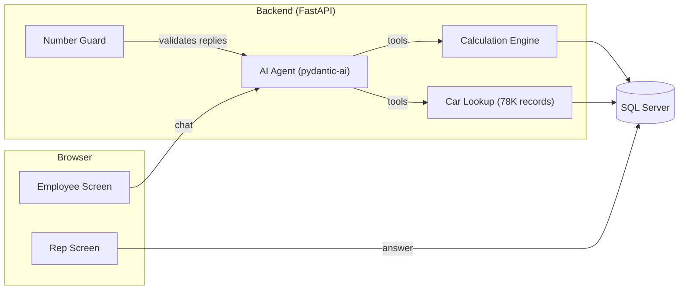

# 🚗 Strauss Car Advisor

A Hebrew-language salary advisor that answers one question for Strauss employees with a company car: **"How does my monthly net pay change if I switch car, go electric, or give up the car?"**

Built for the Open Source AI Hackathon 2026 (Strauss Challenge).

[Live Demo](https://strauss-car-advisor.duckdns.org/)

---

## The Problem

Strauss employees entitled to a company car have no easy way to understand the financial impact of switching. The calculation involves income tax brackets, social insurance, usage values from the Tax Authority, group budgets, participation fees and more. Today it takes three emails and two weeks.

## The Solution

A chatbot that collects only what's missing, calculates everything in deterministic code, and presents a clear comparison table with plain-language Hebrew explanations.

```
Employee: "אני מנהלת מוצר, שכר בסיס 18,500. מה יקרה אם אעבור ל-BYD Atto 3?"

Bot collects: occupation → salary → deductions → current car → desired alternative

Result: Net pay today ₪11,032 → With Atto 3: ₪11,693 → +₪661/month
        "הנטו עולה ב-₪661 בחודש: שווי השימוש הנמוך חוסך ₪411, והחזר החשמל מוסיף ₪250."
```

All 6 reference employees from the challenge match the organizers' spreadsheet to the shekel.

---

## Architecture

The core principle: **AI manages the conversation, code owns every number.**



| Component | Role |
|---|---|
| **AI Agent** | Manages the Hebrew conversation. Asks only for missing fields, calls tools, presents results. Never calculates. |
| **Calculation Engine** | Monthly net pay from `rules.yaml`: tax brackets, NI, health tax, pension credit. Zero hardcoded numbers. Pure functions, exact decimal arithmetic. |
| **Car Lookup** | Searches the Tax Authority's 77,988-record usage-value dataset. Official data, never guessed. |
| **Number Guard** | Every bot reply is validated: any number not from a tool result is rejected and the model retries. An employee making a financial decision based on AI advice needs numbers they can trust. |
| **Document Reader** | Optional payslip/contract upload. The system extracts values for the employee to confirm before saving. |
| **Rep Screen** | Transport representative answers questions the bot can't (participation amounts, unknown occupations). The conversation resumes automatically. |

### Tech Stack

| Layer | Technology |
|---|---|
| Backend | Python 3.12, FastAPI, pydantic-ai, SQLAlchemy, Alembic |
| Frontend | Angular 22 (standalone, signals), RTL Hebrew, WCAG keyboard+screen reader support |
| Database | SQL Server 2025 |
| AI Model | OpenAI via pydantic-ai Responses API |
| Infrastructure | Docker Compose, single-command startup, auto-restart on failure |

---

## Key Design Decisions

**The engine is pure and isolated.** The calculation module imports nothing from the rest of the app — no database, no network, no files. It receives inputs as arguments and returns results. This makes it testable, auditable, and replaceable.

**The API owns the comparison, not the agent.** After every state change (profile edit, car swap, rep answer), the backend recalculates the comparison in code. The agent reads the same stored result. The chat and the table can never disagree.

**Data-driven, not code-driven.** Every rule, budget, tax bracket and threshold lives in `rules.yaml`. The car catalog and occupations table are separate YAML files. Moving from hackathon to pilot means replacing data files, not rewriting code.

| File | Contents |
|---|---|
| `config/rules.yaml` | Tax brackets, group budgets, pension credit, all calculation parameters |
| `config/car_catalog.yaml` | 20 cars with official codes, costs, groups |
| `config/occupations.yaml` | 14 occupations with eligibility groups, waiver rules, maintenance amounts |
| `data/usage-values-2026.csv` | 77,988 Tax Authority records (official, unmodified) |

**Race-safe rep answers.** A filtered unique index ensures exactly one open question per combination. The answer is stored with a conditional update, so concurrent submissions can't create duplicate resumes. The conversation guard uses a database flag that survives restarts.

---

## What's Implemented

| Requirement | Status |
|---|---|
| Hebrew chatbot with 4-step conversation script | Done |
| Net pay calculation engine (monthly method, 2025 tax tables) | Done |
| Group budgets with eligibility by group order | Done |
| Electric car refund (+₪250 net, exactly) | Done |
| Family track (4+ children, 50/50 gap split) | Done |
| Car waiver by occupation | Done |
| Tax Authority usage values (77,988 records) | Done |
| Car catalog (20 cars across 4 groups + 2 family track) | Done |
| Comparison table with breakdown and explanation | Done |
| Rep screen with structured answer forms | Done |
| Automatic conversation resume after rep answers | Done |
| 6 reference employees matching the challenge spreadsheet | Done |
| Document upload (payslip/contract, optional) | Done |
| Number Guard on every bot reply | Done |

---

## Testing

- **1,100+ backend tests** including the 6 challenge employees validated against the organizers' spreadsheet
- **400+ frontend tests** for components, validation and accessibility
- No network access or API key required — the model is replaced by scripted mocks in agent tests
- Single command: `./check.sh` runs ruff, pytest, Angular lint and frontend tests

---

## Project Structure

```
├── config/                  Rules, car catalog, occupations (YAML)
├── data/                    Tax Authority usage-value dataset (CSV)
├── backend/
│   └── src/car_advisor/
│       ├── engine/          Pure calculation: payroll, eligibility, comparison
│       ├── agent/           AI agent, 6 tools, Number Guard, document reader
│       ├── dataset/         CSV importer, car lookup
│       ├── conversations/   State management, rep questions, run guard
│       └── api/             HTTP routes, schemas, health check
├── frontend/
│   └── src/app/
│       ├── landing/         Role selection (employee / rep)
│       ├── employee/        Chat, details panel, comparison table, document upload
│       ├── rep/             Question list and answer forms
│       └── shared/          API client, formatting, polling
└── docs/
    ├── requirements.md      Full requirements (17 sections)
    ├── design.md            Architecture, interfaces, decisions
    ├── tasks.md             Implementation plan
    └── pilot-readiness.md   What works, what's needed for production
```

---

## Running Locally

Prerequisites: Docker and Docker Compose.

```bash
git clone https://github.com/MalkaGreenfeld/strauss-car-advisor.git
cd strauss-car-advisor
cp .env.example .env
# Set DB_PASSWORD and optionally OPENAI_API_KEY in .env

docker compose up
# First run builds images and loads the dataset (~3 min)
# Open http://127.0.0.1:8080/
```

Without an API key the system starts but the advisor won't respond. The comparison table, car picker, details panel and rep screen all work independently.

### Dev Mode

```bash
docker compose up db                              # Database only
cd backend && uv run uvicorn car_advisor.api.app:app --reload --host 127.0.0.1
cd frontend && npx ng serve --host 127.0.0.1      # Proxies /api to backend
```

---

## Pilot Readiness

See [docs/pilot-readiness.md](docs/pilot-readiness.md) for a detailed assessment: what works today, what Strauss needs to provide, and the path from hackathon to production.

---

## License

No license specified. Challenge data (car codes, usage values) is from the Israel Tax Authority public dataset.
