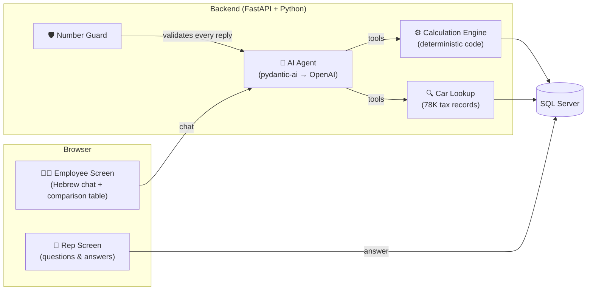

# 🚗 Strauss Car Advisor

> An employee asks *"What happens to my net pay if I switch to an electric car?"* — and gets an accurate, explained answer in under a minute.

**Built for the Open Source AI Hackathon 2026 · Strauss Challenge**

🔗 [Live Demo — Employee](http://34.22.142.208:8080/employee) · [Rep Screen](http://34.22.142.208:8080/rep)

---

## The Problem

Strauss employees entitled to a company car have no easy way to understand the financial impact of switching cars, going electric, or giving up the car entirely. The calculation involves tax brackets, social insurance, usage values from the Tax Authority, group budgets, and participation fees — too complex for a spreadsheet conversation with HR.

## The Solution

A Hebrew chatbot that collects only what's missing, calculates everything in deterministic code, and presents a clear comparison table with explanations.

```
Employee: "אני מנהלת מוצר, שכר בסיס 18,500 ש"ח. מה יקרה אם אעבור ל-BYD Atto 3 חשמלי?"

Bot collects: occupation → salary → deductions → current car → desired alternative

Result: Net pay today ₪11,032 → With Atto 3: ₪11,693 → Difference: +₪661/month
        "הנטו עולה ב-₪661 בחודש: שווי השימוש הנמוך חוסך ₪411, והחזר החשמל מוסיף ₪250."
```

All 6 reference employees from the challenge match the organizers' spreadsheet to the shekel. Automated tests enforce this.

---

## Architecture



**The key principle: AI talks, code calculates.**

| Component | Role |
|---|---|
| **AI Agent** (pydantic-ai + OpenAI) | Manages the Hebrew conversation. Asks only missing fields, calls tools, presents results. Never calculates. |
| **Calculation Engine** (pure Python) | Monthly net pay: tax brackets, NI, health tax, pension credit — all from `rules.yaml`, zero hardcoded numbers. |
| **Car Lookup** | Searches the Tax Authority's 77,988-record usage-value dataset. Usage values are official, never guessed. |
| **Number Guard** 🛡️ | Validates every bot reply: any number not from a tool result is rejected, and the model retries. |
| **Document Reader** | Employee uploads a payslip or contract, the system extracts values for confirmation. Optional — manual input works too. |
| **Rep Screen** | Transport rep answers questions the bot can't (participation amounts, unknown occupations). The conversation resumes automatically. |

### Tech Stack

| Layer | Technology |
|---|---|
| Backend | Python 3.12, FastAPI, pydantic-ai, SQLAlchemy |
| Frontend | Angular 22, RTL Hebrew, WCAG keyboard navigation |
| Database | SQL Server 2025 |
| AI Model | OpenAI (GPT) via pydantic-ai |
| Infrastructure | Docker Compose (one command startup, auto-restart on failure) |

---

## What's Implemented (Challenge Checklist)

| Requirement | Status | Details |
|---|---|---|
| Hebrew chatbot managing a conversation | ✅ | 4-step script: basics → pay → current car → alternatives |
| Net pay calculation engine in code | ✅ | Monthly method, 2025 tax tables, exact decimal arithmetic |
| Group budgets (A=3,500 B=3,700 C=4,500 D=5,200) | ✅ | From `rules.yaml`, not hardcoded |
| Pick from your group or lower | ✅ | Deterministic eligibility check |
| Electric car refund (+₪250 net) | ✅ | Added to net pay exactly, as the challenge specifies |
| Family track (4+ children, 50/50 gap split) | ✅ | Carnival ₪6,000 / Santa Fe ₪5,600 |
| Waiver by occupation | ✅ | 14 occupations with maintenance amounts |
| Usage values from Tax Authority CSV | ✅ | 77,988 records imported, powertrain encoding verified |
| Car catalog (20 cars in 4 groups + 2 family) | ✅ | All codes and values match the challenge data |
| Comparison display with explanation | ✅ | Breakdown: what changed, why, how much in net |
| Rep screen with questions and answers | ✅ | Participation, occupation choice, group override, free text |
| Conversation resumes after rep answers | ✅ | Background task with automatic agent continuation |
| 6 reference employees match the spreadsheet | ✅ | Automated tests in `test_challenge_employees.py` |
| Document upload (payslip/contract) | ✅ | Employee uploads a payslip or contract, values offered for confirmation |

---

## 🛡️ Original Feature: Number Guard

**The problem:** Language models hallucinate numbers. In a salary advisor, a wrong number isn't just an error — it's a breach of trust.

**The solution:** Every reply from the bot passes through a Number Guard that:

1. Extracts every number from the reply (amounts, dates, percentages, model codes)
2. Checks each one against the set of numbers returned by tool calls in this conversation
3. If any number wasn't returned by a tool → the reply is **rejected** and the model retries with an explanation of what went wrong

**Why it matters for Strauss:** An employee making a ₪3,000/month decision based on AI advice needs 100% accurate numbers. The Number Guard is a safety net that ensures the bot can never present a number it didn't calculate.

**How to test it:** Ask the bot about an alternative. Every number in the response can be traced back to the comparison table. In our test suite, we deliberately provoke the model to invent numbers — the guard catches and corrects them every time.

📁 `backend/src/car_advisor/agent/number_guard.py`

---

## Quick Start

```bash
# 1. Clone and configure
git clone https://github.com/MalkaGreenfeld/strauss-car-advisor.git
cd strauss-car-advisor
cp .env.example .env
# Edit .env: set DB_PASSWORD and OPENAI_API_KEY

# 2. Start everything (first run builds images + loads dataset, ~3 min)
docker compose up

# 3. Open
# Employee screen: http://127.0.0.1:8080/employee
# Rep screen:      http://127.0.0.1:8080/rep
# Health check:    http://127.0.0.1:8000/api/health
```

Without an API key, the system starts but the advisor doesn't respond — the panel, car picker, comparison table, and rep screen all keep working.

---

## Data-Driven Design: Change Data, Not Code

The engine reads everything from files. To move from hackathon to pilot, Strauss replaces data files:

| File | What It Contains | How to Update |
|---|---|---|
| `config/rules.yaml` | Tax brackets, budgets, pension credit, all calculation parameters | Edit values, restart backend |
| `config/car_catalog.yaml` | 20 cars with codes, costs, participations, groups | Replace with Strauss's real catalog |
| `config/occupations.yaml` | 14 occupations with groups, waiver rules, maintenance amounts | Replace with Strauss's real table |
| `data/usage-values-2026.csv` | 77,988 Tax Authority records | Replace file, run import command |

---

## Testing

```bash
./check.sh  # Runs everything: ruff + pytest (backend), lint + tests (frontend)
```

- **1,100+ backend tests** — including the 6 challenge employees validated against the organizers' spreadsheet
- **400+ frontend tests** — components, services, accessibility
- No network, no API key required for tests
- The model is replaced by a scripted mock in agent tests

---

## Project Structure

```
├── config/                  Rules, car catalog, occupations (YAML)
├── data/                    Tax Authority usage-value dataset (CSV)
├── backend/
│   ├── src/car_advisor/
│   │   ├── engine/          Pure calculation: payroll, eligibility, comparison, explanation
│   │   ├── agent/           AI agent, 6 tools, Number Guard, document reader
│   │   ├── dataset/         CSV importer, car lookup (78K records)
│   │   ├── conversations/   State management, rep questions
│   │   └── api/             HTTP routes
│   └── tests/               1,100+ tests including challenge employee validation
├── frontend/
│   └── src/app/
│       ├── employee/        Chat, details panel, comparison table
│       ├── rep/             Rep question list and answer forms
│       └── shared/          API client, RTL formatting, number display
└── docs/
    └── pilot-readiness.md   What's done, what's needed for production
```

---

## Pilot Readiness

See [docs/pilot-readiness.md](docs/pilot-readiness.md) for a detailed assessment of what works today and what Strauss needs to provide for a real deployment.

---

## License

No license specified. All challenge data (car codes, usage values) is from the Israel Tax Authority public dataset.
