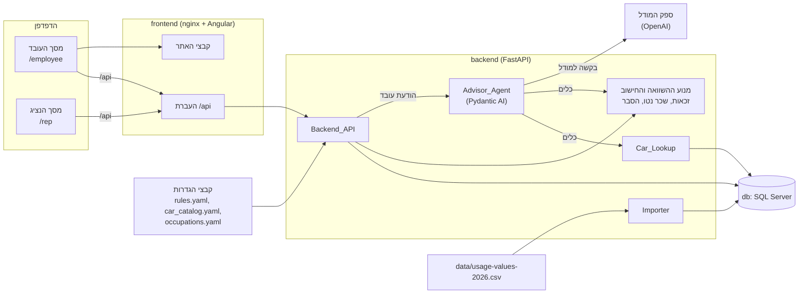

# יועץ הרכב של שטראוס: הסברים על המערכת

המסמך הזה מסביר בעברית איך המערכת בנויה, איך מריצים אותה, איך מחשבים את השכר הנטו, איך מוצאים תקלות ואיך מוסיפים יכולת חדשה.
בסוף יש סיכום להגשה (מה עובד, מה חסר, מה נדרש לפיילוט) ורשימת שאלות פתוחות לשטראוס.
הוראות ההפעלה הקצרות נמצאות ב־[README.md](../README.md) (באנגלית).

## תוכן העניינים

1. [מה המערכת עושה](#1-מה-המערכת-עושה)
2. [ארכיטקטורה](#2-ארכיטקטורה)
3. [מבנה התיקיות](#3-מבנה-התיקיות)
4. [איך כל חלק עובד](#4-איך-כל-חלק-עובד)
5. [חישוב השכר הנטו, צעד אחר צעד](#5-חישוב-השכר-הנטו-צעד-אחר-צעד)
6. [הרצה והגדרות](#6-הרצה-והגדרות)
7. [ניפוי שגיאות](#7-ניפוי-שגיאות)
8. [הוספת יכולת חדשה](#8-הוספת-יכולת-חדשה)
9. [מוזרויות בקובץ הנתונים](#9-מוזרויות-בקובץ-הנתונים)
10. [סיכום להגשה](#10-סיכום-להגשה)
11. [שאלות פתוחות לשטראוס](#11-שאלות-פתוחות-לשטראוס)

## 1. מה המערכת עושה

עובד שיש לו רכב חברה (או שרוצה לעבור לרכב אחר, לרכב חשמלי, או לוותר על הרכב) משוחח עם יועץ בעברית.
היועץ שואל רק את מה שחסר לו: עיסוק, שכר, רכיבי שכר, אחוזי הפרשה, נקודות זיכוי, הרכב הנוכחי וההשתתפות בו. קבוצת הזכאות נגזרת מהעיסוק, והיועץ לא שואל עליה.
בכל שינוי מחושבת מחדש טבלת השוואה בין המצב היום לבין החלופות שנבדקו, בשכר נטו חודשי, עם פירוק ההפרש להסבר קצר.

ההשתתפות ברכב חדש מהקטלוג היא ההשתתפות שהקטלוג מציין, כך שהעמודה מחושבת מיד. מתחת לטבלה כתוב שהסכום הסופי נקבע מול נציג התחבורה, והעובד יכול לבקש שהנציג יאשר אותו.
כשהיועץ צריך נתון שרק נציג התחבורה יודע (למשל עיסוק שאינו בטבלה, או השתתפות ברכב שאין לו סכום בקטלוג), הוא לא מנחש.
הוא פותח שאלה לנציג, ואומר לעובד שנשלחה שאלה.
הנציג עונה במסך נפרד, ושיחת העובד ממשיכה מעצמה, בלי שהעובד יעשה משהו.

המערכת כוללת שלושה חלקים שרצים ב־Docker Compose:

- **db:** SQL Server 2025, ששומר את נתוני הרכבים, השיחות, ההודעות והשאלות לנציג.
- **backend:** שרת FastAPI עם סוכן Pydantic AI. הוא מחשב, שומר ועונה.
- **frontend:** nginx שמגיש את האתר (Angular) ומעביר את הקריאות של `/api` אל ה־backend.

המערכת בכוונה פשוטה: אין התחברות, השכר בדוי, והקטלוג והעיסוקים הם נתוני האתגר ולא נתונים אמיתיים של שטראוס (ראו את המגבלות בסעיף 10).

## 2. ארכיטקטורה



הנקודות החשובות:

- **הטבלה היא של ה־API, לא של הסוכן.** אחרי כל שינוי (עריכת פרט בפאנל, החלפת רכב, תשובת נציג, או פרט ששמר הסוכן) השרת מריץ את מנוע ההשוואה ושומר את התוצאה בשיחה.
  הסוכן מקבל את אותה תוצאה שמורה, ולכן הצ'אט והטבלה אף פעם לא סותרים זה את זה.
- **הסוכן לא מחשב ולא מנחש.** כל מספר בתשובה שלו חייב להופיע בתוצאה של כלי. אם הוא כותב מספר אחר, התשובה נדחית והמודל מתבקש לנסות שוב.
- **שאלה לנציג נבנית בקוד, לא על ידי המודל.** הטקסט שלה כולל תווית עובד, קבוצה ורכב, ואף פעם לא נתוני שכר, כי מסך הנציג פתוח בלי התחברות.
- **ההגדרות נקראות בעליית השרת.** שינוי בקובץ הגדרות נכנס לתוקף אחרי `docker compose restart backend`.
- **בלי מפתח API המערכת עולה.** היועץ לא עונה (מוצגת הודעה), אבל הפאנל, בורר הרכב, הטבלה ומסך הנציג ממשיכים לעבוד.

## 3. מבנה התיקיות

```text
.
├── README.md             הוראות הפעלה קצרות (באנגלית)
├── check.sh              פקודה אחת שמריצה את כל הבדיקות והלינט
├── compose.yaml          שלושת השירותים: db, backend, frontend
├── .env.example          כל הגדרות היישום, בלי סודות (מעתיקים ל־.env)
├── config/               קבצי ההגדרות: rules.yaml, car_catalog.yaml, occupations.yaml
├── data/                 קובץ הנתונים usage-values-2026.csv
├── docs/                 המסמך הזה
├── backend/              השרת
│   ├── Dockerfile, pyproject.toml, uv.lock, alembic.ini
│   ├── migrations/       יצירת הטבלאות (Alembic)
│   ├── src/car_advisor/
│   │   ├── settings.py   הגדרות היישום (.env)
│   │   ├── db.py         חיבור למסד, יצירת מסד והרצת מיגרציות
│   │   ├── logs.py       לוגים בשורות JSON ו־middleware של בקשות
│   │   ├── dataset/      Importer (טעינת ה־CSV) ו־Car_Lookup (חיפוש רכב)
│   │   ├── rules/        טעינה ובדיקה של קבצי ההגדרות
│   │   ├── engine/       זכאות, חישוב שכר נטו, השוואה והסבר (פונקציות טהורות)
│   │   ├── conversations/ שיחות, פרופיל עובד, הודעות ושאלות לנציג
│   │   ├── agent/        הסוכן, ששת הכלים, הגנת המספרים וההרצה
│   │   └── api/          נתיבי ה־HTTP ועליית השרת
│   └── tests/            הבדיקות של השרת. fixtures/challenge/ הוא ששת עובדי האתגר עם הנטו של המארגנים
└── frontend/             האתר
    ├── Dockerfile, nginx.conf, angular.json, package.json
    └── src/app/
        ├── employee/     מסך העובד: צ'אט, פרטים, טבלת השוואה
        ├── rep/          מסך הנציג
        └── shared/       לקוח ה־API, עיצוב מספרים, טקסט דו־כיווני, רענון מחזורי
```

## 4. איך כל חלק עובד

לכל חלק: מה האחריות שלו, מה נכנס ומה יוצא, איפה הקוד, ועם מי הוא מדבר.

### Importer: טעינת קובץ הנתונים

- **אחריות:** לקרוא את `data/usage-values-2026.csv` לטבלה `usage_values`. הקובץ בקידוד windows-1255, והשדות מרופדים ברווחים.
- **קלט ופלט:** קובץ CSV נכנס, ו־77,988 רשומות יוצאות. לכל רשומה מפתח רשמי (Official_Key) מחמישה חלקים, וגם סוג ההנעה (Powertrain) שנגזר מעמודת החשמל.
- **מה הוא בודק:** מפתח כפול נכשל ומציין את שתי השורות. תאריכים נקראים יום־חודש־שנה. שווי השימוש נשמר כמו שהוא בקובץ.
- **מתי רץ:** אוטומטית בעליית השרת כשאין רשומות של `TAX_YEAR`, ובפקודה `car-advisor-import --tax-year 2026` (שמחליפה את רשומות השנה בטרנזקציה אחת).
- **איפה:** `backend/src/car_advisor/dataset/importer.py`, `cli.py`, `models.py`.
- **מדבר עם:** מסד הנתונים בלבד.

### Car_Lookup: חיפוש רכב

- **אחריות:** למצוא רכב בנתונים. חיפוש לפי מפתח רשמי מלא, או לפי שנת רישום וטקסט (יצרן או שם מסחרי, בלי הבדל בין אותיות גדולות וקטנות).
- **פלט:** `Found` או חלקים חסרים לחיפוש מפתח. לחיפוש טקסט: כל המועמדים, סימון שנדרשת בחירה כשיש יותר מאחד, או "לא נמצא". תקלת מסד מחזירה `LookupFailed` ולא מפילה את הבקשה.
- **חשוב:** המפתח הרשמי חייב לכלול את קוד סוג הרכב. בלעדיו יש 512 התנגשויות בין רכבים שונים.
- **בדיקה בעליית השרת:** כל רכב בקטלוג חייב להיות בנתונים, אחרת השרת לא עולה ורושם איזה רכב חסר. בנוסף, שווי השימוש שהקטלוג מציין (`usage_value`) מושווה לשווי שבנתונים. זו בדיקה בלבד: אם הם שונים, השרת עולה בכל זאת, נכתבת שורת אזהרה `catalog_usage_value_mismatch` לכל רכב, והרכב מופיע ב־`catalog_warnings` של `/api/health`. החישוב תמיד משתמש בשווי שבנתונים. כך קוד דגם שגוי בקטלוג של שטראוס מתגלה ולא נכנס לחישוב בשקט. בקטלוג שבגיט כל 20 הערכים שווים לנתונים.
- **איפה:** `dataset/lookup.py`.
- **מדבר עם:** המסד; הסוכן (הכלים `lookup_car` ו־`list_catalog_cars`); הנתיב `/api/cars/search` של פאנל הפרטים; מנוע ההשוואה (רשומות הרכבים).

### Rules_Config: טעינת ההגדרות

- **אחריות:** לטעון את `rules.yaml`, `car_catalog.yaml` ו־`occupations.yaml` לאובייקטים מוגדרים, ולדחות קובץ שגוי.
- **פלט:** `AppConfig`. אם יש בעיה, השרת לא עולה, ובלוג מופיעים הנתיב לקובץ וכל הבעיות שבו.
- **כלל מיוחד:** ברשימת `pending` ב־`rules.yaml` כל ברירת מחדל חייבת להיות שווה לערך הנוכחי של השדה שלה, אחרת הקובץ נדחה. כך אי אפשר לשנות ערך שממתין לתשובה בלי לעדכן גם את הרשימה.
- **איפה:** `backend/src/car_advisor/rules/loader.py`, `engine/config.py`.

### Eligibility_Checker: בדיקת זכאות

- **אחריות:** להחליט אם עובד רשאי לבחור חלופה: רכב מקבוצתו או מקבוצה נמוכה ממנה, רכב במסלול ברוכת ילדים (לעובד עם לפחות 4 ילדים עד גיל 23), או ויתור על הרכב (לפי טבלת העיסוקים). שם עיסוק עם לוכסן, כמו "מפתח/ת תוכנה", מתאים גם בזכר ("מפתח תוכנה") וגם בנקבה ("מפתחת תוכנה"). שם בלי לוכסן צריך להיות זהה, אחרי חיתוך רווחים בקצוות.
- **קבוצת העובד:** הפונקציה `employee_group()` מחזירה את הקבוצה שהנציג קבע לעובד, אם יש כזו, ואחרת את הקבוצה של העיסוק בטבלה. העובד לא יכול לקבוע קבוצה: לא בצ'אט, לא בפאנל ולא בהעלאת מסמך. עובד שחושב שהקבוצה שלו שונה יכול לבקש מהיועץ לפנות לנציג. כל מי שקורא את הקבוצה (הזכאות, תקציב הרכב בהשוואה, רשימת הקטלוג ושאלות לנציג) עובר דרך הפונקציה הזו.
- **פלט:** `eligible`, `not_eligible` עם סיבה בעברית, או `missing` עם הפרט שחסר (למשל עיסוק או מספר ילדים). בלי עיסוק שנמצא בטבלה הקבוצה לא ידועה, והפרט שחסר הוא העיסוק. בסטטוס `missing` אין החלטה, והסוכן שואל את העובד.
- **איפה:** `engine/eligibility.py`. זו פונקציה טהורה: אותו קלט נותן תמיד אותה תוצאה.

### Payroll_Calculator: חישוב שכר נטו

- **אחריות:** לחשב שכר נטו חודשי מנתוני העובד ומארבעה פרטי רכב (שווי שימוש, השתתפות, החזר חשמל ואחזקת רכב).
- **פלט:** שכר נטו ופירוק מלא של כל רכיב (ברוטו, מס הכנסה, ביטוח לאומי, מס בריאות ועוד), בלי עיגול. אם חסר נתון מוחזרת רשימת החסרים, ואם ערך לא תקין מוחזרת רשימת הערכים הלא תקינים.
- **איפה:** `engine/payroll.py`. ההסבר המלא בסעיף 5.

### Comparison_Engine וההסבר

- **אחריות:** לחשב את עמודת "היום" ואת העמודה של כל חלופה, ולבנות הסבר קצר להפרש.
- **איך:** "היום" מחושב פעם אחת, וכל חלופה מחושבת בנפרד מולו, כך שחלופה אחת אף פעם לא משפיעה על אחרת.
- **ההשתתפות, לפי הסדר:** ברכב הנוכחי של העובד, ההשתתפות שהעובד מסר. ברכב חדש, תשובת הנציג לאותו רכב אם יש, אחרת ההשתתפות של הקטלוג (`default_participation`), ואם גם היא חסרה העמודה ממתינה לנציג. כל עמודה מחזירה גם את מקור ההשתתפות (עובד, קטלוג או נציג). כשהעובד ביקש שהנציג יאשר את סכום הקטלוג, העמודה נשארת מחושבת עם סכום הקטלוג ומסומנת "ממתין לאישור הנציג" (`participation_awaiting_rep`), ותשובת הנציג מחליפה את הסכום.
- **מסלול ברוכת ילדים:** ההשתתפות נקבעת באותו סדר, ועליה מתווסף חלקו של העובד (50%) בפער בין עלות הרכב בקטלוג (₪6,000 לקיה קרניבל, ₪5,600 ליונדאי סנטה פה) לבין תקציב הקבוצה. שניהם יורדים מהנטו, והטבלה מציגה אותם בשורות נפרדות.
- **שאר הרכיבים:** ברכב חשמלי נוסף החזר החשמל. בוויתור על רכב שווי השימוש וההשתתפות הם אפס, ואחזקת הרכב באה מטבלת העיסוקים. גם "היום" של עובד בלי רכב כולל את אחזקת הרכב של העיסוק שלו, כי מי שאין לו רכב ויתר עליו. לכן בלי עיסוק שנמצא בטבלה "היום" ממתין, וכל החלופות איתו. בעיסוק שהרכב בו חובה (`car_mandatory`) אין מצב בלי רכב, ולכן "היום" ממתין לרכב הנוכחי.
- **סטטוסים של עמודה:** `calculated` (מחושבת), `pending` (חסר נתון, ומוצגים הפרטים החסרים והאם נשלחה שאלה לנציג) ו־`not_eligible` (לא זכאי, עם סיבה). בעמודה שאינה מחושבת אין שכר נטו, הפרש, פירוק או הסבר.
- **פירוק ההפרש:** הרכיבים (שווי שימוש, החזר חשמל, השתתפות, אחזקת רכב) מוחלפים בזה אחר זה, ולכן סכומם המדויק שווה להפרש. אחרי עיגול לשקלים שלמים הסכום המוצג שווה להפרש המוצג.
- **ההסבר:** משפט אחד בשתי שורות לכל היותר ("הנטו עולה ב־₪305 בחודש: ..."). כל מספר בו הוא מספר שמוצג בטבלה.
- **איפה:** `engine/comparison.py`, `engine/explanation.py`, והטקסטים בעברית ב־`engine/copy_he.py`.

### Advisor_Agent וששת הכלים

- **אחריות:** לנהל שיחה בעברית: לשאול רק את מה שחסר בשלב הנוכחי, לאשר רכב רק מתוך מועמדים שהכלי החזיר, לשלוח לנציג שאלה כשהנתון אצלו, ולהציג את ההשוואה בלי לחשב בעצמו.
- **ההוראות:** הוראה קבועה (טון, איסור לחשב או לנחש, תשובה קבועה לשאלות שאינן קשורות), רשימת העיסוקים של הטבלה, והוראה דינמית שנבנית מהמצב השמור: הפרטים, השלב הנוכחי בתסריט, השאלות הפתוחות והחלופות. הרשימה נועדה לכך שהסוכן ישמור את העיסוק בשם שהטבלה מכירה. כשמילות העובד מתאימות לכמה עיסוקים או לאף אחד, הוא מציג את הרשימה ושואל, ופונה לנציג רק אם העובד אומר שאין בה את העיסוק שלו. העיסוק נשאל בשלב הראשון, לצד שכר הבסיס, כי הקבוצה נגזרת ממנו. הסוכן אף פעם לא שואל על קבוצה ולא שומר קבוצה שהעובד אמר: כשהעובד אומר שהקבוצה שלו שונה, הסוכן מסביר שהיא נגזרת מהעיסוק ומציע לפנות לנציג. בעיסוק שהרכב בו חובה, עובד שאמר שאין לו רכב נשאל איזה רכב יש לו.
- **הגנת המספרים:** מאמת הפלט (`check_reply`) בודק שכל מספר בתשובה מופיע בתוצאות הכלים. תשובה עם מספר זר נדחית, והמודל מנסה שוב (עד פעמיים).
- **ששת הכלים:**
  1. `update_profile`: שומר פרטים שהעובד מסר (הכול או כלום), ומחשב מחדש.
  2. `lookup_car`: מחפש רכב לפי שנת רישום וטקסט, ומחזיר מועמדים. העובד בוחר, והסוכן לא בוחר בשבילו.
  3. `list_catalog_cars`: מציג את רכבי הקטלוג שהעובד רשאי לבחור.
  4. `check_eligibility`: בודק זכאות לרכב או לוויתור.
  5. `compare_alternatives`: קובע את החלופות בשיחה ומחזיר את ההשוואה השמורה.
  6. `ask_rep`: פותח שאלה לנציג, ומחזיר את המשפט שהסוכן אומר לעובד. השדות: השתתפות ברכב חדש (רכב בלי סכום בקטלוג, או אישור של סכום הקטלוג לבקשת העובד), עיסוק שאינו בטבלה, קבוצת זכאות, זיהוי הרכב הנוכחי והשתתפות ברכב הנוכחי.
- **הרצה:** `agent/runner.py` מחזיק "דגל ריצה" לשיחה (כדי שלא ירוצו שתי ריצות יחד), מגביל ריצה ל־60 שניות, ושומר הודעת מערכת כשהריצה נכשלת: `agent_unavailable` (אין מפתח או שהמפתח נדחה), `agent_failed` (תקלה אחרת או זמן ארוך מדי) ו־`resume_failed` (ההמשך אחרי תשובת נציג נכשל).
- **איפה:** `backend/src/car_advisor/agent/`.
- **מדבר עם:** ספק המודל (OpenAI), שירות השיחות, Car_Lookup ומנוע ההשוואה.

### תהליך השאלה לנציג וההמשך

1. הסוכן קורא ל־`ask_rep` עם השדה החסר והרכב. נפתחת שורה ב־`rep_questions`. שאלה זהה (אותה שיחה, שדה ורכב) שעדיין פתוחה לא נפתחת שוב.
2. פרט שחסר מסומן בטבלה כ"נשלחה שאלה לנציג", והעמודה נשארת `pending`. שאלת אישור על סכום הקטלוג לא עוצרת את העמודה: היא נשארת מחושבת עם סכום הקטלוג, ומסומנת "ממתין לאישור הנציג".
3. מסך העובד בודק עדכונים כל 3 שניות כל עוד יש שאלה פתוחה או ריצה של הסוכן.
4. הנציג רואה את השאלה במסך שלו (בלי נתוני שכר ובלי מזהה השיחה) ועונה לפי סוג השאלה:
   - **השתתפות:** סכום, תאריך תחילה והערה. ברכב מהקטלוג השדה מתחיל בסכום הקטלוג, שמוצג לידו, ותאריך התחילה נשאר ריק כדי שהנציג יאשר.
   - **עיסוק:** בחירה מתוך שורות טבלת העיסוקים.
   - **קבוצת זכאות:** בחירה מתוך א', ב', ג' ו־ד'.
   - **שאר השאלות:** טקסט חופשי.
5. השרת שומר את התשובה ומחשב מחדש את ההשוואה בטרנזקציה אחת. תשובת בחירה נכתבת לפרופיל באותה טרנזקציה: העיסוק שנבחר הופך לעיסוק של העובד (וממנו הקבוצה, הוויתור ואחזקת הרכב), והקבוצה שנבחרה הופכת לקבוצה של העובד. תשובה שנייה לאותה שאלה נדחית (409) ולא משנה כלום.
6. אחרי שהתשובה נשמרה, משימת רקע מריצה את הסוכן עם הערה פנימית באנגלית ("הנציג ענה על ..."). הסוכן מוסיף הודעה אחת שמציינת מה נענה ומציגה את ההשוואה המעודכנת. ההיסטוריה הקודמת לא משתנה.
7. אם ההמשך נכשל, התשובה והחישוב נשארים, ומוצגת הודעה שהתשובה התקבלה וההשוואה עודכנה, אבל היועץ לא הצליח להמשיך.

פער ידוע: המשך שרץ ברגע שהשרת נעצר לא מתחדש מעצמו. העובד יכול לשלוח הודעה כדי להמשיך.

### מסך העובד

- **איפה:** `frontend/src/app/employee/`. הכתובת `/employee` פותחת שיחה חדשה ומעבירה ל־`/employee/<מזהה>`. רענון הדף טוען את השיחה השמורה, ומזהה לא קיים מציג "השיחה לא נמצאה".
- **צ'אט:** הודעות, חיווי הקלדה, אזורי הכרזה לקורא מסך, ושליחה ב־Enter.
- **פאנל "הנתונים שלי":** כל פרט הוא שדה עם תווית. הערך נשמר ביציאה מהשדה או ב־Enter, בלי הודעה ליועץ. ערך לא תקין לא נשלח, ולידו מוצגת שגיאה. כולל עורך רכיבי שכר וחיפוש הרכב הנוכחי. קבוצת הזכאות מוצגת לקריאה בלבד עם המקור שלה (לפי העיסוק, או נקבעה על ידי הנציג). בשדה העיסוק מוצעים שמות טבלת העיסוקים (`GET /api/occupations`), והשדה מקבל גם שם אחר.
- **טבלת ההשוואה:** טבלה סמנטית עם עמודה ל"היום" ועמודה לכל חלופה. בכותרת של חלופת רכב יש בורר רכב, והחלפת רכב מחשבת מחדש בלי לפנות למודל. בעמודה של רכב במסלול ברוכת ילדים מוצגות בשורות נפרדות ההשתתפות, חלק העובד בפער וחלק המעסיק בפער. ליד כל השתתפות מופיע המקור שלה, ובזמן שאישור הנציג ממתין גם הסימון "ממתין לאישור הנציג". כשעמודה מציגה את השתתפות הקטלוג, מתחת לטבלה כתוב שהסכום הסופי נקבע מול נציג התחבורה.
- **רענון:** `EmployeeStore` בודק עדכונים רק כשצריך, וממשיך עוד מעט אחרי תשובת נציג כדי לתפוס את ההודעה של ההמשך.

### מסך הנציג

- **איפה:** `frontend/src/app/rep/`, בכתובת `/rep`, בלי התחברות.
- **מה מוצג:** קודם השאלות הפתוחות ואז הנענות, מהישנה לחדשה. לכל שאלה: הטקסט, הסוג, מתי נשאלה, תווית העובד והקבוצה, הרכב והמפתח הרשמי, והמצב.
- **טופס תשובה:** בשאלת השתתפות: סכום (ברכב מהקטלוג מתחיל בסכום הקטלוג, שמוצג ליד השדה), תאריך תחילה והערה. בשאלת עיסוק או קבוצה: בחירה מרשימה. בשאר השאלות: טקסט חופשי. הערכים שהוקלדו נשמרים גם כשהרשימה מתרעננת, וכל שגיאה מוצגת ליד השדה שלה.
- **רענון:** הרשימה נטענת מחדש כל 3 שניות ובלחיצה על "רענון". אם הטעינה נכשלת, הרשימה האחרונה נשארת ומוצגת הודעה.

### שמירת הנתונים במסד

ארבע טבלאות (מיגרציה `0001` ב־`backend/migrations/`). המיגרציה `0002` מוסיפה ל־`rep_questions` את העמודה `answer_choice` לתשובות בחירה, ומשנה את סוג השאלה `occupation_waiver` ל־`occupation`:

| טבלה | מה היא שומרת |
|---|---|
| `usage_values` | רשומות הרכבים, המפתח הוא המפתח הרשמי |
| `conversations` | השיחה: פרופיל העובד, החלופות, ההשוואה האחרונה, היסטוריית הסוכן (`agent_history`) ודגל הריצה |
| `messages` | ההודעות והודעות המערכת, לפי סדר |
| `rep_questions` | השאלות לנציג והתשובות |

בעת יצירת המסד מופעל `READ_COMMITTED_SNAPSHOT`, כדי שתשובות מקבילות של הנציג לא ייתקעו זו בזו.

## 5. חישוב השכר הנטו, צעד אחר צעד

החישוב נמצא ב־`backend/src/car_advisor/engine/payroll.py`. הוא משתמש בחשבון עשרוני מדויק, ולא מעגל בשום שלב ביניים.
עיגול לשקלים שלמים נעשה רק בהצגה, ותמיד אותו כלל: חצי עולה בערכו המוחלט (₪1,234.50 מוצג כ־₪1,235, ו־‎−‎₪0.50 מוצג כ־‎−‎₪1).
כל הפרמטרים (מדרגות מס, ערך נקודת זיכוי, תקרות ואחוזים) נקראים מ־`config/rules.yaml`, ואין בקוד אף מספר כזה.
הפרמטרים הם אלה של קובץ הכללים של האתגר (גרסה `mock-2026-10-12`, לוחות 2025 להמחשה). המנוע משחזר את הגיליון של המארגנים: בששת העובדים לדוגמה הנטו של היום, הנטו בחלופה וההפרש זהים לו עד השקל (`backend/tests/engine/test_challenge_employees.py`).

**שיטת החישוב:** חודשית בלבד. שיטה מצטברת לא נממשה, כי היא דורשת נתוני שכר מתחילת השנה. הטבות מס לפי יישוב מחוץ לתחום.

### הצעדים

1. **בדיקת קלט.** ערכים לא תקינים (שלילי, אחוז מעל 100) נבדקים קודם, ואחריהם חסרים. כל רשימה מלאה, כדי שהסוכן ישאל על הכול בבת אחת. הערך 0 ורשימה ריקה נחשבים כמסופקים.
2. **שכר ברוטו** = שכר בסיס + עמלות + בונוסים + אחזקת רכב. החזר החשמל נכנס לברוטו רק כש־`ev_refund.mode` הוא `taxable_gross`. ברירת המחדל `net` מוסיפה אותו לנטו בסוף.
3. **בסיס ההפרשות.** שכר הבסיס ועמלות ובונוסים: הדגל `flags.variable_pay_in_contribution_base` דלוק בברירת המחדל, כמו בגיליון של האתגר, וכשהוא כבוי הבסיס הוא שכר הבסיס בלבד. אחזקת רכב נכנסת לבסיס רק אם `flags.car_maintenance_outside_benefits_base` כבוי, ובברירת המחדל היא מחוץ לו (חייבת במס ואינה פנסיונית).
   הפרשת העובד לפנסיה ולקרן ההשתלמות היא אחוז הבסיס כפול האחוז שהעובד מסר.
4. **שווי שימוש חייב** = שווי השימוש מהנתונים. ההשתתפות מפחיתה אותו רק אם `flags.participation_reduces_usage_value` דלוק (כבוי כברירת מחדל). שווי השימוש לעולם לא מתווסף לשכר הנטו, רק להכנסה החייבת.
5. **עודף הפרשת מעסיק לקרן השתלמות.** הפרשת המעסיק היא `payroll.study_fund.employer_rate_percent` מהבסיס, ורק כשהעובד מפריש (אחוז מעל 0). החלק שעולה על הסכום הפטור (`exempt_employer_rate_percent` מהבסיס עד `salary_ceiling`) נחשב הכנסה חייבת. בברירת המחדל האחוז הוא 0, כי השיטה של האתגר לא מוסיפה הפרשת מעסיק להכנסה החייבת, ולכן אין עודף.
6. **הכנסה חייבת** = ברוטו + שווי שימוש חייב + עודף הקרן. אין עוד תוספות ואין ניכויים.
7. **מס הכנסה.** מס לפי המדרגות (`payroll.income_tax.brackets`), פחות זיכוי נקודות הזיכוי (מספר הנקודות כפול `payroll.credit_point.value`) ופחות זיכוי הפנסיה (35% מהפרשת העובד, עד 7% מתקרת הכנסה של 9,500). זיכוי שעולה על המס נזרק, ומס ההכנסה לא יורד מאפס. שני הזיכויים מוצגים בפירוק כפי שחושבו, לפני ההגבלה לאפס.
8. **ביטוח לאומי ומס בריאות**, כל אחד לחוד: שיעור מופחת על ההכנסה החייבת עד `reduced_rate_threshold`, ושיעור מלא על החלק שמעליו עד `max_insurable_income`.
9. **שכר נטו** = ברוטו − מס הכנסה − ביטוח לאומי − מס בריאות − הפרשת פנסיה − הפרשת קרן השתלמות − השתתפות, ועוד החזר חשמל כשהמצב `net`.
   ההשתתפות היא ניכוי נטו אחרי חישוב המס, והיא לא מקטינה את הברוטו ולא את בסיס ההפרשות. ברכב במסלול ברוכת ילדים הניכוי הוא ההשתתפות ועוד חלקו של העובד בפער.

### דוגמה מחושבת

העובדת היא נועה לוי (E-001) מהגיליון של האתגר: מנהלת מוצר, ולכן קבוצה ג', שכר בסיס ₪18,500, בלי עמלות ובלי בונוס, הפרשת פנסיה 6%, קרן השתלמות 2.5%, 2.75 נקודות זיכוי.
**היום:** טויוטה קורולה קרוס עם שווי שימוש ₪4,070 והשתתפות ₪300.
**חלופה:** BYD Atto 3 חשמלי עם שווי שימוש ₪3,130, השתתפות ₪300 (ההשתתפות של הקטלוג, בלי שאלה לנציג) והחזר חשמל ₪250.
הפרמטרים הם אלה של `config/rules.yaml` שבגיט.

| רכיב | היום | החלופה | איך מחושב |
|---|---|---|---|
| שכר ברוטו | ₪18,500 | ₪18,500 | שכר הבסיס, בלי עמלות ובונוסים |
| שווי שימוש חייב | ₪4,070 | ₪3,130 | שווי השימוש של הרכב, ההשתתפות לא מפחיתה אותו |
| עודף קרן השתלמות חייב | ₪0 | ₪0 | הפרשת המעסיק מוגדרת 0, ולכן אין עודף |
| הכנסה חייבת | ₪22,570 | ₪21,630 | 18,500 + שווי שימוש |
| מס לפני זיכויים | ₪4,341 (4,341.4) | ₪4,045 (4,044.8) | לפי המדרגות: היום ההכנסה נכנסת למדרגה של 35%, ובחלופה היא נשארת במדרגה של 31% |
| זיכוי נקודות זיכוי | ₪666 (665.5) | ₪666 (665.5) | 2.75 × 242 |
| זיכוי פנסיה | ₪233 (232.75) | ₪233 (232.75) | 35% מ־665 (7% מתקרת 9,500) |
| מס הכנסה | ₪3,443 (3,443.15) | ₪3,147 (3,146.55) | מס לפני זיכויים פחות שני הזיכויים |
| ביטוח לאומי | ₪1,132 (1,131.5888) | ₪1,066 (1,065.7888) | 1.04% מ־7,522 + 7% מהיתרה |
| מס בריאות | ₪1,021 (1,020.9422) | ₪972 (972.3442) | 3.23% מ־7,522 + 5.17% מהיתרה |
| הפרשת פנסיה | ₪1,110 | ₪1,110 | 6% מ־18,500 |
| הפרשת קרן השתלמות | ₪463 (462.5) | ₪463 (462.5) | 2.5% מ־18,500 |
| השתתפות | ₪300 | ₪300 | ניכוי נטו |
| החזר חשמל | ₪0 | ₪250 | נוסף לנטו |
| אחזקת רכב | ₪0 | ₪0 | |
| **שכר נטו** | **₪11,032** (11,031.819) | **₪11,693** (11,692.817) | ברוטו פחות הניכויים והשתתפות, ועוד החזר חשמל |

**ההפרש:** ‎+₪661 בחודש לטובת החלופה (660.998 לפני עיגול).

**פירוק ההפרש.** הרכיבים מוחלפים בזה אחר זה לפי הסדר, והשפעת כל אחד כוללת את השינוי במסים:

| רכיב | השפעה על הנטו |
|---|---|
| שווי שימוש (מ־4,070 ל־3,130) | ‎+₪411 |
| החזר חשמל | ‎+₪250 |
| השתתפות (מ־300 ל־300) | ₪0 |
| אחזקת רכב | ₪0 |

הסכום: ‎+411 + 250 + 0 + 0 = 661, שווה להפרש המוצג. החיסכון משווי השימוש הוא ₪411 ולא ₪406 (43.17% מ־940), כי 130 מהשקלים שירדו היו במדרגת המס של 35% (מעל 22,440) ולא ב־31%.

**ההסבר שמוצג לעובד:**

> הנטו עולה ב־₪661 בחודש: שווי השימוש הנמוך חוסך ₪411, והחזר החשמל מוסיף ₪250.

**השוואה לגיליון של האתגר.** הנטו בגיליון הוא ₪11,032 היום ו־₪11,693 בחלופה, והפרש של ₪661: זהים למספרים כאן. ההבדל היחיד הוא במס ובביטוח הלאומי של החלופה: בגיליון הם ₪3,283 ו־₪2,092, גבוהים יותר, כי ההחזר מגולם שם. הוא משולם ברוטו (₪440), כך שאחרי המסים העובד נשאר עם ₪250. אצלנו ההחזר מתווסף לנטו בדיוק (`ev_refund.mode` הוא `net`), ולכן המס נמוך יותר והנטו זהה.

הבדיקה `backend/tests/test_docs.py` מחשבת את הדוגמה מחדש במנוע ובודקת שכל הסכומים בטבלאות ובהסבר שווים לתוצאה.

## 6. הרצה והגדרות

### הרצה עם Docker Compose

```bash
cp .env.example .env     # ואז לערוך את .env
docker compose up
```

- בהפעלה הראשונה נבנות התמונות, מסד הנתונים נוצר, המיגרציות רצות וקובץ הנתונים נטען (כמה דקות). בהפעלות הבאות הטעינה מדלגת, כי הנתונים נשמרים ב־volume של Docker.
- השירותים עולים לפי הסדר: `db`, אחריו `backend` (אחרי שה־`db` בריא), ואחריו `frontend` (אחרי שה־`backend` בריא).
- הכתובות: מסך העובד `http://127.0.0.1:8080/employee`, מסך הנציג `http://127.0.0.1:8080/rep`, בדיקת תקינות `http://127.0.0.1:8000/api/health`. כל הפורטים קשורים ל־`127.0.0.1` בלבד.
- `docker compose down` עוצר ומשאיר את הנתונים. `docker compose down -v` מוחק גם את מסד הנתונים.
- אם השרת לא עולה (קובץ הגדרות שגוי, רכב קטלוג שחסר בנתונים), הוא יוצא עם שגיאה, והסיבה מופיעה ב־`docker compose logs backend`.

### הרצה במצב פיתוח

מסד הנתונים ב־Docker, והשרת והאתר על המחשב. הפקודות המלאות ב־[README.md](../README.md).
ב־`.env` צריך `DB_HOST=127.0.0.1` ולא `localhost`: הפורט של ה־`db` מפורסם ב־IPv4 בלבד, ו־`localhost` עלול להתחבר קודם ל־IPv6 ולהיכשל.
שרת הפיתוח של Angular מעביר את `/api` אל `http://127.0.0.1:8000` (הקובץ `frontend/proxy.conf.json`).

### הגדרות היישום (App_Settings, הקובץ `.env`)

הקובץ `.env` לא נכנס לגיט. את הדוגמה בלי סודות מעתיקים מ־`.env.example`.
הערכים נקראים בעליית השרת. אחרי שינוי: `docker compose restart backend`.

| המשתנה | חובה ב־`.env` | ברירת מחדל בקוד | משמעות |
|---|---|---|---|
| `DATASET_PATH` | כן | אין | נתיב קובץ הנתונים (CSV, windows-1255), יחסית לתיקיית `backend/`. בדוגמה `../data/usage-values-2026.csv` |
| `TAX_YEAR` | כן | אין | שנת המס של הנתונים שנטענים ומחפשים בהם (מספר, בדוגמה 2026) |
| `DB_HOST` | כן | אין | כתובת שרת ה־SQL. ב־Compose היא `db`, במצב פיתוח `127.0.0.1` |
| `DB_PORT` | כן | 1433 | מספר הפורט של שרת ה־SQL |
| `DB_NAME` | כן | אין | שם המסד (אותיות, ספרות וקו תחתון). נוצר בעליית השרת אם חסר |
| `DB_USER` | כן | אין | משתמש ה־SQL. בקונטיינר המקומי יש רק `sa` |
| `DB_PASSWORD` | כן | אין | סיסמת המשתמש, שהיא גם סיסמת `sa` של קונטיינר ה־`db`. סוד, לא נרשם בלוגים |
| `LLM_PROVIDER` | כן | `openai` | ספק המודל. רק `openai` נתמך |
| `LLM_MODEL` | כן | אין | שם המודל אצל הספק (בדוגמה `gpt-6-luna`) |
| `OPENAI_API_KEY` | לא | אין | מפתח ה־API של OpenAI. בלעדיו המערכת עולה בלי היועץ. סוד, לא נרשם בלוגים |
| `RULES_PATH` | כן | `../config/rules.yaml` | קובץ הכללים |
| `CATALOG_PATH` | כן | `../config/car_catalog.yaml` | קטלוג הרכבים |
| `OCCUPATIONS_PATH` | כן | `../config/occupations.yaml` | טבלת העיסוקים |

משתנה ריק נחשב כאילו לא הוגדר. הודעת שגיאה על הגדרה שגויה מציינת רק את שם המשתנה, אף פעם לא את הערך.

### כללי החישוב (Rules_Config, הקובץ `config/rules.yaml`)

כל מספר שהחישוב משתמש בו נמצא כאן, ולא בקוד. עורכים את הערך, ואז `docker compose restart backend`.
קובץ שגוי (שדה חסר, ערך לא חוקי, ברירת מחדל ב־`pending` שאינה שווה לערך הנוכחי) מונע מהשרת לעלות, והלוג מציין את הנתיב ואת כל הבעיות.
הטבלה כוללת כל שדה בקובץ, ובעמודה האחרונה הערך שבקובץ שבגיט.

| השדה | מה הוא קובע | יחידה | ברירת מחדל (כפי ב־`rules.yaml`) |
|---|---|---|---|
| `groups.order` | סדר קבוצות הזכאות מהנמוכה לגבוהה. עובד רשאי לבחור רכב מקבוצתו ומהקבוצות שמתחתיה | - | [A, B, C, D] |
| `groups.budgets.A` | תקציב הרכב החודשי של קבוצה א' | ₪ לחודש | 3500 |
| `groups.budgets.B` | תקציב הרכב החודשי של קבוצה ב' | ₪ לחודש | 3700 |
| `groups.budgets.C` | תקציב הרכב החודשי של קבוצה ג' | ₪ לחודש | 4500 |
| `groups.budgets.D` | תקציב הרכב החודשי של קבוצה ד' | ₪ לחודש | 5200 |
| `family_track.children_threshold` | מספר הילדים עד גיל 23 שמזכה במסלול ברוכת ילדים | ילדים | 4 |
| `family_track.employer_share_percent` | חלק המעסיק בפער בין עלות הרכב בקטלוג לתקציב | אחוז | 50 |
| `family_track.employee_share_percent` | חלק העובד בפער בין עלות הרכב בקטלוג לתקציב. הוא יורד מהנטו בנוסף להשתתפות | אחוז | 50 |
| `ev_refund.amount` | החזר חודשי לרכב חשמלי | ₪ לחודש | 250 |
| `ev_refund.mode` | איך ההחזר נכנס לתלוש: `net` מוסיף לנטו בדיוק את הסכום, וזה מה שההחזר המגולם של האתגר נותן לעובד (הסכום הברוטו לא מחושב). `taxable_gross` מוסיף לברוטו החייב, והוא החלופה הפשוטה של האתגר | - | net |
| `unused_budget` | מה עושים בתקציב שלא נוצל: `not_paid`, כלומר מוצג לידיעה בלבד ולא משולם. זה הערך היחיד שהקובץ מקבל | - | not_paid |
| `flags.participation_reduces_usage_value` | האם ההשתתפות מקטינה את שווי השימוש החייב (לפי המספרים בגיליון של האתגר: לא) | דגל | false |
| `flags.variable_pay_in_contribution_base` | האם עמלות ובונוסים נכללים בבסיס ההפרשות לפנסיה ולקרן השתלמות | דגל | true |
| `flags.car_maintenance_outside_benefits_base` | האם אחזקת רכב מחוץ לבסיס ההפרשות | דגל | true |
| `payroll.net_pay_method` | שיטת חישוב השכר הנטו: `monthly`. זה הערך היחיד שהקובץ מקבל | - | monthly |
| `payroll.income_tax.source` | מקור מדרגות המס (קובץ הכללים של האתגר) | - | הטקסט שבקובץ |
| `payroll.income_tax.brackets` | מדרגות מס הכנסה חודשיות: `above` (מעל), `up_to` (עד, `null` בלי תקרה) ו־`rate_percent` (שיעור) | ₪ לחודש, אחוז | 0–7,010: 10%; 7,010–10,060: 14%; 10,060–16,150: 20%; 16,150–22,440: 31%; 22,440–46,690: 35%; 46,690–60,130: 47%; 60,130–∞: 50% |
| `payroll.credit_point.value` | ערך נקודת זיכוי אחת | ₪ לחודש | 242 |
| `payroll.credit_point.source` | מקור ערך נקודת הזיכוי (קובץ הכללים של האתגר) | - | הטקסט שבקובץ |
| `payroll.social_insurance.source` | מקור סכומי הביטוח הלאומי ומס הבריאות (קובץ הכללים של האתגר) | - | הטקסט שבקובץ |
| `payroll.social_insurance.reduced_rate_threshold` | עד סכום זה חל השיעור המופחת | ₪ לחודש | 7522 |
| `payroll.social_insurance.max_insurable_income` | ההכנסה המרבית החייבת בביטוח לאומי ובמס בריאות | ₪ לחודש | 50,695 |
| `payroll.social_insurance.national_insurance.reduced_rate_percent` | ביטוח לאומי, שיעור מופחת | אחוז | 1.04 |
| `payroll.social_insurance.national_insurance.full_rate_percent` | ביטוח לאומי, שיעור מלא | אחוז | 7 |
| `payroll.social_insurance.health_tax.reduced_rate_percent` | מס בריאות, שיעור מופחת | אחוז | 3.23 |
| `payroll.social_insurance.health_tax.full_rate_percent` | מס בריאות, שיעור מלא | אחוז | 5.17 |
| `payroll.pension_credit.source` | מקור זיכוי הפנסיה (קובץ הכללים של האתגר) | - | הטקסט שבקובץ |
| `payroll.pension_credit.rate_percent` | שיעור זיכוי המס על הפרשת העובד לפנסיה | אחוז | 35 |
| `payroll.pension_credit.qualifying_share_percent` | החלק מההכנסה שהפרשתו מזכה בזיכוי | אחוז | 7 |
| `payroll.pension_credit.income_ceiling` | תקרת ההכנסה לזיכוי הפנסיה (7% ממנה הם 665 ₪ לחודש) | ₪ לחודש | 9500 |
| `payroll.study_fund.source` | מקור תקרת קרן ההשתלמות (כתובת) | - | הכתובת שבקובץ |
| `payroll.study_fund.salary_ceiling` | תקרת השכר שעד אליה הפרשת המעסיק לקרן השתלמות פטורה (משפיעה רק כששיעור הפרשת המעסיק מעל 0) | ₪ לחודש | 15,712 |
| `payroll.study_fund.exempt_employer_rate_percent` | שיעור הפרשת המעסיק הפטור ממס (משפיע רק כששיעור הפרשת המעסיק מעל 0) | אחוז | 7.5 |
| `payroll.study_fund.employer_rate_percent` | שיעור הפרשת המעסיק לקרן השתלמות. 0 כי השיטה של האתגר לא מוסיפה אותה להכנסה החייבת | אחוז | 0 |
| `pending` | הפריטים שממתינים לאישור שטראוס: `field`, `default` ו־`question`. כל ברירת מחדל חייבת להיות שווה לערך הנוכחי של השדה. הרשימה יכולה להיות ריקה | - | 2 פריטים (ראו סעיף 11) |

הערות על המקורות: ערכי המס הם אלה של קובץ הכללים של האתגר (גרסה `mock-2026-10-12`, לוחות 2025 להמחשה). זיכוי הפנסיה על 7% מהתקרה הוא מסקנה מהמספרים בגיליון, כי הקובץ נותן רק שיעור ותקרה. תקרת קרן ההשתלמות ושיעור הפטור באים מהאתר "כל זכות" (מקור משני), והם לא משפיעים כל עוד שיעור הפרשת המעסיק הוא 0. לפני פיילוט מחליפים בלוחות של שנת הפיילוט (ראו סעיף 11).

### החלפת קבצי הנתונים בקבצים של שטראוס

| קובץ | מה לעשות | מה נכנס לתוקף |
|---|---|---|
| `config/car_catalog.yaml` | להחליף בקובץ באותו מבנה: `display_name`, `official_key` (חמשת החלקים), `monthly_cost` (העלות החודשית לחברה; ברכב במסלול ברוכת ילדים היא קובעת את הפער מעל התקציב), `default_participation` (לא חובה: ההשתתפות ברכב חדש עד שהנציג נותן סכום אחר; בלעדיה העמודה ממתינה לנציג), `usage_value` (לא חובה: שווי השימוש שבגיליון, לבדיקה מול הנתונים בלבד), `group` ו־`family_track`. חובה שכל רכב יופיע בקובץ הנתונים, וכל מפתח כולל קוד סוג רכב | `docker compose restart backend`. רכב שחסר בנתונים מונע עלייה, והלוג מפרט אותו. שווי שימוש שונה הוא אזהרה בלבד |
| `config/occupations.yaml` | להחליף בקובץ באותו מבנה: `name`, `group` (קבוצת הזכאות של העיסוק), `car_mandatory` (האם הרכב חובה), `car_waiver_allowed` ו־`car_maintenance` לכל עיסוק. עיסוק שהרכב בו חובה לא יכול לאפשר ויתור, אחרת הקובץ נדחה. שם עם לוכסן ("מפתח/ת תוכנה") מתאים לזכר ולנקבה, ובשאר השמות ההשוואה מנקה רווחים בקצוות בלבד | `docker compose restart backend` |
| `config/rules.yaml` | לערוך ערכים. לשינוי ערך שמופיע ב־`pending`, לעדכן גם את `default` שלו | `docker compose restart backend` |
| `data/usage-values-2026.csv` | להחליף בקובץ באותו פורמט. כדי לטעון מחדש שנה שכבר נטענה: `uv run car-advisor-import --tax-year 2026` | מיידי, אחרי הטעינה |

הקבצים ב־`config/` וב־`data/` מחוברים לקונטיינר לקריאה בלבד, ולכן אין צורך לבנות מחדש תמונות.
הקטלוג והעיסוקים שבגיט הם נתוני האתגר מ־12.10.2026: 20 רכבים (18 בארבע הקבוצות ושניים במסלול ברוכת ילדים) ו־14 עיסוקים. העלויות וההשתתפויות בדויות, והקודים ושווי השימוש אמיתיים. קבוצת הזכאות ו"רכב חובה" של כל עיסוק נלקחו מהגיליון, והיועץ גוזר את הקבוצה של העובד מהעיסוק שלו. רק הנציג יכול לקבוע לעובד קבוצה אחרת (סעיף 4).

## 7. ניפוי שגיאות

### הלוגים

השרת כותב לפלט הסטנדרטי שורת JSON אחת לכל אירוע: `docker compose logs backend`.
בכל שורה יש `ts`, `level`, `event`, ושדות מתוך רשימה סגורה: `method`, `route`, `status`, `duration_ms`, `tool`, `ok`, `conversation_id`, `stage`, `error_type`, `tax_year`, `record_count`, `fields`, ולבדיקת הקטלוג `display_name`, `car_key`, `catalog_usage_value` ו־`dataset_usage_value`.

| האירוע | מה הוא מתעד |
|---|---|
| `request` | בקשת HTTP אחת: שיטה, התבנית של הנתיב (לא הכתובת עצמה), סטטוס וזמן, ומזהה השיחה כשיש |
| `tool_call` | הפעלה אחת של כלי של הסוכן: שם הכלי, האם הצליח, הזמן ומזהה השיחה |
| `agent_turn`, `agent_resume` | ריצה אחת של הסוכן (תור בצ'אט או המשך אחרי תשובת נציג) ובאיזה שלב היא הסתיימה |
| `startup_failed` | כשל בעלייה: `stage` (שלב) ו־`error_type`, ובשגיאת הגדרות או קובץ גם הפרטים. השרת יוצא אחרי שורה כזו |
| `dataset_imported`, `dataset_present`, `agent_disabled` | עלייה תקינה: נטענו נתונים, נמצאו נתונים, או אין מפתח API |
| `catalog_usage_value_mismatch` | אזהרה בעלייה: לרכב בקטלוג שווי שימוש שונה מזה שבנתונים. השורה כוללת את שם הרכב, המפתח הרשמי ושני הסכומים, והשרת עולה בכל זאת |
| `database_unavailable`, `lookup_failed`, `health_check_failed` | תקלת מסד בבקשה, בחיפוש רכב או בבדיקת התקינות |

כדי למצוא את כל השורות של שיחה אחת לפי המזהה שלה (שמופיע בכתובת `/employee/<מזהה>`):

```bash
docker compose logs --no-log-prefix backend | grep '"conversation_id": "<המזהה>"'
```

**מה אין בלוגים:** סכומי שכר, טקסט של הודעות ותשובות, מפתח ה־API, סיסמת המסד, מסמכים, פרמטרים של שאילתות והודעות של חריגים (רק שם סוג החריג). שדה שאינו ברשימה הסגורה לא נכתב, גם אם מישהו הוסיף אותו בקוד.

### בדיקת התקינות

`GET /api/health` מחזיר `{"database_reachable", "dataset_loaded", "tax_year", "record_count", "catalog_warnings"}`. ב־`catalog_warnings` מופיעים רכבי הקטלוג ששווי השימוש שלהם שונה מהנתונים, עם שני הסכומים. הם לא משנים את הסטטוס.

| התשובה | משמעות |
|---|---|
| 200 | המסד זמין, ויש רשומות של `TAX_YEAR` (כשהקובץ המלא נטען: 77,988) |
| 503 עם `database_reachable: false` | המסד לא ענה תוך 3 שניות או שהחיבור נכשל. הבקשה עצמה חוזרת תוך 5 שניות לכל היותר |
| 503 עם `database_reachable: true` ו־`dataset_loaded: false` | המסד עונה אבל אין בו נתונים של השנה |

היעדר מפתח API לא משפיע על הבדיקה. היועץ יכול להיות כבוי והמערכת תקינה.

### היסטוריית השיחה וקריאות הכלים

כל מה שנשמר על שיחה נמצא במסד. כדי לצפות בו:

```bash
docker compose exec db bash -c '/opt/mssql-tools18/bin/sqlcmd -C -S localhost -U sa -P "$MSSQL_SA_PASSWORD" -d car_advisor -W'
```

ובתוך `sqlcmd` (כל שאילתה מסתיימת ב־`GO`):

```sql
SELECT role, text, notice_code, created_at FROM messages WHERE conversation_id = '<מזהה>' ORDER BY id;
GO
SELECT profile, alternatives, comparison FROM conversations WHERE id = '<מזהה>';
GO
SELECT agent_history FROM conversations WHERE id = '<מזהה>';
GO
SELECT status, question_type, question_text, answer_choice, answer_text, participation_amount FROM rep_questions WHERE conversation_id = '<מזהה>';
GO
```

- `messages` הוא מה שהעובד רואה בצ'אט, כולל הודעות מערכת (`notice_code`).
- `agent_history` הוא ה־JSON של שיחת הסוכן עם המודל, כולל כל קריאת כלי (שם, ארגומנטים ותוצאה). משם רואים מה הסוכן ביקש ומה קיבל.
- `comparison` הוא ההשוואה השמורה, בדיוק מה שהטבלה מציגה.

### הבדיקות

- הכול: `./check.sh` (שרת: ruff ו־pytest. אתר: lint, בדיקת עיצוב ובדיקות יחידה). בלי רשת ובלי מפתח API.
- בדיקה אחת של השרת: `cd backend && uv run pytest tests/engine/test_payroll.py -k <שם>`.
- בדיקות הזהב של האתגר: `cd backend && uv run pytest tests/engine/test_challenge_employees.py`. הן מריצות את ששת העובדים על קבצי ההגדרות שבגיט ועל קובץ הנתונים האמיתי, ומשוות לנטו, להפרש ולמסים של הגיליון.
- בדיקות מול SQL Server אמיתי: `docker compose up -d db`, ואז `cd backend && TEST_MSSQL_URL='mssql+mssqlpython://sa:<הסיסמה>@127.0.0.1:1433/master' uv run pytest -m mssql`. בלי המשתנה הן מדולגות.
- בדיקה אחת של האתר: `cd frontend && npx ng test --watch=false --include='src/app/rep/**/*.spec.ts'`.
- מה שאינו נבדק אוטומטית ונבדק ידנית: זמני תגובה של היועץ מול OpenAI אמיתי (יעד של כ־8 שניות לתור), וסקירת נגישות עם קורא מסך וניווט מקלדת. בדיקות אוטומטיות לא מוכיחות עמידה בתקן נגישות.

## 8. הוספת יכולת חדשה

בכל הדוגמאות: קודם כותבים את הבדיקה, ואז הקוד. `./check.sh` חייב לעבור.

### דוגמה: כלל חדש (החזר חשמל שונה לפי קבוצה)

1. `config/rules.yaml`: מוסיפים את השדה (למשל `ev_refund.amount_by_group`), עם ערך לכל קבוצה.
2. `backend/src/car_advisor/engine/config.py`: מוסיפים את השדה למודל `EvRefund` עם בדיקת תקינות (כל הקבוצות מוגדרות).
3. `backend/src/car_advisor/engine/comparison.py`: הפונקציה `_ev_refund` בוחרת את הסכום לפי קבוצת העובד.
4. אם הכלל ממתין לאישור שטראוס: מוסיפים פריט ל־`pending` ב־`rules.yaml`, עם `default` שווה לערך.
5. בדיקות: `tests/engine/test_config.py` (הקובץ נטען, ושדה חסר נדחה), `tests/engine/test_comparison.py` (העמודה החשמלית מחושבת לפי הקבוצה) ו־`tests/engine/test_rule_examples.py` אם זו דוגמה מהאתגר.
6. תיעוד: שורה בטבלת `rules.yaml` בסעיף 6 במסמך הזה (הבדיקה `tests/test_docs.py` נכשלת אם שדה חסר).

### דוגמה: כלי חדש לסוכן (למשל `get_group_budget`)

1. `backend/src/car_advisor/agent/tools.py`: פונקציה עם מודל תוצאה, והרשמה ב־`register_tools`. כל כלי עובר דרך `logged_tool`, שכותב שורת `tool_call` בלוג וממיר חריג לתוצאת שגיאה שהמודל מקבל, כך שתקלה בכלי לא מפילה את השיחה.
2. `backend/src/car_advisor/agent/advisor.py`: אם הסוכן צריך הנחיה מתי להשתמש בכלי, מוסיפים אותה להוראה הקבועה.
3. בדיקות: `tests/agent/test_tools.py` (הכלי מול שירותי SQLite), `tests/agent/test_advisor.py` (בדיקת המספר המדויק של הכלים וסכמות תקינות) ובמידת הצורך תרחיש ב־`tests/agent/test_scenarios.py` עם המודל המתוסרט.
4. תיעוד: מוסיפים את הכלי לרשימה בסעיף 4.

### דוגמה: שדה חדש בפרופיל העובד (למשל `years_of_service`)

1. `backend/src/car_advisor/engine/types.py`: השדה ב־`EmployeeProfile`. אם הסוכן צריך לשאול עליו, גם ערך חדש ב־`MissingField`.
2. `backend/src/car_advisor/engine/copy_he.py`: תווית בעברית ב־`MISSING_FIELD_LABELS` והסבר לטווח התקין ב־`PROFILE_FIELD_RANGES`.
3. `backend/src/car_advisor/conversations/profile.py`: הוולידציה, ושלב התסריט שבו הסוכן שואל (אם צריך). הפרופיל נשמר כ־JSON, ולכן אין מיגרציה.
4. אם הכלל משתמש בשדה, מעדכנים את המנוע (`engine/eligibility.py` או `engine/comparison.py`).
5. האתר: `frontend/src/app/shared/api-models.ts` (הטיפוס), `frontend/src/app/employee/my-details/field-values.ts` (סוג השדה ובדיקתו), `my-details.ts` (מקומו ברשימה) ו־`employee.copy.ts` (התווית).
6. בדיקות: `tests/conversations/test_profile.py`, בדיקות המנוע שמשתמשות בשדה, `tests/api/test_conversations.py` (הצורה של התשובה), ובאתר `field-values.spec.ts` ו־`my-details.spec.ts`.

## 9. מוזרויות בקובץ הנתונים

| המוזרות | איך המערכת מטפלת בה |
|---|---|
| **קידוד windows-1255** ושדות מרופדים ברווחים | הקובץ נקרא בקידוד הנכון, והרווחים בקצוות נחתכים |
| **קודים עם אפסים מובילים** (יצרן, דגם, סוג רכב) | נשמרים כטקסט כדי שהאפסים לא יאבדו |
| **המקרא של עמודת החשמל בכותרת שגוי** (כתוב 1 חשמלי, 2 היברידי, 3 נטען) | סוג ההנעה נגזר מהערכים שבפועל בקובץ: 3 חשמלי, 1 היברידי, 2 היברידי נטען, 0 רגיל. הערך הגולמי נשמר לצד הסיווג |
| **כ־12 שורות שהסיווג שלהן נראה שגוי** (למשל לפי סוג דלק או נפח מנוע) | מתייחסים לערך שבקובץ כנתון רשמי ולא מתקנים אותו לפי עמודה אחרת. אם שטראוס יתקן את הקובץ, אפשר לטעון אותו מחדש |
| **קוד סוג הרכב חיוני למפתח הרשמי** | בלעדיו יש 512 התנגשויות בין רכבים שונים. המפתח הרשמי הוא חמישה חלקים (שנת מס, שנת רישום, סוג רכב, יצרן, דגם). חיפוש בלי אחד מהם נדחה ומציין מה חסר, וקטלוג שטראוס צריך לכלול את קוד סוג הרכב לכל רכב |
| **שמות מסחריים לא חד־משמעיים** (אותו שם בכמה דגמים) | חיפוש לפי שנה וטקסט מחזיר את כל המועמדים, והעובד בוחר. הסוכן לא בוחר בשבילו |
| **תאריכים יום־חודש־שנה** | `06/01/2020` נשמר כ־6 בינואר ולא כ־1 ביוני |
| **שווי השימוש** | נשמר ונקרא כמו שהוא בקובץ, בלי עיגול, שינוי קנה מידה או חישוב מחדש |

## 10. סיכום להגשה

### מה עובד בגרסה המוגשת

- שיחה בעברית עם יועץ שמזהה מה כבר נמסר ושואל רק את מה שחסר בשלב הנוכחי.
- טבלת השוואה בין המצב היום לבין חלופות: רכב אחר מהקטלוג, רכב חשמלי, מסלול ברוכת ילדים וויתור על רכב. בכל עמודה שכר נטו, הפרש, פירוק ההפרש להסבר קצר ומשפט הסבר. הנטו וההפרש של ששת העובדים לדוגמה של האתגר זהים לגיליון של המארגנים עד השקל, ובדיקות אוטומטיות שומרות על כך.
- כללי האתגר: תקציבי הקבוצות, בחירת רכב מקבוצת העובד ומתחתיה, מסלול ברוכת ילדים עם חלוקת הפער (על גבי ההשתתפות), החזר חשמל, תקציב שלא נוצל (מוצג לידיעה בלבד) וויתור על רכב לפי עיסוק.
- חיפוש רכב בקובץ הנתונים של רשות המסים (77,988 רשומות) לפי שנת רישום וטקסט, עם בחירה מתוך מועמדים.
- פאנל "הנתונים שלי" עם עריכה ישירה, בדיקת ערכים בעברית, בורר רכב לכל חלופה, וחישוב מחדש בלי פנייה למודל.
- שאלה לנציג התחבורה כשחסר נתון שרק הוא יודע, מסך נציג עם תשובה מובנית, והמשך אוטומטי של שיחת העובד אחרי התשובה.
- רענון הדף ושיתוף הכתובת שומרים את השיחה כפי שנשמרה: הודעות, פרטים, חלופות והשוואה.
- הפעלה בפקודה אחת (`docker compose up`), כל הפורטים על `127.0.0.1`.
- נגישות ועיצוב: ימין לשמאל, ניווט מקלדת, הכרזות לקורא מסך, ומספרים וסכומים בכיוון נכון בתוך טקסט עברי.
- בדיקות אוטומטיות לשרת ולאתר (יותר מאלף ומאה בדיקות לשרת וארבע מאות לאתר), שרצות בלי רשת ובלי מפתח API.
- **קורא המסמכים (העלאת תלוש) לא כלול** בגרסה זו. זו דרישה אופציונלית, והיא לא נבנתה.

### מגבלות

- **אין התחברות** לא במסך העובד ולא במסך הנציג. מי שמגיע לכתובת השיחה רואה אותה, ומי שפותח את מסך הנציג רואה את השאלות. לכן כל הפורטים נקשרים ל־`127.0.0.1` ושאלות לנציג לא כוללות נתוני שכר.
- **נתוני השכר בדויים.** אין שום נתון אמיתי של עובד.
- **קטלוג הרכבים וטבלת העיסוקים הם נתוני האתגר**: הקודים ושווי השימוש אמיתיים, והעלויות, ההשתתפויות והעיסוקים בדויים, עד ששטראוס תשלח את הקבצים האמיתיים.
- **שיטת חישוב חודשית בלבד.** השיטה המצטברת לא נממשה, והטבות מס לפי יישוב מחוץ לתחום.
- **החזר החשמל** מתווסף לנטו בדיוק ₪250 (`net`), כמו שהאתגר מתאר. הסכום הברוטו שהתלוש משלם כדי לגלם אותו לא מחושב.
- **ההשתתפות ברכב חדש** היא של הקטלוג עד שהנציג נותן סכום אחר, וכתוב מתחת לטבלה שהסכום הסופי נקבע מול הנציג.
- **פריטים שממתינים לשטראוס, ובכל אחד ברירת המחדל בשימוש:**
  - לוחות המס, ערך נקודת הזיכוי ותקרות הביטוח הלאומי של שנת הפיילוט: אלה של האתגר, לוחות 2025 להמחשה.
  - הפרשת המעסיק לקרן השתלמות: ₪0 בהכנסה החייבת, כמו בשיטה של האתגר.
- **לוחות המס הם לוחות 2025** שהאתגר נתן להמחשה, ולא טבלאות מס הכנסה של שנה נוכחית.
- **שמירת נתונים מתאימה להדגמה בלבד.** כל השיחות נשמרות במסד בלי מדיניות שמירה ובלי מחיקה.
- **פער ידוע:** המשך שיחה שרץ בדיוק כשהשרת נעצר לא מתחדש מעצמו (ראו סעיף 4).
- **זמני התגובה של היועץ** מול OpenAI אמיתי נמדדים ידנית, ולא כלולים בבדיקות האוטומטיות.

### מה נדרש לפיילוט

- התחברות דרך SSO או Active Directory.
- תפקידים נפרדים לעובד ולנציג התחבורה.
- יומן ביקורת (מי ראה ומי שינה מה).
- מדיניות שמירה ומחיקה של שיחות.
- משתמש SQL עם הרשאות מינימליות במקום `sa`.
- בדיקת עיבוד הנתונים מול OpenAI (פרטיות והסכם עיבוד).
- קטלוג הרכבים וטבלת העיסוקים האמיתיים מידי שטראוס, כולל קוד סוג הרכב לכל רכב.
- בדיקות זהב נוספות מנטו מאושר של שטראוס עצמה (ששת העובדים של האתגר כבר נבדקים).
- אישור של שטראוס לשיטת חישוב השכר, והחלפת לוחות המס בלוחות של שנת הפיילוט.
- סקירת אבטחה, ואירוח.

## 11. שאלות פתוחות לשטראוס

התשובה לכל שאלה היא עריכת נתונים או הגדרה, לא שינוי קוד, אלא אם כתוב אחרת.

עדכון האתגר מ־12.10.2026 ענה על רוב השאלות שהיו פתוחות (הטבלה השנייה למטה). הטבלה הראשונה היא מה שנשאר.

| # | השאלה | ברירת המחדל בשימוש | מה התשובה מעדכנת |
|---|---|---|---|
| 1 | לוחות המס, ערך נקודת הזיכוי ותקרות הביטוח הלאומי של שנת הפיילוט (האתגר נתן לוחות 2025 להמחשה) | נקודת זיכוי ₪242, והשאר כבקובץ הכללים של האתגר | `config/rules.yaml`: השדה `payroll.credit_point.value` (ברירת מחדל 242), שמייצג את כל ערכי `payroll.*` |
| 2 | האם הפרשת המעסיק לקרן השתלמות מעל התקרה (₪15,712) נחשבת הכנסה חייבת. בשיטה של האתגר היא לא נחשבת | 0, כלומר לא נוספת | `config/rules.yaml`: השדה `payroll.study_fund.employer_rate_percent` (ברירת מחדל 0). התנאי "רק עם הפרשת עובד" הוא בקוד (`engine/payroll.py`, צעד 5) |
| 3 | הקטלוג והעיסוקים האמיתיים, עם קוד סוג רכב לכל רכב (בגיליון של האתגר אין אותו, וכל הרכבים בו מתאימים לסוג 1) | נתוני האתגר | `config/car_catalog.yaml` ו־`config/occupations.yaml` |
| 4 | אילו קבוצות רואות רכב ברוכת ילדים. הגיליון נותן להם קבוצה משלהם ("משפחתי"), ואצלנו הם בקבוצה א' כדי שכולם יראו אותם, והזכאות נקבעת לפי מספר הילדים | קבוצה א' | הקבוצה של רכבי המסלול ב־`config/car_catalog.yaml` |
| 5 | איזו השתתפות ברכב הנוכחי יכולה לבוא מהנציג | תשובת הנציג בטקסט חופשי מועברת לעובד, והוא מאשר את הסכום שהסוכן שומר | אין שינוי אם מקובל |
| 6 | בדיקות זהב נוספות: נטו מאושר של שטראוס עצמה (ששת עובדי האתגר כבר נבדקים) | ששת עובדי האתגר | קבצים חדשים ב־`backend/tests/fixtures/challenge/` (הוספת נתונים בלבד, בלי שינוי קוד) |

**נסגר בעדכון של האתגר (12.10.2026):**

| השאלה שהייתה פתוחה | התשובה |
|---|---|
| מחיר הרכב במסלול ברוכת ילדים | ₪6,000 לקיה קרניבל ו־₪5,600 ליונדאי סנטה פה, כעלות החודשית של הרכב בקטלוג (השדה `family_track.car_cost` הוסר) |
| שיטת חישוב השכר הנטו | חודשית ולא מצטברת, בלוחות 2025 |
| האם ההשתתפות מקטינה את שווי השימוש החייב | לא: המספרים בגיליון מתאימים רק כשהיא לא מקטינה אותו |
| האם עמלות ובונוסים בבסיס ההפרשות, והאם אחזקת רכב חייבת מחוץ לבסיס | עמלות ובונוסים כלולים (הדגל `flags.variable_pay_in_contribution_base`). אחזקת הרכב חייבת במס ואינה פנסיונית |
| הפרשת המעסיק לקרן השתלמות | לא מתווספת להכנסה החייבת (ראו שאלה 2) |
| האם עובד שאין לו רכב מקבל אחזקת רכב | כן, לפי העיסוק שלו (רחל פרידמן בגיליון). אצלנו "היום" של עובד בלי רכב כולל את האחזקה |
| הקטלוג, העיסוקים והעובדים לדוגמה | התקבלו: 20 רכבים, 14 עיסוקים ו־6 עובדים עם נטו ייחוס. ששת העובדים הם בדיקות זהב אוטומטיות |

פריטים נוספים:

- **רישיון:** המאגר בלי רישיון. מוסיפים רישיון MIT רק אם ההאקתון דורש קוד פתוח.
- **מס בריאות על שווי השימוש** נכלל בבסיס, כמו בגיליון של האתגר: השיטה שלו מוסיפה את שווי השימוש להכנסה החייבת ולביטוח הלאומי.

### סתירות ופערים שנמצאו בדרישות המקוריות

1. **דרישה 8.7, "כל רכיב מוצג שונה בפחות מ־₪1".** זה מתקיים כשהשכר הנטו המצטבר שומר על סימן. הסטייה מגיעה ל־₪1 בדיוק רק כשנטו חוצה אפס בין שני ערכים שמסתיימים ב־.50. מוצע לקבל את המקרה, או לנסח מחדש "לכל היותר ₪1".
2. **דרישה 5.16 עם 10.6.** הנציג ענה על עיסוק שאינו בטבלה בטקסט חופשי, אבל בודק הזכאות קורא רק את טבלת העיסוקים, ולכן הוויתור נשאר `pending` גם אחרי התשובה. נסגר בסקירת הדרישות (20.10.2026, דרישה 12.6): הנציג בוחר שורה מטבלת העיסוקים, והיא הופכת לעיסוק של העובד (מיגרציה `0002`, סעיף 4). עיסוק שאין לו שורה דומה בטבלה עדיין מחכה לכך ששטראוס תוסיף אותו.
3. **דרישה 6.4 עם 9.6:** השתתפות ברכב הנוכחי (שאלה 5 למעלה).
4. **דרישות 4.8 ו־11.7 עם 5.9–5.10:** הנראות של רכב ברוכת ילדים (שאלה 4).
5. **דרישות 7.2 עם 8.2:** אחזקת רכב ל"היום בלי רכב". נסגר בעדכון של האתגר (דרישה 8.2): אחזקת הרכב של העיסוק.
6. **דרישה 10.14:** המשך שרץ כשהשרת נעצר לא מתחדש (ראו סעיף 4).
